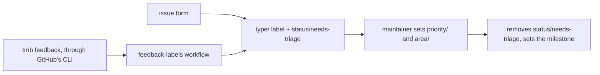

# Labels

The issue labels on trustmybot/tmb, tmb's own board, as GitHub holds them (`gh label list --repo trustmybot/tmb`), and how a contributor uses them. The design of fields and labels is in [ISSUES.md](../architecture/ISSUES.md).

Planned (trustmybot/tmb#403): type and priority leave the labels for GitHub's own fields.

## Rule: one type, one priority, one area

Every issue carries exactly **one type**, **one priority** and **one area**. Themes are optional. An issue that misses the rule keeps `status/needs-triage` until it is fixed.

To add, rename or remove a label, change it on GitHub and change this page in the same pull request.

## Canonical list

### Type — exactly one

Planned (trustmybot/tmb#403): type moves to GitHub's issue types, one type per label below, and these seven labels go.

| Label | Means |
|---|---|
| `type/bug` | Something isn't working |
| `type/feature` | New feature or request |
| `type/improvement` | Refactor / polish / quality work |
| `type/docs` | Documentation-only changes |
| `type/test` | Test-only changes |
| `type/chore` | Tooling, deps, release mechanics |
| `type/research` | Papers, experiments and open design questions |

### Priority — exactly one

Planned (trustmybot/tmb#403): priority moves to GitHub's built-in Priority field, with the same four values, and these four labels go.

| Label | Means |
|---|---|
| `priority/urgent` | Critical priority — broken-in-prod class |
| `priority/high` | High priority — blocks meaningful workflows |
| `priority/medium` | Medium priority — quality / UX |
| `priority/low` | Low priority — polish / nice-to-have |

### Area — exactly one

| Label | Means |
|---|---|
| `area/workflow` | Issues, tasks, feature branches, review, the gate and its guards |
| `area/trajectory` | The record: its store, its tools, sessions, the syncer, migration from the plugin |
| `area/code-graph` | Indexing, lookups, concepts |
| `area/roles` | The planner, worker and reviewer prompts |
| `area/adapters` | Host adapters and what setup writes for a host |
| `area/dashboard` | The local web page |
| `area/distribution` | Build, install, update, release channels, CI |

### Theme — optional

| Label | Means |
|---|---|
| `theme/design-gap` | The docs are silent on something the work needs |
| `theme/docs-drift` | Code, an issue or a request disagrees with the docs |
| `theme/false-block` | A guard or gate blocked something it should have allowed |
| `theme/prompt` | Agent prompts, roles or skills |
| `theme/regression` | Something that worked before stopped working |
| `theme/tech-debt` | Shortcut or leftover that should be cleaned up |
| `theme/token-burn` | Cost/perf cleanup to reduce LLM/API token consumption |

### Status — set by the form, removed by a maintainer

| Label | Means |
|---|---|
| `status/needs-triage` | Missing a type, a priority or an area; stays until all three are set |

### Decision — what the planner decided for the Human

| Label | Means |
|---|---|
| `decision/needs-human` | bro decided something on the Human's behalf; the body lists those decisions in one section |
| `decision/human-reviewed` | The Human answered the decisions bro listed |

## Checks

| Piece | What it does |
|---|---|
| `.github/ISSUE_TEMPLATE/` | Bug, Improvement, Feature and Research forms. Each sets its `type/` label and `status/needs-triage`. Blank issues are disabled; a security problem goes to the security policy, never an issue. |
| The bug form's Area answer | Optional, and a guess: Workflow, Record, Code graph, Roles, Host setup, Dashboard, Install and update. The maintainer sets the `area/` label. |
| `.github/workflows/feedback-labels.yml` | On an issue opened with the marker `tmb feedback` leaves in its body, adds the labels of the form the marker names. A report filed through GitHub's CLI carries no labels of its own. |
| One labels file in the repo that this page and the board are both made from, with a sync to GitHub | Planned. |
| A workflow that turns the form's Area and Impact answers into labels, and adds or removes `status/needs-triage` by itself | Planned. |
| Tests that compare the forms and this page with the labels | Planned. |

## Filing with labels

Whoever files an issue, a contributor or an agent working on tmb, applies one type, one priority and one area from the list above ([README.md](README.md#issues) has the forms).

- **No label fits.** Propose a new one in a pull request to this page; never make up a label on the spot.
- **Edge case.** No label marks an issue as stale: it would only repeat the issue's last-update time. Search by that time instead (`gh issue list --state open --search 'updated:<YYYY-MM-DD>'`).
