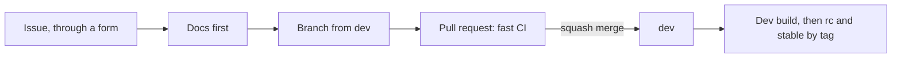
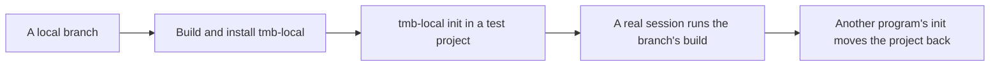

# Contributing

How work on this repo is done. Read this page first, then the page for the job at hand.

| Page | Holds |
|---|---|
| [RELEASE.md](RELEASE.md) | The dev, rc and stable channels, and how a release is cut |
| [LABELS.md](LABELS.md) | The issue labels and the rule for them |
| [ENUMS.md](ENUMS.md) | Every set of allowed values in the record, the code graph and the code |
| [`TRAJECTORY.md`](../architecture/TRAJECTORY.md#details-schema), [`CODE_GRAPH.md`](../architecture/CODE_GRAPH.md#schema) | The tables of the record and the code graph |
| [`CONFIG.md`](../architecture/CONFIG.md) | The settings keys |

## Issues

**An issue is opened through a form, and the forms are the one place the rules for a report live.** The forms are in `.github/ISSUE_TEMPLATE`: bug report, feature request, improvement and research.

- **Example 1.** A reporter fills in the bug form. The form adds one `type/` label and `status/needs-triage`, because someone who cannot write to the repo cannot add labels. It asks for what `tmb --version` prints, which names the channel too.
- **Example 2.** A maintainer finishes the labels by the rule in [LABELS.md](LABELS.md): sets the Priority field and the `area/` label, then removes `status/needs-triage` and sets the milestone. The area the reporter picked in the form is a guess.
- **Example 3.** `tmb feedback` fills in the bug form as it stands on the default branch, so a change to the form changes what tmb reports. A workflow, `.github/workflows/feedback-labels.yml`, adds the form's labels to a report that `tmb feedback` filed through GitHub's CLI.
- **Edge case.** A form is edited. `tmb feedback` fills fields by their `id`, so a field may be added or removed, but one that stays keeps its `id`.
- **Not an issue.** A security problem: see `SECURITY.md` at the root.

## Docs first

**The docs are the ground truth, and code follows them.**

- **Example.** A change in behaviour starts with a change to the design page.
- **Edge case.** The docs and the code disagree. The disagreement goes to the Human before either side is changed ([docs/README.md](../README.md#when-two-things-disagree)).

## Branches

**Every change reaches `dev` through a pull request.**

- **Example 1.** `dev` is the base branch and the default. A pull request targets it.
- **Example 2.** `main` holds releases only.
- **Edge case.** A release is a tag, not a branch. Release tags start with `v` ([RELEASE.md](RELEASE.md)).

## Commits and pull requests

**Commit subjects follow Conventional Commits with a type emoji in front, and pull requests are squash-merged.**

| Emoji | Type |
|---|---|
| 🐛 | bug |
| ✨ | feature |
| ⚡ | improvement |
| 📝 | docs |
| 🔧 | chore |
| ✅ | test |
| 🔬 | research |

- **Example.** A pull request with five commits lands on `dev` as one commit.
- **Language.** Everything in the repo, its issues and its pull requests is written in English.

## CI

**A pull request runs only the fast Linux jobs, so CI never slows a lane down. The heavy jobs run later.**

| When | What runs |
|---|---|
| A pull request, or a push to `dev` | `test` (typecheck, the component boundary lint, `bun test` and the link lint) and `chain` (the whole chain in a container, without its model steps, trustmybot/tmb#260). `test` is the one required check. |
| After each merge to `dev` | The dev channel's build. It does not block a pull request ([RELEASE.md](RELEASE.md)). |
| A version tag | The heavy jobs. They do not block a pull request ([RELEASE.md](RELEASE.md)). |

- **Example 1.** A docs pull request runs `test` and `chain` on Linux, and merges once `test` is green.
- **Example 2.** A change breaks macOS or Windows. The break shows up in the dev build or at the rc tag, not on the pull request. That is the trade-off taken for speed. `packaging-probe` can also be run by hand from the Actions tab.
- **Edge case.** A pull request changes the install smoke test itself. `install-smoke` runs on it: the one exception.
- **Before an rc.** An rc is tagged only after the whole chain passes on a maintainer's own machine. [RELEASE.md](RELEASE.md) holds the rule and the steps.

## Testing a branch on your machine

Planned (trustmybot/tmb#447).

**A branch is tried in a real session before it is pushed, with a program of its own, `tmb-local`.** `tmb-local` is a program, not a channel: it is built on this machine and never published, so no installer or release makes it ([RELEASE.md](RELEASE.md)).

- **Example 1.** Its version names the commit: `X.Y.Z-local.<sha>`, with `.dirty` when the tree has uncommitted changes.
- **Example 2.** `tmb-local init` ties a project to it. Another program's `init` moves the project back, as for any [channel switch](../flows/1_INSTALL.md#switch-channels).
- **Example 3.** It never updates itself, like a pinned version, and keeps its own state folder beside the other programs ([install](../flows/1_INSTALL.md#install-one-program-three-channels)).
- **Edge case 1.** There is one `tmb-local` per machine: a new build replaces it. A session that is running keeps the build it started with.
- **Edge case 2.** Until `tmb-local` is built, a local build is named `tmb` at the package version, so it counts as the stable program and shares its state. Use it only in a throwaway project.
