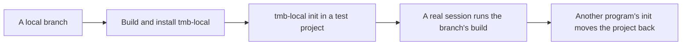

# Contributing

How work on this repo is done. Read this page first, then the page for the job at hand.

| Page | Holds |
|---|---|
| [RELEASE.md](RELEASE.md) | The dev, rc and stable channels, and how a release is cut |
| [LABELS.md](LABELS.md) | The issue labels and the rule for them |
| [ENUMS.md](ENUMS.md) | Every set of allowed values in the record, the code graph and the code |
| [`TRAJECTORY.md`](../architecture/TRAJECTORY.md#details-schema), [`CODE_GRAPH.md`](../architecture/CODE_GRAPH.md#schema) | The tables of the record and the code graph |
| [`CONFIG.md`](../architecture/CONFIG.md) | The settings keys |

## Branches

- `dev` is the base branch and the default. Every change reaches it through a pull request.
- `main` holds releases only.
- Release tags start with `v`.

## Commits and pull requests

- Commit subjects follow Conventional Commits with a type emoji in front: 🐛 bug, ✨ feature, ⚡ improvement, 📝 docs, 🔧 chore, ✅ test, 🔬 research.
- Pull requests are squash-merged.
- Everything in the repo, its issues and its pull requests is written in English.

## CI

CI is split so that it never slows a lane down.

- **Pull requests and pushes to `dev` run only the fast Linux jobs:** `test` (typecheck, `bun test` and the link lint) and `chain` (the whole chain in a container, without its model steps, trustmybot/tmb#260). `test` is the one required check. The one exception is `install-smoke`, which runs on a pull request that changes the install smoke test itself.
- **The heavy jobs run on a version tag, and the dev channel is built after each merge.** Neither blocks a pull request ([RELEASE.md](RELEASE.md)).
- **A macOS or Windows break shows up in the dev build or at the rc tag, not on the pull request.** That is the trade-off taken for speed. `packaging-probe` can also be run by hand from the Actions tab.
- **An rc is tagged only after the whole chain passes on a maintainer's own machine.** [RELEASE.md](RELEASE.md) holds the rule and the steps.

## Testing a branch on your machine

Planned (trustmybot/tmb#447). A branch is tried in a real session before it is pushed, with a program of its own, `tmb-local`.

- **`tmb-local` is a program, not a channel.** It is built on this machine and never published, so no installer or release makes it ([RELEASE.md](RELEASE.md)).
- **It never updates itself,** like a pinned version, and keeps its own state folder beside the other programs ([install](../flows/1_INSTALL.md#install-one-program-three-channels)).
- **Its version names the commit:** `X.Y.Z-local.<sha>`, with `.dirty` when the tree has uncommitted changes.
- **A project is tied to it by its `init`,** and moved back by another program's `init`, as for any [channel switch](../flows/1_INSTALL.md#switch-channels).
  - **Edge case 1.** One `tmb-local` per machine: a new build replaces it. A session that is running keeps the build it started with.
  - **Edge case 2.** Today a local build is named `tmb` at the package version, so it counts as the stable program and shares its state. Use it only in a throwaway project until `tmb-local` is built.

## Docs first

The docs are the ground truth, and code follows them. A disagreement goes to the Human before either side is changed ([docs/README.md](../README.md#when-two-things-disagree)).

## Issues

- **An issue is opened through a form.** The forms are in `.github/ISSUE_TEMPLATE`: bug report, feature request, improvement and research. A security problem is never an issue: see `SECURITY.md` at the root.
- **A form sets the type and marks the issue for triage.** It adds one `type/` label and `status/needs-triage`. Someone who cannot write to the repo cannot add labels, so the form does it.
- **A maintainer finishes the labels** by the rule in [LABELS.md](LABELS.md): sets the `priority/` and `area/` labels, then removes `status/needs-triage` and sets the milestone. The area a reporter picks in the form is a guess.
- **A bug report names the version.** The form asks for what `tmb --version` prints, which names the channel too.
- **The forms are the one place the rules for a report live.** `tmb feedback` fills in the bug form as it stands on the default branch, so a change to the form changes what tmb reports. A workflow, `.github/workflows/feedback-labels.yml`, adds the form's labels to a report that `tmb feedback` filed through GitHub's CLI.
- **A field's `id` in a form is kept.** `tmb feedback` fills fields by their `id`. A field may be added or removed; one that stays keeps its `id`.
