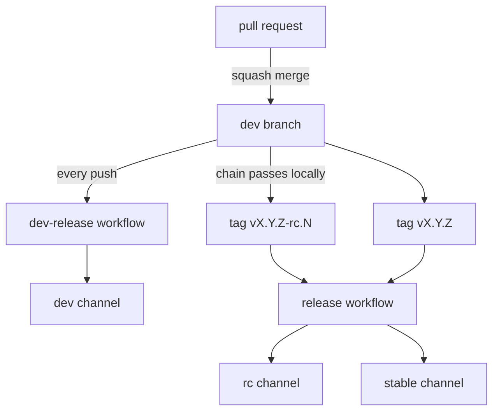
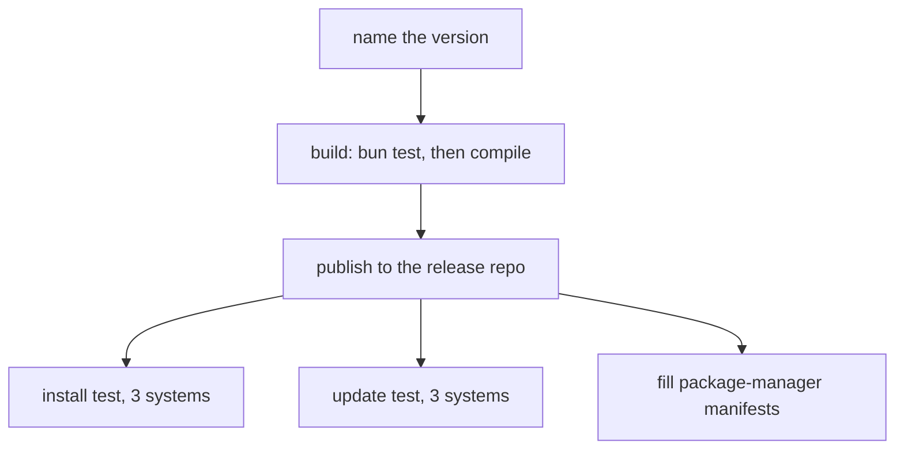

# Releasing

For maintainers: the three channels, dev builds, the checks a tag runs, and how to cut an rc (release candidate) and a stable release. It states only what the workflows in `.github/workflows` do. Contributors need none of this; see [`README.md`](README.md).

## Channels

| Channel | Holds | Version | Made by | On the release repo | Program |
|---|---|---|---|---|---|
| dev | Every merge to `dev` | `X.Y.Z-dev.<n>.gh<PR>` | a push to `dev` | one rolling prerelease, tag `dev`, replaced each time | `tmb-dev` |
| rc | Release candidates | `X.Y.Z-rc.N` | a pushed tag `vX.Y.Z-rc.N` | a prerelease, never marked latest | `tmb-rc` |
| stable | Releases | `X.Y.Z` | a pushed tag `vX.Y.Z` | a normal release, marked latest only when it is the highest version | `tmb` |

Release files go to one public repo, `trustmybot/tmb-releases`, separate from the source repo. Nothing publishes on a merge to any branch but `dev`; an rc or a stable release is published only by its tag. How a channel installs and updates is in [1_INSTALL.md](../flows/1_INSTALL.md).

## Dev builds

Every push to `dev` runs `.github/workflows/dev-release.yml`; it can also be started by hand. A newer push cancels a run still in progress. `scripts/dev-version.ts` names the build `X.Y.Z-dev.<n>.gh<PR>`.

- `X.Y.Z` is the version in `package.json`.
- `<n>` counts first-parent commits on `dev` since the highest stable `vX.Y.Z` tag (rc tags don't count): one per merged PR. `n` orders builds.
- `gh<PR>` names the PR whose merge produced the build, read from the commit subject. It is a label, not an order; a build with no PR in its subject omits it.

**Is a fix in my build?** Your build has it when its `n` is at least the `n` of the build that shipped the fix's PR (same `X.Y.Z`). `tmb-dev --version` prints it.

**Dev channel or rc?** The dev channel serves each merged PR as soon as it lands; the only checks it has passed are its PR's own and the build's `bun test`. Cut an rc when you have a candidate to ship.

## What a release run does

The dev run and the tag run (`.github/workflows/release.yml`) do the same steps.

| Step | What it does |
|---|---|
| Name the version | Dev: `scripts/dev-version.ts`. Tag: the tag without its `v`. A tag that is neither `vX.Y.Z` nor `vX.Y.Z-rc.N` fails the run. |
| Build | A macOS runner builds `darwin-arm64` and `darwin-x64` and signs them ad hoc. A Linux runner builds `linux-x64`, `linux-arm64` and `windows-x64`. Each runs `bun test` first. |
| Publish | Uploads the five programs, `install.sh`, `install.ps1`, a `VERSION` file and `SHA256SUMS`. Dev deletes and recreates its one release. A tag's release is never replaced: pushing the same tag again fails. |
| Install test | Installs the published release with the real installer on macOS, Linux and Windows. |
| Update test | Checks an install updating itself on the same three systems. |
| Package managers | Fills the Homebrew cask, the Scoop manifest and the winget manifests from `SHA256SUMS`, only when the release is the newest on its channel. It skips cleanly while the tap, the bucket or their token is missing; the winget manifests are kept with the run. |

Why the installer script is the only route on macOS, and the package-manager routes, are in [1_INSTALL.md](../flows/1_INSTALL.md). Planned (trustmybot/tmb#91): signing the macOS programs with a Developer ID and notarizing them.

## Release gate

There is no separate gate workflow. A version tag starts these, beside the release run:

| Workflow | On a tag it runs |
|---|---|
| `ci.yml` | `test` (typecheck, `bun test`, link lint), `chain` (the whole chain in a container, without its model steps), and `update-scenario` on macOS and Windows |
| `packaging-probe.yml` | The packaging probe on macOS, Linux and Windows |
| `release.yml` | The build, the publish and the install and update tests above |

None of them holds the publish back: the release run publishes once its own build passes. So the check that gates an rc comes before the tag:

- **An rc is tagged from `dev` only after the whole chain passes on a maintainer's own machine,** in the container, with a model login and the session steps: see [the whole chain in a container](../../tests/README.md#the-whole-chain-in-a-container). The run on GitHub comes after the local one, never in its place.
- There is no rc branch: an rc is the tag.
- `agent-run.yml` runs the model steps on GitHub, by hand only, and needs the `CLAUDE_CODE_OAUTH_TOKEN` secret.

Planned (trustmybot/tmb#260): a gate on GitHub that an rc must pass before it publishes.

## Release steps

**Phase A — candidate**
1. Land everything for the release on `dev` through normal PRs, and empty the milestone: close, move or ship every open item.

**Phase B — local pre-flight**
2. Run the whole chain locally on the exact `dev` commit you will tag. When it passes, you may tag.

**Phase C — rc**
3. Tag `vX.Y.Z-rc.N` on that commit and push the tag. The release run publishes the rc; the tag workflows above check it.
4. If a tag workflow goes red, fix on `dev` and cut `rc.N+1`. A published release is never replaced.

**Phase D — stable**
5. Tag `vX.Y.Z` and push the tag. The release run publishes it as stable.
6. If a stable release is broken, ship a fix in a new release at once, because this one is already public.

Open, for the Human:

- **Where the version is bumped.** A tag's version comes from the tag alone. `package.json` gives only the `X.Y.Z` of dev builds, and no script or workflow changes it.
- **What reaches `main`, and how.** `main` holds releases only ([README.md](README.md#branches)), but no workflow moves it, and none checks which branch a tag is on.
- **Whether a stable tag must sit on the commit of a passed rc.** Nothing checks it.
- **Whether tmb keeps a changelog.**
