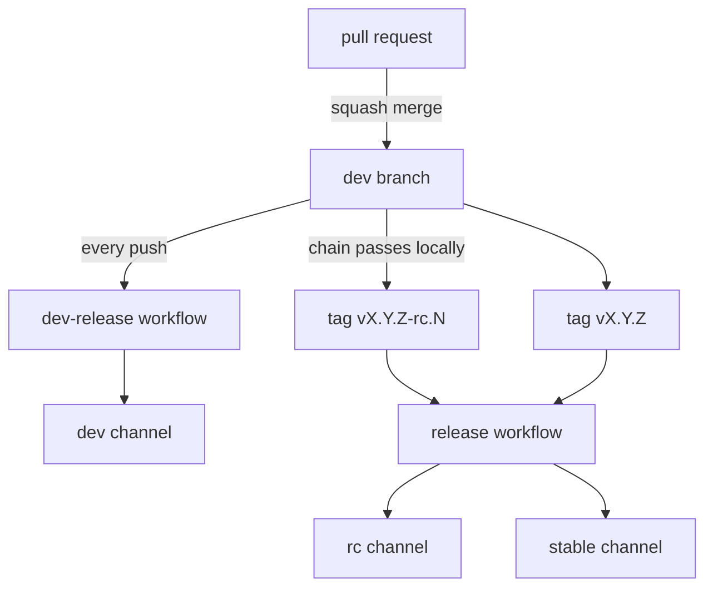
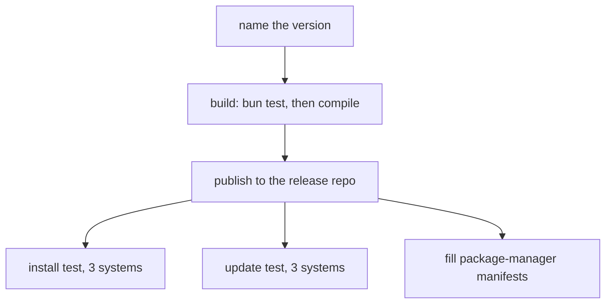
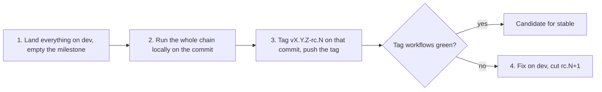

# Releasing

For maintainers: how a build moves from `dev` to an rc (release candidate) to stable. The page states only what the workflows in `.github/workflows` do. Contributors need none of this; see [`README.md`](README.md).

## 1. Three channels, one release repo

**A push to `dev` publishes a dev build. An rc or a stable release is published only by its tag.** Release files go to one public repo, `trustmybot/tmb-releases`, separate from the source repo. How a channel installs and updates is in [1_INSTALL.md](../flows/1_INSTALL.md).

| Channel | Holds | Version | Made by | On the release repo | Program |
|---|---|---|---|---|---|
| dev | Every merge to `dev` | `X.Y.Z-dev.<n>.gh<PR>` | a push to `dev` | one rolling prerelease, tag `dev`, replaced each time | `tmb-dev` |
| rc | Release candidates | `X.Y.Z-rc.N` | a pushed tag `vX.Y.Z-rc.N` | a prerelease, never marked latest | `tmb-rc` |
| stable | Releases | `X.Y.Z` | a pushed tag `vX.Y.Z` | a normal release, marked latest only when it is the highest version | `tmb` |

- **Example 1.** A pull request is squash-merged into `dev`. The dev channel gets a new build; rc and stable do not change.
- **Example 2.** A maintainer pushes the tag `v1.2.0-rc.1`. The rc channel gets `1.2.0-rc.1`.
- **Edge case.** A commit lands on a branch other than `dev`, with no tag. Nothing is published.

## 2. Every push to `dev` makes a dev build

**Each push to `dev` runs `.github/workflows/dev-release.yml`, which names the build `X.Y.Z-dev.<n>.gh<PR>` and publishes it.** A maintainer can also start the run by hand. A newer push cancels a run still in progress.

| Part | Means |
|---|---|
| `X.Y.Z` | The version in `package.json`. |
| `<n>` | The count of first-parent commits on `dev` since the highest stable `vX.Y.Z` tag: one per merged pull request. rc tags do not count. `n` orders builds. |
| `gh<PR>` | The pull request whose merge produced the build, read from the commit subject. It is a label, not an order. |

- **Example 1.** `1.2.0-dev.7.gh512` is the seventh merge to `dev` since the last stable tag, and pull request 512 produced it.
- **Example 2. Is a fix in my build?** `tmb-dev --version` prints the build's name. The fix shipped in `1.2.0-dev.7.gh512` and you run `1.2.0-dev.9.gh530`: 9 is at least 7 and `X.Y.Z` is the same, so you have it.
- **Example 3. Dev channel or rc?** The dev channel serves each merged pull request as soon as it lands. Its only checks are that pull request's own and the build's `bun test`. Cut an rc when you have a candidate to ship.
- **Edge case.** A commit subject names no pull request. The build omits `gh<PR>`.

## 3. A dev run and a tag run do the same steps

**The dev run and the tag run (`.github/workflows/release.yml`) name the version, build, publish, then test what they published.**

| Step | What it does |
|---|---|
| Name the version | Dev: the name in section 2. Tag: the tag without its `v`. |
| Build | A macOS runner builds `darwin-arm64` and `darwin-x64` and signs them ad hoc. A Linux runner builds `linux-x64`, `linux-arm64` and `windows-x64`. Each runs `bun test` first. |
| Publish | Uploads the five programs, `install.sh`, `install.ps1`, a `VERSION` file and `SHA256SUMS`. Dev deletes and recreates its one release. |
| Install test | Installs the published release with the real installer on macOS, Linux and Windows. |
| Update test | Checks an install updating itself on the same three systems. |
| Package managers | Fills the Homebrew cask, the Scoop manifest and the winget manifests from `SHA256SUMS`, only when the release is the newest on its channel. |

- **Example 1.** The tag `v1.2.0-rc.1` is pushed. The run names the version `1.2.0-rc.1`, builds five programs, publishes them and tests the install and the update on three systems.
- **Example 2.** A tag is neither `vX.Y.Z` nor `vX.Y.Z-rc.N`. The run fails.
- **Example 3.** The same tag is pushed again. The run fails: a tag's release is never replaced.
- **Edge case.** The Homebrew tap, the Scoop bucket or their token is missing. The package-manager step skips cleanly, and the winget manifests are kept with the run.

Why the installer script is the only route on macOS, and the package-manager routes, are in [1_INSTALL.md](../flows/1_INSTALL.md). Planned (trustmybot/tmb#91): signing the macOS programs with a Developer ID and notarizing them.

## 4. A tag's checks do not hold the publish back

**A version tag starts three workflows, and none of them gates the publish.** There is no separate gate workflow. The release run publishes once its own build passes.

| Workflow | On a tag it runs |
|---|---|
| `ci.yml` | `test` (typecheck, `bun test`, link lint), `chain` (the whole chain in a container, without its model steps), and `update-scenario` on macOS and Windows |
| `packaging-probe.yml` | The packaging probe on macOS, Linux and Windows |
| `release.yml` | The build, the publish and the install and update tests in section 3 |

- **Example 1.** The build passes and `packaging-probe.yml` is still running. The rc is published already.
- **Edge case.** A tag workflow goes red after the publish. The release stays public; the fix is a new rc (section 6).

Planned (trustmybot/tmb#260): a gate on GitHub that an rc must pass before it publishes.

## 5. The local chain gates an rc

**An rc is tagged from `dev` only after the whole chain passes on a maintainer's own machine.** The maintainer runs it in the container, with a model login and the session steps: see [the whole chain in a container](../../tests/README.md#the-whole-chain-in-a-container). The run on GitHub comes after the local one, never in its place.

- **Example 1.** The chain passes locally on a `dev` commit. The maintainer may tag that commit.
- **Example 2.** The `chain` job is green on GitHub, but nobody ran the chain locally. No rc is tagged: the GitHub job leaves out the model steps.
- **Edge case.** A maintainer wants the model steps run on GitHub. `agent-run.yml` runs them, by hand only, and needs the `CLAUDE_CODE_OAUTH_TOKEN` secret. It does not replace the local run.

## 6. Cut an rc: tag the commit that passed

**There is no rc branch: an rc is the tag `vX.Y.Z-rc.N` on the exact `dev` commit that passed the local chain.**

- **Example 1.** Everything for the release is on `dev` through normal pull requests, and every open item in the milestone is closed, moved or shipped. The chain passes locally. The maintainer pushes `v1.2.0-rc.1`; the release run publishes it and the tag workflows in section 4 check it.
- **Edge case.** A tag workflow goes red on `rc.1`. The maintainer fixes on `dev` and cuts `rc.2`. A published release is never replaced.

## 7. Cut stable: tag `vX.Y.Z`

**A maintainer tags `vX.Y.Z` and pushes the tag. The release run publishes it as stable.**

- **Example 1.** The maintainer pushes `v1.2.0`. The stable channel gets `1.2.0`, marked latest when it is the highest version.
- **Edge case.** A stable release is broken. It is already public, so the maintainer ships a fix in a new release at once.

## Open, for the Human

- **Where the version is bumped.** A tag's version comes from the tag alone. `package.json` gives only the `X.Y.Z` of dev builds, and no script or workflow changes it.
- **What reaches `main`, and how.** `main` holds releases only ([README.md](README.md#branches)), but no workflow moves it, and none checks which branch a tag is on.
- **Whether a stable tag must sit on the commit of a passed rc.** Nothing checks it.
- **Whether tmb keeps a changelog.**
