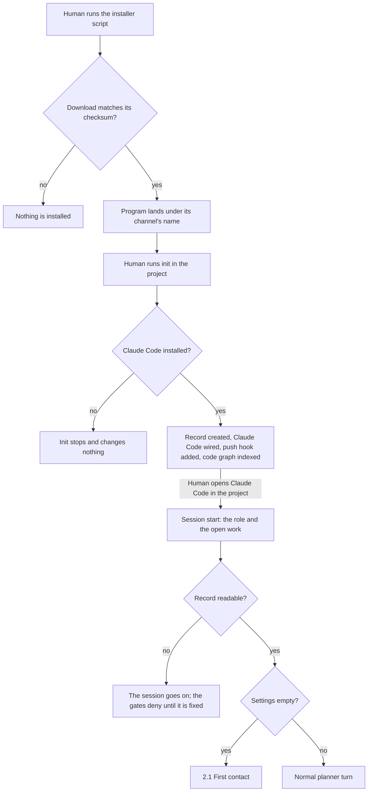
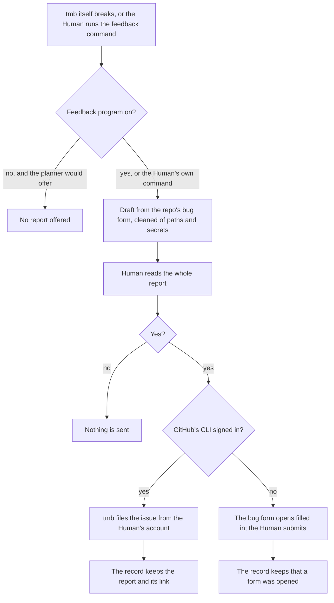

# Install, upgrade and session start

Flows 1.1, 1.2 and 5.1 of [FLOWS.md](FLOWS.md), in the order they happen: tmb gets onto a machine and into a project, each session starts from the record, updates land, and the Human finds what broke. The commands to type are in the [reference](../reference/README.md).

## Install: one program, three channels

**tmb is one compiled program per platform, installed by the installer script.** It is not a plugin of Claude Code, and the script is the only supported way to install it.

- **Example 1.** The program holds the engine, the command line, the tool server, the dashboard's pages and the Claude Code adapter. Nothing else is installed first: no Node, no package install.
- **Example 2.** The script needs no login. It checks the download against the published checksums and refuses on a mismatch.
- **Example 3.** One program serves the whole machine. Only the record and the Claude Code wiring are per project.
- **Edge case.** The packaging test comes first: one compiled file must run on all three platforms with no network, open the record, parse code and answer a tool call from Claude Code.

**Each channel is its own program.** A program updates only from its own channel and keeps its machine-wide state in a folder of its own name. Channels live side by side, and one never swaps another.

| Channel | Program | Holds |
|---|---|---|
| stable | `tmb` | Releases, tagged `vX.Y.Z`. |
| rc | `tmb-rc` | Release candidates, tagged `vX.Y.Z-rc.N`. |
| dev | `tmb-dev` | Every merge to the base branch, as one rolling prerelease. |
| one release | `tmb-<version>` | One rc or stable release. It never updates itself. |

- **Example 1.** `TMB_CHANNEL` picks the channel at install.
- **Example 2.** `TMB_INSTALL_VERSION` pins one release.
- **Edge case.** A version names its channel: `X.Y.Z-dev.N`, `X.Y.Z-rc.N` or `X.Y.Z`. A `tmb` whose version names dev or rc follows that channel.

**A project runs the program that initialised it.** Claude Code's events, the tool server and git's push hook all call that program.

- **Example 1.** Every printed command names the running program. A project set up by `tmb-dev` is told to run `tmb-dev init`.
- **Example 2.** A test builds tmb as `tmb-dev` and fails on any printed `tmb <command>`.
- **Edge case.** Running another program's `init` moves the project, in either direction, whenever that program can read the record. The record keeps every move.

**Releases are plain downloads** from one public repo, separate from the source repo. What publishes each channel is in [RELEASE.md](../contributing/RELEASE.md).

- **Example.** The source repo's README offers stable only. It links to the release repo for rc and dev.

## Operating systems

**tmb runs on macOS, Linux and Windows.** After each release, CI runs the published installer on all three.

| OS | Builds | Installer | Notes |
|---|---|---|---|
| macOS | arm64, x64 | `install.sh` | Signed ad hoc |
| Linux | x64, arm64 | `install.sh` | |
| Windows | x64, native | `install.ps1` | git's hooks run under Git for Windows' own sh |

- **Example.** Offline, the engine, the record, the code graph and the dashboard still work. Whether the agents run offline depends on Claude Code and its models.
- **Edge case: macOS signing.** Homebrew marks its downloads as quarantined, and macOS refuses to run a quarantined program that is only signed ad hoc. So a Homebrew install on macOS installs, then does not run. The installer script works because curl does not quarantine. It is the only route on macOS, and the tap says so.
- **Planned (trustmybot/tmb#91).** The release workflow signs the macOS files with a Developer ID and has Apple notarize them.

## Package managers

**Package managers are added beside the installer scripts, and tmb keeps its own updater on every route.**

| Where | Route | Channels |
|---|---|---|
| macOS and Linux | tmb's own Homebrew tap, as a cask. On macOS it waits for notarization. | `tmb`, `tmb@rc` and `tmb@dev` |
| Windows | tmb's own Scoop bucket, then winget's community list | Scoop: `tmb`, `tmb-rc` and `tmb-dev`. winget: one package per channel. |
| Linux without Homebrew | The installer script | |

- **Example 1.** The cask sets `auto_updates`, and the winget package refuses winget's own upgrade. tmb's updater does the updating.
- **Example 2.** A manifest is a template in the source repo. A release fills in its version and checksums, then pushes the cask to the tap and the Scoop manifest to the bucket. The winget manifests are kept with the workflow run, for a submission.
- **Example 3.** Homebrew gets a cask, not a formula. A formula would not avoid the macOS quarantine, and Homebrew allows no formula name such as `tmb@dev`.
- **Edge case.** A release that is not the newest on its channel leaves the tap and the bucket alone.
- **Planned (trustmybot/tmb#91).** The Human creates the tap, the bucket and their token, and submits to winget. While any of them is missing, the publishing step skips and the release still succeeds.

## What init writes

**`tmb init` prepares a project and asks nothing** ([2_ONBOARD.md](2_ONBOARD.md#init-asks-nothing)). It finds Claude Code and has the adapter wire tmb in ([ADAPTERS.md](../architecture/ADAPTERS.md)).

| Init writes | Where |
|---|---|
| The record and one code graph per repo | `.tmb/` |
| Claude Code's project files | The project |
| git's pre-push hook | Each repo tmb works in |
| Ignore lines | `.gitignore` |

The limits on each are in [ENGINE.md](../architecture/ENGINE.md).

- **Example 1.** Init leaves the settings empty. It ends by saying so and how they get filled ([2_ONBOARD.md](2_ONBOARD.md)).
- **Example 2.** Claude Code is not installed. Init stops, says it needs Claude Code and changes nothing.
- **Example 3.** Init installs git's pre-push hook; session start does not. A repo marked exempt gets none, and a hook that is another tool's is kept ([3_GIT.md](3_GIT.md)).
- **Edge case.** Run again, init replaces only what tmb wrote. It takes out what this version does not wire: role files for roles it does not have, and hooks under an event it does not use. The Human's own entries stay. Files marked as written by `tmb setup` count as tmb's.

## Session start

**The role comes from the engine, every time.** Claude Code raises its session start event. The engine answers with the role, the open work from the record and the project's layout from the code graph.

- **Example 1.** Claude Code raises the event again on resume, clear or compaction. It gets the same answer, so a session resumes from the record and needs nothing from the conversation before it.
- **Example 2.** The settings are empty. The session starts first contact ([2_ONBOARD.md](2_ONBOARD.md)).
- **Edge case.** The engine cannot read the record. A session start never fails and never blocks: it gives the role and one line naming the problem, and the gates deny until it is fixed ([ENGINE.md](../architecture/ENGINE.md#gates-fail-closed)).

What else a session start does:

| Rule | Detail |
|---|---|
| Which record | The nearest record in the session's folder or a folder above it. |
| One line per finding | The planner is told, in one line each: a host-file refresh, what `tmb doctor` would find ("N things need a look"), each pull request that ended since the last session, and a repo whose push gate is off. It runs only doctor's quick checks, asks git and not GitHub, and says nothing when there is nothing to say. |
| It tidies | With no task open or in review, tmb tries again to remove the worktrees that closed and dropped tasks kept. |
| Unattended runs | A run with no one to answer is told so first ([ENGINE.md](../architecture/ENGINE.md#unattended-mode)). |
| Claude Code's own instruction file | tmb never writes it. |

## Upgrade

**An install follows one channel and updates itself. A running session keeps the build it started with,** so a task never meets a new build half way.

### An update installs at once

**An update installs at a session's end or on `tmb update`, whatever is running.**

- **Example 1.** `tmb update --check` only looks. `TMB_NO_UPDATE=1` turns updates off.
- **Example 2.** `tmb --version` prints the program's name, its version, its source commit and its channel.
- **Edge case.** A tmb run from source never updates itself.
- **Edge case.** tmb never deletes an old build by itself. It says how many old builds no session uses and their size. `tmb doctor` lists them and deletes them on the Human's yes.

### A running session keeps its build

**A running session and its project stay on the session's build.** Every tmb call there runs that build: Claude Code's events, the tool server, git's push hook, a command the Human types. The record keeps its shape and the host files stay as they are until the session moves.

- **Example 1.** The session has no task open. At its next tool call its tool server moves to the new build by itself, says so, and keeps its conversation.
- **Example 2.** A task is open. The session stays on its build. `tmb update` names each session still on an old build, with its folder, title and start time, and why it waits.
- **Edge case.** The move fails. The session keeps its build and says how to reconnect the tool server in Claude Code.

### The record follows the program

**A newer tmb that opens a record upgrades it by itself.** It runs every pending step in one transaction, so the record is never left between versions.

- **Example.** tmb takes no backup before an upgrade.
- **Edge case.** An older tmb refuses a record that a newer one reshaped. It names the program that wrote it and the command that moves on, never a version number. Such a project never holds this tmb's update back.

### The host files follow at a session start

**When another version of the same program last wired the project, a session start redoes init's wiring:** Claude Code's project files and git's push hook.

- **Example 1.** The refresh changes only what tmb wrote. It asks nothing and changes no setting.
- **Example 2.** An older version refreshes as a newer one does, so the files match the program that runs.
- **Example 3.** The record keeps each refresh as a change of the program tie: the program, from which version to which, and what changed.
- **Edge case.** A task is open. The refresh waits; it never runs while a task is open.
- **Edge case.** The project is tied to another channel's program. The refresh does not run: moving a project stays the Human's `init`.
- **Edge case.** A refresh fails. It never stops the session: the line says what failed and names `init`.

### Switch channels

**To switch, install the other channel's program and run its `init` in the project.**

- **Example.** The record is per project, so the data carries over.

## Uninstall

**`tmb remove` undoes what init added and leaves the Human's own settings alone.** It runs only on a terminal, after a typed yes.

Three things stay:

- the record, which is the Human's data;
- the lines init added to `.gitignore`;
- the repo from `git init` in a folder that had none.

## Bug reports

**Nothing is sent by itself, on any channel: the Human says yes to each report.** This is flow 5.1. How to use it is in the [reference](../reference/README.md#report-a-bug-in-tmb).

| Rule | Detail |
|---|---|
| Who is offered a report | The feedback program is on by default on dev and rc. On stable tmb asks once, at the first run. The setting belongs to the person: it is kept with the machine-wide state of each channel's program. |
| Where a report goes | A public issue on the source repo, from the user's own GitHub account. |
| What a report follows | The repo's bug form as it stands on the default branch, so the version, the labels and the questions are always current ([contributing](../contributing/README.md#issues)). |
| What a report never holds | Source code, file contents, prompts, agent messages or environment variables. |

- **Example 1.** GitHub's CLI is signed in. tmb files the issue, and the record keeps the report and its link.
- **Example 2.** A link to a filled-in form is kept under 7,500 characters. A longer report is saved to a file to attach.
- **Example 3.** With no network, the draft uses a built-in copy of the form. The build takes that copy from the same form file.
- **Edge case.** GitHub drops the labels of an issue filed through its API by someone who cannot write to the repo. So a report filed through the CLI carries one hidden line, `<!-- tmb-feedback form=bug.yml -->`, and a workflow on the repo adds that form's labels. Labels come from the form on both routes.
- **Edge case.** For an opened form, the record cannot know whether the user pressed submit.
- **Planned (trustmybot/tmb#446).** A check for an earlier or matching report before a new one is offered.

## Debugging

**`tmb doctor` checks the machine and the project and names the fix for each finding.** It only reads; `--fix` asks before each change.

- **Example 1.** The record is broken. Every check that does not need the record still runs, and the others say why they were skipped.
- **Example 2.** Leftovers. Doctor lists what tmb left on disk: old builds no session uses, entries of ended sessions, and worktrees and branches of closed and dropped tasks. `--fix` removes each on the Human's yes.
- **Edge case.** Doctor never touches a file tmb did not write, and deletes nothing without the Human's yes. A worktree holding work nobody committed stays. A tracked repo file is deleted through a task, like any other change.
- **Edge case.** A check that fails by itself looks like tmb's own bug. Its line says so and names the bug report command.

| Symptom | Cause | Fix |
|---|---|---|
| `tmb: command not found` after install | The install folder is not on PATH in this terminal | Open a new terminal, or add the line the installer printed |
| `tmb init` stops and says it needs Claude Code | Claude Code is not installed | Install it |
| No role, tools or events in a session | Init has not run here, the session started before init, or the worktree is one the host files do not wire | `tmb init`, then start a new session; `tmb doctor` lists unwired worktrees |
| Writes and agent starts denied: `tmb cannot read the project's record, so it allows nothing` | The record is damaged, empty, or not a tmb database | `tmb doctor --fix` repairs it on a yes and keeps the damaged file beside it |
| `has schema version N, made by a newer tmb` | Another program, or a newer build, reshaped the record | Run the program the message names, or `tmb update` |
| `task_start` is refused: no review mode | The review mode is the Human's choice and none is set | Answer the planner's question, or `tmb onboard` on a terminal |
| Session start says the push gate is off in a repo | The repo's pre-push hook is another tool's, or the record names none of the folder's repos | `tmb onboard --add-push-gate`; or `tmb init` again in the project folder |
| Host files are still an older version's | A task is open, so the refresh waits | Close or drop the task; the next session start refreshes |
| A session stays on an old build | A task is open in its project, or the move failed | `tmb update` says which and why; reconnect the tool server as the session says (`/mcp`, then Reconnect on tmb) |
| A Homebrew install on macOS does not run | The build is not notarized | Use the installer script |
| A tmb check fails by itself | It looks like tmb's own bug | `tmb feedback` drafts a report |
