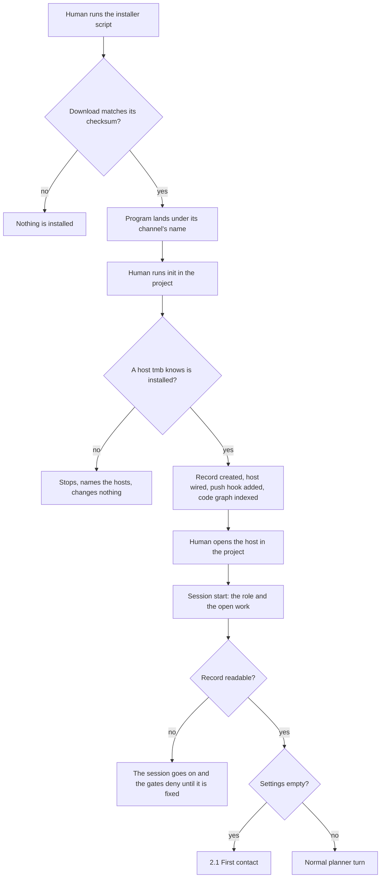
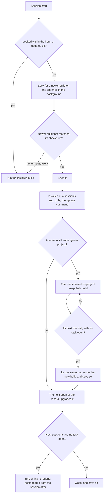
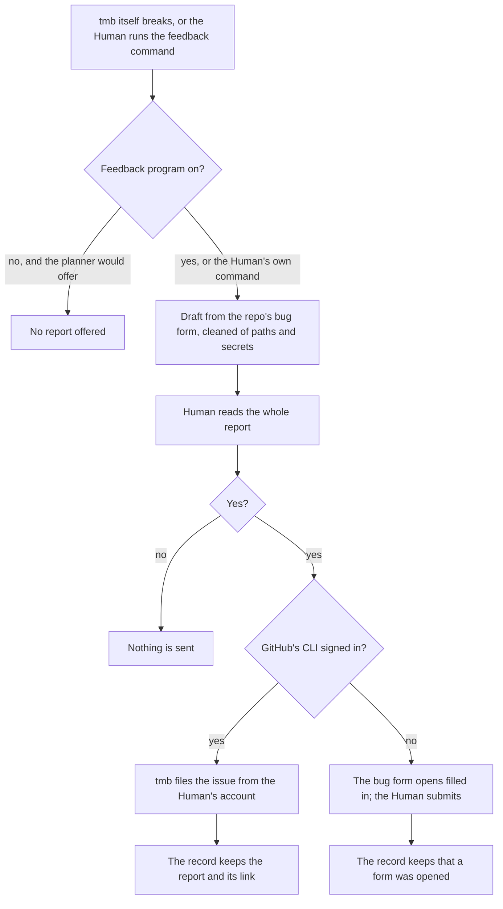

# Install, upgrade and session start

Every case of flows 1.1 to 1.3, 3.7 and 5.1 in [FLOWS.md](FLOWS.md): how tmb gets onto a machine and into a project, what each session start does, how an update lands, and how to tell what broke. The commands a user types are in the [reference](../reference/README.md).

## Install: one program, three channels

tmb is one compiled program per platform, not a plugin of any host. The installer script is the only supported way to install it.

- **What the program holds.** The engine, the command line, the tool server, the dashboard's pages and every host adapter. Nothing else has to be installed first: no Node, no package install.
- **One program for the whole machine.** Only the record and the host wiring are per project.
- **The installer script** needs no login. It checks the download against the published checksums and refuses on a mismatch.
- **The packaging test comes first.** One compiled file must run on all three platforms with no network, open the record, parse code and answer a tool call from a host.

| Channel | Program | Holds |
|---|---|---|
| stable | `tmb` | Releases, tagged `vX.Y.Z`. |
| rc | `tmb-rc` | Release candidates, tagged `vX.Y.Z-rc.N`. |
| dev | `tmb-dev` | Every merge to the base branch, as one rolling prerelease. |
| one release | `tmb-<version>` | One rc or stable release. It never updates itself. |

**Channels live side by side.** Each program updates only from its own channel and keeps its machine-wide state in a folder of its own name, so one never swaps another.

- **Example.** `TMB_CHANNEL` picks the channel at install. `TMB_INSTALL_VERSION` pins one release.
- **Edge case.** A version names its channel: `X.Y.Z-dev.N`, `X.Y.Z-rc.N` or `X.Y.Z`. A `tmb` whose version names dev or rc follows that channel.

**A project runs the program that initialised it.** Its host events, its tool server and git's push hook call that program.

- **Example.** Every printed command names the running program: a project set up by `tmb-dev` is told to run `tmb-dev init`. A test builds tmb as `tmb-dev` and fails on any printed `tmb <command>`.
- **Edge case.** Running another program's `init` moves the project, in either direction, whenever that program can read the record. The record keeps every move.

**Releases are plain downloads** from one public repo, separate from the source repo. What publishes each channel is in [RELEASE.md](../contributing/RELEASE.md). The source repo's README offers stable only and links to the release repo for rc and dev.

## Operating systems

| OS | Builds | Installer | Notes |
|---|---|---|---|
| macOS | arm64, x64 | `install.sh` | Signed ad hoc; see macOS signing below |
| Linux | x64, arm64 | `install.sh` | |
| Windows | x64, native | `install.ps1` | git's hooks run under Git for Windows' own sh |

After each release, CI runs the published installer on all three.

- **macOS signing.** Homebrew marks what it downloads as quarantined, and macOS refuses to run a quarantined program that is only signed ad hoc: a Homebrew install on macOS installs, then does not run. So the installer script is the only route on macOS, and the tap says so. The script works because curl does not quarantine. Planned (trustmybot/tmb#91): the release workflow signs the macOS files with a Developer ID and has Apple notarize them.
- **Offline.** The engine, the record, the code graph and the dashboard need no network. Whether the agents run offline depends on the host and its models.

## Package managers

tmb's own installer and updater come first. The installer scripts stay; package managers are added beside them.

| Where | Route | Channels |
|---|---|---|
| macOS and Linux | tmb's own Homebrew tap, as a cask. On macOS it waits for notarization. | `tmb`, `tmb@rc` and `tmb@dev` |
| Windows | tmb's own Scoop bucket, then winget's community list | Scoop: `tmb`, `tmb-rc` and `tmb-dev`. winget: one package per channel. |
| Linux without Homebrew | The installer script | |

- **tmb keeps its own updater on every route.** The cask sets `auto_updates`, and the winget package refuses winget's own upgrade.
- **A manifest is a template in the source repo.** A release fills in its version and checksums, and pushes the cask to the tap and the Scoop manifest to the bucket. A release that is not the newest on its channel leaves them alone. The winget manifests are kept with the workflow run, for a submission.
- **A cask, not a formula.** A formula would not avoid the quarantine above, and Homebrew allows no formula name such as `tmb@dev`.
- **Planned (trustmybot/tmb#91):** the Human creates the tap, the bucket and their token, and submits to winget. While any of them is missing the publishing step skips and the release still succeeds.

## What init writes

`tmb init` prepares a project and asks nothing ([2_ONBOARD.md](2_ONBOARD.md#init-asks-nothing)). It finds the installed host and has its adapter wire tmb in ([ADAPTERS.md](../architecture/ADAPTERS.md)).

Init creates the record and one code graph per repo in `.tmb/`, writes the host's project files, adds git's pre-push hook to each repo tmb works in, and adds ignore lines to `.gitignore`. The limits on each are in [ENGINE.md](../architecture/ENGINE.md).

- **Settings stay empty.** Init ends by saying so and how they get filled ([2_ONBOARD.md](2_ONBOARD.md)).
- **No host installed.** Init stops, names the hosts it supports and changes nothing.
- **Run again, init replaces only what tmb wrote.** It takes out what this version does not wire: role files for roles it does not have, and hooks under an event it does not use. The Human's own entries stay.
- **Files marked as written by `tmb setup` are recognised as tmb's**.
- **The push gate.** Init installs git's pre-push hook; session start does not. A repo marked exempt gets none, and a hook that is another tool's is kept ([3_GIT.md](3_GIT.md)).

## Move a plugin project

Flow 1.3. `tmb migrate` carries a plugin project's records over: a one-way copy that leaves the plugin's database unchanged. How to use it is in the [reference](../reference/README.md#move-a-plugin-project).

- **Edge case.** A plugin project of several repos goes into one workspace record, each repo to the workspace repo of the same name or one the Human names. tmb never guesses a repo.

## Session start

The role comes from the engine, every time. The host raises its session start event, and the engine answers with the host's role, the open work from the record and the project's layout from the code graph.

- **Example 1.** A host raises the event again on resume, clear or compaction. It gets the same answer, so a session resumes from the record and needs nothing from the conversation before it.
- **Example 2.** Empty settings start first contact ([2_ONBOARD.md](2_ONBOARD.md)).
- **Edge case.** The engine cannot read the record. A session start never fails and never blocks: it gives the role and one line naming the problem, and the gates deny until it is fixed ([ENGINE.md](../architecture/ENGINE.md#gates-fail-closed)).

What else a session start does:

| Rule | Detail |
|---|---|
| Which record | The nearest record in the session's folder or a folder above it. |
| One line per finding | The planner is told, in one line each: a host-file refresh, what `tmb doctor` would find ("N things need a look"), each pull request that ended since the last session, and a repo whose push gate is off. It runs only doctor's quick checks, asks git and not GitHub, and says nothing when there is nothing to say. |
| It tidies | With no task open or in review, tmb tries again to remove the worktrees closed and dropped tasks kept. |
| Unattended runs | A run with no one to answer is told so first ([ENGINE.md](../architecture/ENGINE.md#unattended-mode)). |
| The host's own instruction file | tmb never writes it. |

## Upgrade

An install follows one channel and updates itself. A session that is running keeps the build it started with, so a task never meets a new build half way.

### An update installs at once

An update installs at once, whatever is running: at a session's end or on `tmb update`.

- `tmb update --check` only looks.
- `TMB_NO_UPDATE=1` turns updates off.
- A tmb run from source never updates itself.
- `tmb --version` prints the program's name, its version, its source commit and its channel.
- **An old build is never deleted by itself.** tmb says how many old builds no session uses and their size. `tmb doctor` lists them and deletes them on the Human's yes.

### A running session keeps its build

So does its project. Every tmb call there runs that build: the host's events, the tool server, git's push hook, a command the Human types. The record keeps its shape and the host files stay as they are until the session moves.

- **Example 1.** The session has no task open. At its next tool call its tool server moves to the new build by itself, says so, and keeps its conversation.
- **Example 2.** A task is open. The session stays on its build. `tmb update` names each session still on an old build, with its folder, title and start time, and why it waits.
- **Edge case.** The move fails. The session keeps its build and says how to reconnect the tool server in that host.

### The record follows the program

A newer tmb that opens a record upgrades it by itself: every pending step in one transaction, so the record is never left between versions.

- **No backup is taken before an upgrade.**
- **Edge case.** An older tmb refuses a record a newer one reshaped. It names the program that wrote it and the command that moves on, never a version number. Such a project never holds this tmb's update back.

### The host files follow at a session start

When another version of the same program last wired the project, tmb redoes init's wiring: each host the project is set up for, and git's push hook.

- **What it changes.** Only what tmb wrote. It asks nothing and changes no setting. An older version refreshes as a newer one does, so the files match the program that runs.
- **When it waits.** Never while a task is open.
- **Where it does not run.** Not for a project tied to another channel's program: moving a project stays the Human's `init`.
- **It is recorded.** The record keeps each refresh as a change of the program tie: the program, from which version to which, the hosts and what changed.
- **Edge case.** A refresh fails. It never stops the session: the line says what failed and names `init`.

### Switch channels

Install the other channel's program and run its `init` in the project. The record is per project, so data carries over.

## Uninstall

`tmb remove` undoes what init added and leaves the Human's own settings alone. It runs only on a terminal, after a typed yes.

Three things stay:

- the record, which is the Human's data;
- the lines init added to `.gitignore`;
- the repo from `git init` in a folder that had none.

## Bug reports

Flow 5.1. Nothing is sent by itself, on any channel: the Human says yes to each report. How to use it is in the [reference](../reference/README.md#report-a-bug-in-tmb).

- **On by default on dev and rc, asked about on stable**, once, at the first run. The setting belongs to the person: it is kept with the machine-wide state of each channel's program.
- **A report is a public issue on the source repo, from the user's own GitHub account.** A link is kept under 7,500 characters; a longer report is saved to a file to attach.
- **A report follows the repo's bug form** as it stands on the default branch, so the version, the labels and the questions are always current ([contributing](../contributing/README.md#issues)). With no network it uses a built-in copy, which the build takes from the same form file.
- **Labels come from the form on both routes.** GitHub drops the labels of an issue filed through its API by someone who cannot write to the repo. So a report filed through the CLI carries one hidden line, `<!-- tmb-feedback form=bug.yml -->`, and a workflow on the repo adds that form's labels.
- **A report holds no source code, file contents, prompts, agent messages or environment variables.**
- **Edge case.** For an opened form the record cannot know whether the user pressed submit.
- **Planned.** A check for an earlier or matching report before a new one is offered.

## Debugging

`tmb doctor` checks the machine and the project and names the fix for each finding. It only reads; `--fix` asks before each change.

- **It runs with a broken record.** Every check that does not need the record still runs, and the others say why they were skipped.
- **It never touches a file tmb did not write,** and deletes nothing without the Human's yes.
- **Edge case.** A check that fails by itself looks like tmb's own bug. Its line says so and names the bug report command.
- **Leftovers (flow 3.7).** It lists what tmb left on disk: old builds no session uses, entries of ended sessions, and worktrees and branches of closed and dropped tasks. `--fix` removes each on the Human's yes. A worktree holding work nobody committed stays. A tracked repo file is deleted through a task, like any other change.

| Symptom | Cause | Fix |
|---|---|---|
| `tmb: command not found` after install | The install folder is not on PATH in this terminal | Open a new terminal, or add the line the installer printed |
| `tmb init` stops and names the hosts it supports | No host tmb knows is installed | Install one; with several installed, `--host <id>` picks |
| No role, tools or events in a session | Init has not run here, the session started before init, or the worktree is one the host files do not wire | `tmb init`, then start a new session; `tmb doctor` lists unwired worktrees |
| Writes and agent starts denied: `tmb cannot read the project's record, so it allows nothing` | The record is damaged, empty, or not a tmb database | `tmb doctor --fix` repairs it on a yes and keeps the damaged file beside it |
| `has schema version N, made by a newer tmb` | Another program, or a newer build, reshaped the record | Run the program the message names, or `tmb update` |
| `task_start` is refused: no review mode | The review mode is the Human's choice and none is set | Answer the planner's question, or `tmb onboard` on a terminal |
| Session start says the push gate is off in a repo | The repo's pre-push hook is another tool's, or the record names none of the folder's repos | `tmb onboard --add-push-gate`; or `tmb init` again in the project folder |
| Host files are still an older version's | A task is open, so the refresh waits | Close or drop the task; the next session start refreshes |
| A session stays on an old build | A task is open in its project, or the move failed | `tmb update` says which and why; reconnect the tool server as the session says (in Claude Code: `/mcp`, then Reconnect on tmb) |
| A Homebrew install on macOS does not run | The build is not notarized | Use the installer script |
| A tmb check fails by itself | It looks like tmb's own bug | `tmb feedback` drafts a report |
