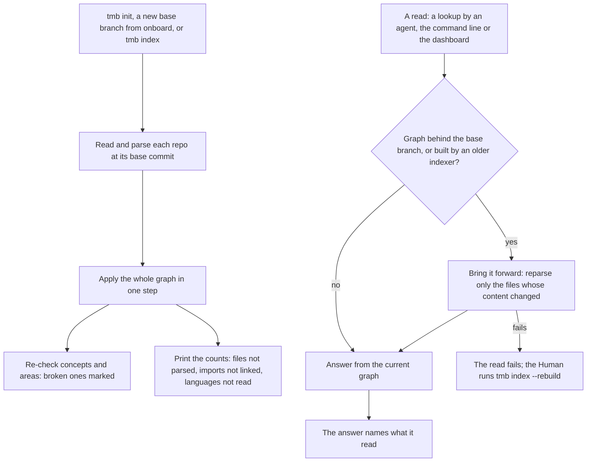
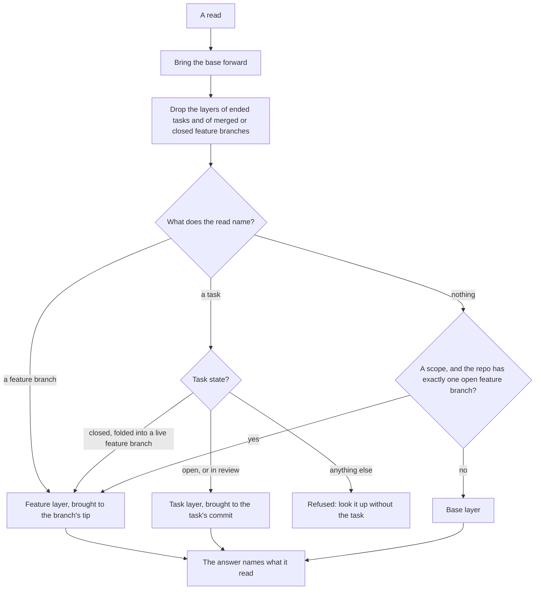

# Code graph: build and refresh

The steps of flow 2.2 in [FLOWS.md](FLOWS.md): how `tmb init` and `tmb index` build the code graph, how a read keeps it fresh, and which layer a read answers from. What the graph holds, how links are proven and its schema are in [CODE_GRAPH.md](../architecture/CODE_GRAPH.md).

## Index

tmb calls the scan an index. The chart above holds every case of flow 2.2.

- **A failed index changes nothing.** The old graph stays, because the new one is applied in one step.
- **Edge case.** Two processes build the same commit. The second keeps the first's graph.

## Refresh at a read

The graph keeps itself fresh. A read that finds the graph behind its base branch brings it forward before it answers.

- **Example 1.** The base branch moved since the last index. The next lookup parses only the changed files, then answers. A parse is kept by the file's content, so a file is parsed once per content: bringing a layer forward costs what the diff costs, not what the repo costs.
- **Example 2.** A session starts. Session start does not index: the planner's first page shows the directories as last indexed, so the start stays fast. Its first lookup brings the graph forward.
- **Edge case.** A newer tmb reads code differently. The graph is rebuilt, and the answer says so.

## Rebuild

A rebuild is the fallback, and the Human's. It forgets every cached parse and builds from nothing.

- **Example.** A read fails. It does not rebuild by itself: the Human runs `tmb index --rebuild`.

## Multi-repo workspace

A multi-repo workspace indexes each repo from its own base branch, so a lookup must say which repo it means.

- **Example 1.** A lookup names its repo, or runs in that repo's folder. A task or a feature branch reads its own repo.
- **Example 2.** A lookup in the workspace folder names no repo. It is refused, with the list of repos.
- **Edge case.** A folder of repos that the record does not name has no graph. The index is refused there and names `tmb init`, run again, as the fix.

## Task overlay

The base graph holds only what has reached the base branch. A layer makes work that is not there yet readable through the graph, without touching the base: one per open task, and one per open feature branch.

In the order a task meets them:

- **A scope reads where the task will be cut.** It reads the repo's only open feature branch by default, and the base branch when several are open.
- **A worker sees its change and its base together.** A read that names an open task answers from the task's commit laid on the base. A truest task in review keeps its layer, so the reviewer reads it.
- **A task's layer ends with the task.** Once the task is no longer open or in review, the next read drops its layer. A read that names a closed task answers from its feature branch, which now holds the work.
- **A feature layer lives while its branch does.** It is brought forward when the tip moves and dropped once the branch is merged or closed. A lookup can name the feature branch; naming a task as well is refused.

For every layer:

- **Built at the read, from git.** The first read that names a layer builds it or brings it forward, from the task's commit or the branch's tip, so it is indexed from git like everything else.
- **Sized by the diff.** Only files whose content changed are parsed again.
- **Concepts and areas belong to the base.** An anchor or a pattern must match the base branch's graph.
- **It is cache.** A layer holds no link into the record and can be rebuilt from its commit.
