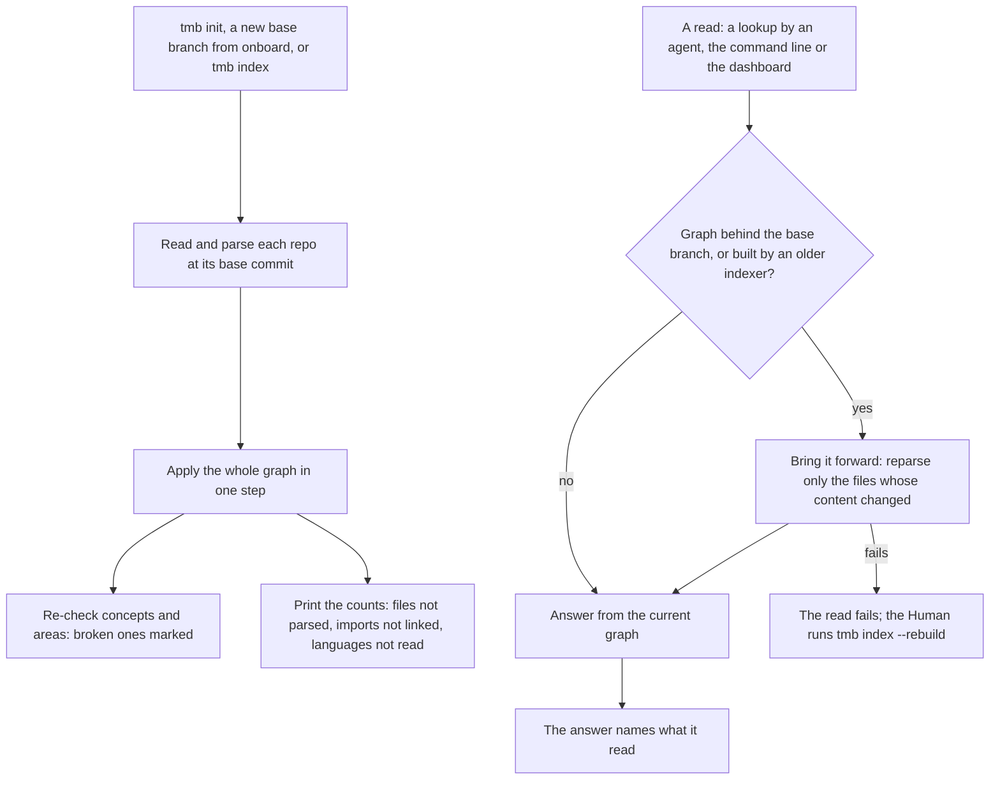
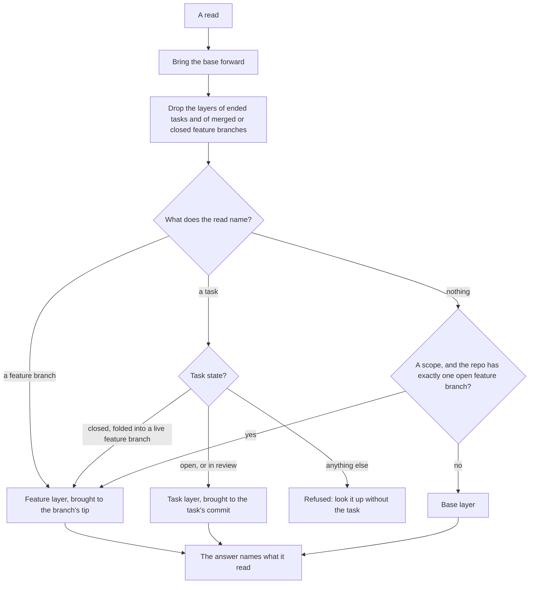

# Code graph: build and refresh

Flow 2.2 in [FLOWS.md](FLOWS.md): how tmb builds the code graph, how a read keeps it fresh, and which layer a read answers from. What the graph holds, how links are proven and its schema are in [CODE_GRAPH.md](../architecture/CODE_GRAPH.md).

## An index applies the whole graph in one step

**tmb calls the scan an index. It reads and parses each repo at its base commit, then applies the whole graph at once.**

- **Example 1.** The Human runs `tmb init` or `tmb index`. The index builds the graph and prints the counts: files not parsed, imports not linked, languages not read.
- **Example 2.** `tmb onboard` sets a new base branch. The graph is indexed from it. After the graph is applied, tmb re-checks the concepts and areas and marks the broken ones.
- **Example 3.** An index fails. Nothing changes: the old graph stays.
- **Edge case.** Two processes build the same commit. The second keeps the first's graph.

## A read brings the graph forward

**A read that finds the graph behind its base branch brings it forward before it answers. The answer names what it read.**

- **Example 1.** The base branch moved since the last index. The next lookup parses only the files whose content changed, then answers. A parse is kept by the file's content, so the cost is the diff's, not the repo's.
- **Example 2.** A session starts. Session start does not index, so it stays fast: the planner's first page shows the directories as last indexed. The planner's first lookup brings the graph forward.
- **Edge case.** A newer tmb reads code differently. The graph is rebuilt, and the answer says so.

## A rebuild is the Human's

**A rebuild is the fallback, and the Human's. It forgets every cached parse and builds from nothing.**

- **Example.** Bringing the graph forward fails, so the read fails. The read does not rebuild by itself: the Human runs `tmb index --rebuild`.

## A lookup in a multi-repo workspace names its repo

**A multi-repo workspace indexes each repo from its own base branch, so a lookup must say which repo it means.**

- **Example 1.** A lookup names its repo, or runs in that repo's folder.
- **Example 2.** A lookup names a task or a feature branch. It reads that task's or branch's own repo.
- **Example 3.** A lookup in the workspace folder names no repo. It is refused, with the list of repos.
- **Edge case.** A folder of repos that the record does not name has no graph. The index is refused there and names the fix: run `tmb init` again.

## Task overlay

**The base graph holds only what has reached the base branch. A layer makes work that is not there yet readable through the graph without touching the base: one layer per open task, one per open feature branch.**

In the order a task meets them:

- **Example 1.** A scope names nothing. It reads where the task will be cut: the repo's only open feature branch, or the base branch when the repo does not have exactly one.
- **Example 2.** A worker's read names its open task. The answer comes from the task's commit laid on the base, so the worker sees its change and its base together.
- **Example 3.** A truest task is in review. It keeps its layer, so the reviewer reads it.
- **Example 4.** A task closes into its feature branch. The next read drops the task's layer, and a read that names the closed task answers from the feature branch, which now holds the work.
- **Example 5.** A lookup names a feature branch. Its layer lives while the branch does: tmb brings it forward when the tip moves and drops it once the branch is merged or closed.
- **Edge case 1.** A lookup names a feature branch and a task. It is refused.
- **Edge case 2.** A read names a task that is neither open, in review, nor folded into a live feature branch. It is refused and told to look it up without the task.

## Every layer is cache

**A layer is built at the read, from git. It holds no link into the record and can be rebuilt from its commit.**

- **Example 1.** The first read that names a layer builds it, from the task's commit or the branch's tip. A later read brings it forward, and only files whose content changed are parsed again.
- **Edge case.** Concepts and areas belong to the base. An anchor or a pattern must match the base branch's graph, not a layer.
