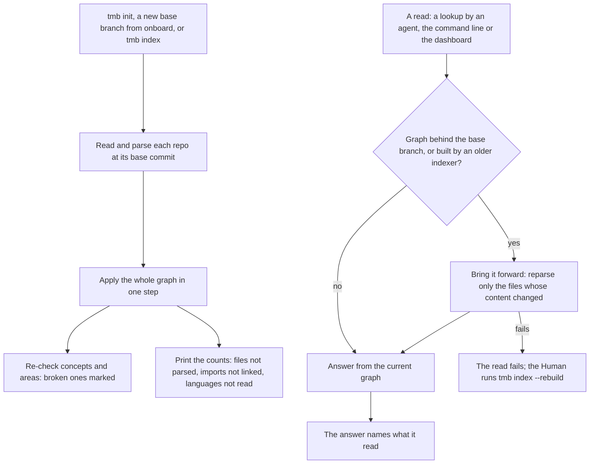
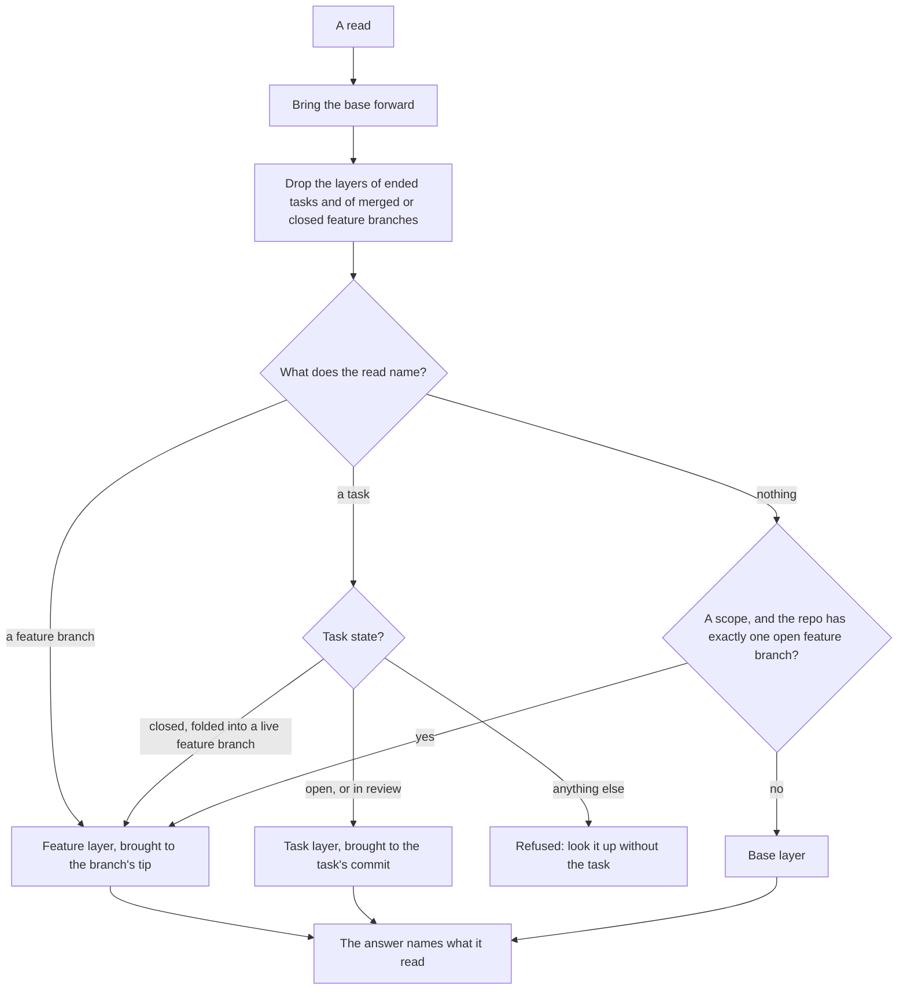

# Code graph: build and refresh

The steps of flow 2.2 in [FLOWS.md](FLOWS.md): how the code graph is built by `tmb init` and `tmb index`, how a read keeps it fresh, and which layer a read answers from. What the graph holds, how links are proven and its schema are in [CODE_GRAPH.md](../architecture/CODE_GRAPH.md).

## Scan

tmb calls the scan an index. Every case of flow 2.2 in [FLOWS.md](FLOWS.md).

- **It keeps itself fresh.** A read brings a graph that is behind its base branch forward before it answers. A graph rebuilt because a newer tmb reads code differently says so in its answer.
- **A rebuild is the fallback, and the Human's.** A read that fails does not rebuild by itself. The rebuild forgets every cached parse and builds from nothing.
- **A file is parsed once per content.** A parse is kept by the file's content, so bringing a layer forward costs what the diff costs, not what the repo costs.
- **A failed index changes nothing.** The old graph stays, because the new one is applied in one step. When two processes build the same commit, the second keeps the first's graph.
- **Session start does not index.** The planner's first page shows the directories as last indexed, so the start stays fast; its first lookup brings the graph forward.
- **A workspace indexes each repo from its own base branch.** A lookup there names its repo, or runs in that repo's folder; in the workspace folder a lookup that names none is refused with the list of repos. A task or a feature branch reads its own repo.
- **A folder of repos the record does not name has no graph.** The index is refused there and names `tmb init`, run again, as the fix.

## Task overlay

The base graph holds only what has reached the base branch. A layer makes work that is not there yet readable through the graph, without touching the base: one per open task, and one per open feature branch (trustmybot/tmb#182).

- **Built at the read, from git.** A layer is built or brought forward by the first read that names it, from the task's commit or the branch's tip, so it is indexed from git like everything else.
- **Sized by the diff.** Only files whose content changed are parsed again.
- **A worker sees its change and its base together.** A read that names an open task answers from the task's commit laid on the base. A truest task in review keeps its layer, so the reviewer reads it.
- **A task's layer ends with the task.** Once the task is no longer open or in review, its layer is dropped at the next read. A read that names a closed task answers from its feature branch, which now holds the work.
- **A feature layer lives while its branch does.** It is brought forward when the tip moves and dropped once the branch is merged or closed. A lookup can name the feature branch; naming a task as well is refused.
- **A scope reads where the task will be cut.** It reads the repo's only open feature branch by default, and the base branch when several are open.
- **Concepts and areas belong to the base.** An anchor or a pattern must match the base branch's graph.
- **It is cache.** A layer holds no link into the record and can be rebuilt from its commit.
