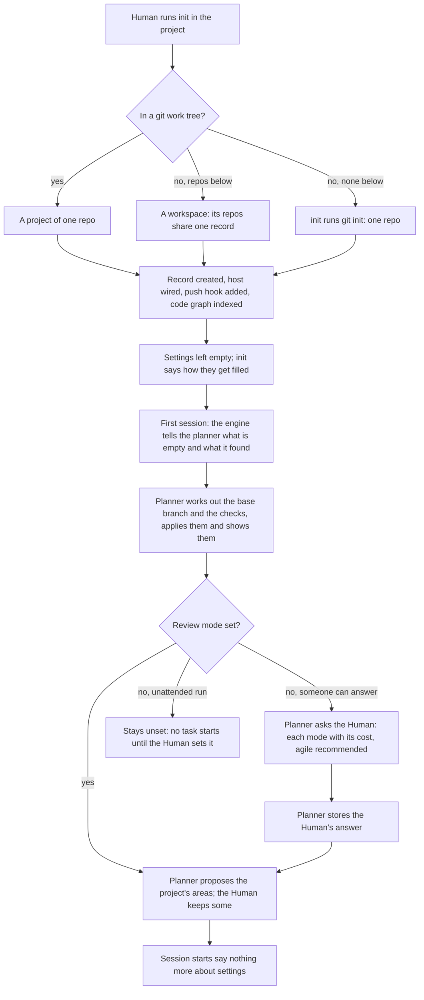
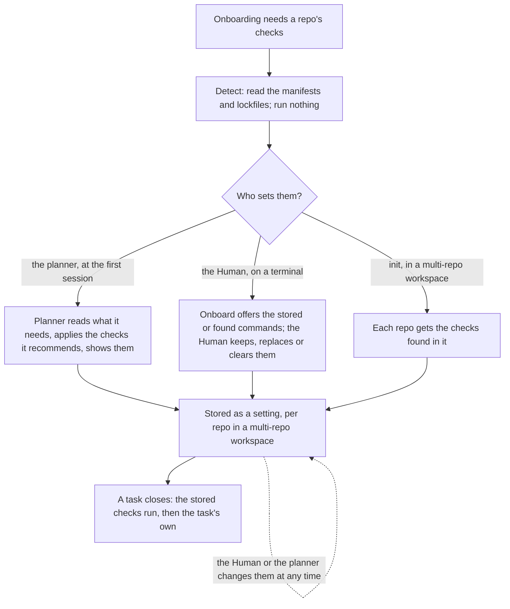

# First contact

Flows 2.1 and 2.3 in [FLOWS.md](FLOWS.md): how tmb learns a project's shape, its policy and [its checks](#the-repos-checks). Init comes first and asks nothing. The planner's onboarding follows at the first session.

`tmb onboard` sets the same settings from a terminal and can run again at any time.

## Steps

Each step, who takes it and what it leaves in the record.

| Step | What happens | Who | Leaves |
|---|---|---|---|
| The project | No question. The record is the nearest one in the folder or above it. `tmb doctor` shows other records above or below. Init refuses a second project in a repo whose push hook already names another. | init | nothing |
| The remote | No question. tmb reads each repo's remote when it needs it. With none, nothing is pushed and no pull request opens ([3_GIT.md](3_GIT.md)). | engine | nothing |
| The base branch | Per repo: origin's default branch, else the current branch, else `main`. The review mode decides the branches ([3_WORKFLOW.md](3_WORKFLOW.md)). | init in a multi-repo workspace, else the planner; or `tmb onboard` | each repo's base branch |
| Bug reports | The feedback program ([1_INSTALL.md](1_INSTALL.md#bug-reports)): on with a notice on dev and rc; on stable the planner asks once per machine. | init's last lines, or the planner | the person's setting, per machine and channel |
| The review mode | Agile or truest, [the Human's choice](#the-review-mode-is-the-humans-choice). In a multi-repo workspace: the workspace's mode once, then once whether any repo takes its own. | the planner's question, or `tmb onboard` on a terminal | the review mode, and how it was chosen |
| The push gate | No switch. Init installs the hook. Where a repo's pre-push hook is another tool's, the Human is asked whether tmb adds its one line first in it. A repo marked exempt gets none ([3_GIT.md](3_GIT.md)). | init; `tmb onboard` on a terminal | git's pre-push hook per repo |
| The checks | Found in the project and stored as a setting, not as a file in the repo ([The repo's checks](#the-repos-checks)). | the planner, or `tmb onboard` | the checks, per repo in a multi-repo workspace |
| The areas | Once the code graph is built, the planner proposes named parts of the project, one line each, and writes those the Human keeps ([CODE_GRAPH.md](../architecture/CODE_GRAPH.md)). | the planner | the areas |
| The design docs | Planned (trustmybot/tmb#302). Where the high-level design is, or in a project with none, where to keep it: a folder in the repo, a link outside it, or the record ([the three layers](../architecture/README.md#three-layers-of-knowledge)). | the planner's question, or `tmb onboard` | where the design is kept |
| Issue sync | Planned, inside the syncer (trustmybot/tmb#70). | | |

## Init asks nothing

**Init never waits for input, on a terminal or not. It sets the host and leaves every other setting empty.**

- **Example 1.** The Human runs init in a repo. Init creates the record, wires the host, adds the push hook and indexes the code graph. Its last lines say how the empty settings get filled.
- **Example 2.** The folder is not a git work tree and holds repos. It becomes a multi-repo workspace: init records every top-level folder, repo or not, and finds repos up to two folders down. Here init also sets each repo's base branch and the checks found in it. Later steps never scan or guess ([3_GIT.md](3_GIT.md#multi-repo-workspaces)).
- **Example 3.** The folder is not a git work tree and holds no repo. Init runs `git init`, and the folder is a project of one repo.
- **Edge case.** No host is installed. Init stops and changes nothing.

## The planner onboards by itself

**When a planner's session starts and the base branch, the review mode or the checks is empty, the engine says so, with what it found. The planner applies what it recommends before other work and shows it.**

- **Example 1.** The base branch and the checks are empty. The planner works both out, applies them and shows them. It asks nothing.
- **Example 2.** The review mode is empty too. The planner asks the Human and stores the answer. Then it proposes the project's areas, and the Human keeps some.
- **Example 3.** The planner reminds the Human that `tmb onboard` can be run again, and that it can change a value when asked.
- **Example 4.** Every setting is stored. Later session starts say nothing more about settings.
- **Edge case.** The run is unattended. The planner applies its recommendations and names each value in its answer. It never sets the review mode.

## The review mode is the Human's choice

**The review mode decides how many tokens a project uses, so only the Human may set it ([ENGINE.md](../architecture/ENGINE.md#ways-into-the-engine)). tmb recommends agile and never picks. No task starts until it is set.**

- **Example 1.** The Human answers the planner's question.
- **Example 2.** The Human answers `tmb onboard` on a terminal.
- **Example 3.** The Human passes `tmb onboard` its review-mode flag and types yes. These are the three ways, and the record keeps which one set the mode.
- **Edge case.** An unattended run leaves the mode unset. The first task is refused, and the refusal names `tmb onboard`.

What each mode does, where the mode is kept and the one case where a run with no terminal may set it are in [3_WORKFLOW.md](3_WORKFLOW.md).

## The repo's checks

**The checks are the commands that must pass before a task closes. tmb hardcodes no toolset: it finds a repo's checks at onboarding and stores them as a setting.**

| Rule | Example |
|---|---|
| **Detect runs nothing.** It reads the files a stack leaves behind, in the repo's top folder only, and suggests commands. | A package manifest has lint, typecheck and test scripts. Detect suggests them, run with the tool the lockfile names. A Python, Rust or Go project gets its usual test command. The list is in the [reference](../reference/README.md#onboard). |
| **A suggestion, never the rule.** | The planner works out what it recommends from the suggestion and the project. The Human confirms or replaces it. |
| **The repo is the source of truth.** tmb suggests only commands the repo already defines. | Teammates, CI and editors enforce the same rules without tmb. |
| **A new detection never overwrites a stored list.** The checks change only when the Human or the planner changes them. | A repo's stack changed. It keeps its stored checks until someone changes them. |
| **One list per repo.** | A project of one repo has one list. In a multi-repo workspace each repo has its own, and the project-wide list is not read ([3_GIT.md](3_GIT.md#multi-repo-workspaces)). |
| **A task adds its own.** A task's spec can name more checks. | At close the stored checks run first, then the task's, each with a time limit, in the task's worktree. What a close refuses is in [3_TASKS.md](3_TASKS.md). |

## How a card is written

**The planner asks through the host's question tool, and only when the Human must choose. A person who has never used tmb must be able to answer from the card alone.**

- **Example 1.** The review mode gets a card: one option per mode with what it costs, agile marked as recommended.
- **Example 2.** The areas to keep get a card, and so does the feedback program on stable. The base branch and the checks get none.
- **Example 3.** Repo modes are asked only in a multi-repo workspace. A project of one repo takes the project's mode.
- **Edge case.** A card that asks for consent recommends nothing.

Planned (trustmybot/tmb#441):

- **The feature comes first.** The question opens by saying what tmb does here, in one or two sentences, and then asks.
- **tmb's own names.** A card uses the name tmb uses everywhere, such as docs task or review mode, and says what it means.
- **Each option says its benefit and its risk or cost**, in one short line.
- **The card shows the actual values.** Commands and branch names appear on the card, shortened with a count when the list is long.
- **Plain, short sentences.** Setting names and file formats stay off the card.
- **The planner recommends a mode per repo** from what each repo shows, with the reason beside it.

## Settings live in the record

**Onboarding writes its settings to the record. Nothing lands in the repo's working tree beyond the ignore lines.** How the record keeps a setting is in [CONFIG.md](../architecture/CONFIG.md).

- **Example.** The checks are a setting, not a file in the repo, so there is no file for the Human to commit.

## Re-runs keep what stands

**`tmb onboard` and init can both run again. Neither changes a setting the Human did not change.**

- **Example 1.** `tmb onboard` offers each stored value first and changes a setting only when the Human gives a new one.
- **Example 2.** Init run again keeps every stored setting and, in a multi-repo workspace, each repo's policy. It adds repos that appeared and drops those that are gone, one line each.
- **Example 3.** The same answers change no file and record nothing.
- **Edge case 1.** Without a terminal `tmb onboard` never waits. Each question takes its default, and the review mode stays as it is.
- **Edge case 2.** `tmb onboard` before init says so and changes nothing.
