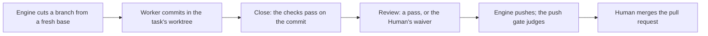
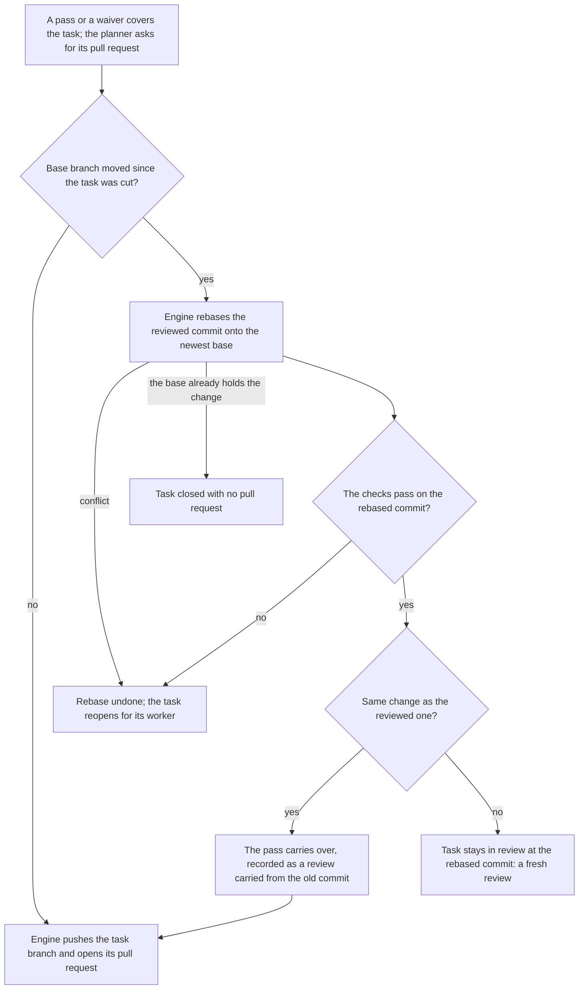
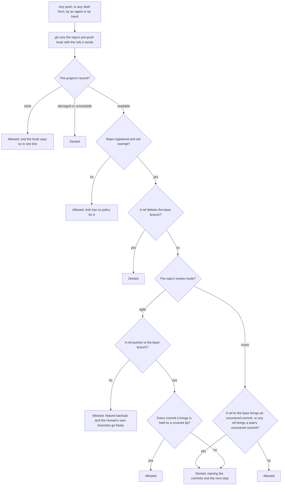
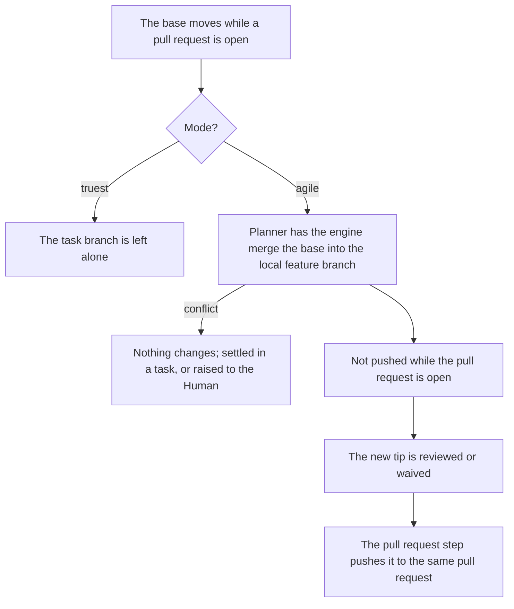

# Git workflow

Where the work sits in git at each step of a task, what the engine does there, what the push gate lets leave the machine, and how a multi-repo workspace decides which repo a step belongs to. [FLOWS.md](FLOWS.md) shows the task chain this serves, from the Human's ask to the merge.

## Local is canonical, origin is downstream

The local branch is the source of truth at every step. Work reaches origin only through a push the engine makes: no worker or reviewer pushes.

- **Example.** A worker commits in its task's worktree, and nothing leaves the machine. The Human can inspect, rebase or drop anything before it reaches origin: routing commits through local branches, rather than letting a worker push, keeps that usual model.
- **The engine does the git steps.** The engine, not an agent, creates branches and worktrees, runs checks, folds a task into its feature branch, pushes and opens pull requests. Agents ask for these through the engine's tools, so every step is recorded and no agent is trusted to follow a git procedure.

## Git guards

tmb has none. It watches no git step on the way and judges what leaves the machine.

- **What tmb does not do.** It reads no shell command to find a commit, a merge, a checkout or a push, and it blocks no direct commit.
- **Why.** A list of every way to write a git command has no end. git already says exactly what a push sends.

What stands in their place, each at a checkpoint:

| Checkpoint | What it does |
|---|---|
| The close | Runs the checks on the committed work, and reports what changed outside the spec and in the main folder |
| The review | Judges the diff |
| The push gate | Judges every push, an agent's or one typed by hand: git's own pre-push hook asks the engine ([below](#the-push-gate-at-gits-own-hook)) |
| One host event | A worker's start is refused without a ready task ([ENGINE.md](../architecture/ENGINE.md#containment)) |

## Where the work sits at each stage

Each actor has one place, and the main folder never changes branch.

- **The Human and the planner** work in the project's main folder, which stays on its branch for the whole task.
- **A worker** works only in the task's worktree, on the task's branch.
- **Origin** is the remote. The base branch is the branch pull requests merge into.

Agile mode, the recommended one:

| Where | Idle | Task started | Worker committed | Task closed | Milestone | After the merge |
|---|---|---|---|---|---|---|
| **Main folder** | its branch | unchanged | unchanged | unchanged | unchanged | unchanged |
| **Task worktree** | none | on the task branch, cut from the feature branch's tip | commits advance the task branch | removed with the task branch | none | none |
| **Feature branch** | cut from the base branch | unchanged | unchanged | moved to the task's commit | base branch merged in, then reviewed | kept; recorded as merged |
| **Origin** | base branch | same | same | feature branch pushed as a backup | reviewed tip pushed; one pull request | base branch advanced |

- **Agile feature branches.** A long-lived feature branch stands between the task branches and the base branch. Each task branch is cut from its tip and folds back into it locally, with no pull request. The engine pushes it as a backup and merges the base branch into it before the review. Only the feature branch reaches the base branch, as one pull request after a pass or a Human waiver.
- **Truest mode has no feature branch.** The task branch is cut from the base branch, waits in review at its commit with its worktree kept, and is pushed only for its own pull request, after a pass or a waiver.
- **Why one checkout.** A branch can be checked out in only one worktree at a time. The task's worktree owns the task branch and the main folder stays where it is, so there is never a second checkout to reconcile.

[3_WORKFLOW.md](3_WORKFLOW.md) covers every case of both modes.

## Keeping the base fresh

The engine fetches the base branch from origin before it cuts a branch from it, so new work starts from the newest base.

| What is cut | Cut from |
|---|---|
| A feature branch | Origin's base branch, fetched first |
| A feature branch, when the local base branch holds a commit origin lacks, or there is no origin | The local base branch |
| A feature branch, when the fetch fails | What git already holds of origin's |
| A truest task | Fetched the same way; origin's base branch, the local one only with no origin |
| An agile task | The feature branch's tip |

When the base branch moves later:

| Mode | What happens |
|---|---|
| Agile | The planner has the engine merge it into the feature branch before the review |
| Truest | The engine rebases the reviewed task before its first push ([below](#rebasing-a-reviewed-task)) |

- **A new branch never reuses a name.** A feature branch whose name already exists is refused.
- **The brief says whether a feature branch holds the base,** so the planner and the reviewer know before the review.
- **The code graph follows the branches.** Each lookup first brings the graph to the newest commit of what it reads: the base branch, a feature branch's tip or an open task's commit.

## Starting a task

The engine provisions: starting a task cuts its branch and adds its worktree in one step. The main folder never switches branches.

- **A failed start leaves nothing.** When git cannot add the worktree, nothing is recorded and what was made is removed.
- **A worker starts only on a ready task.** The gate refuses a worker start that names no open task with its worktree on disk.
- **A worker's own folder is adopted.** A host may start each worker in a worktree of the host's making. When the worker first reads its brief there, the engine makes that folder the task's worktree, if it is clean and belongs to no other task. Otherwise the task keeps the worktree the engine cut ([ADAPTERS.md](../architecture/ADAPTERS.md)).

## Closing a task

There is no planner-side merge. A fold moves the feature branch to the task's commit, and the close then removes the task's worktree and branch.

- **Another task folded first.** The engine rebases the later task onto the new tip and runs every check again.
- **What keeps a worktree and its branch.** Uncommitted changes, untracked files git does not ignore, or a lock set by the host. The close names them. Files git ignores go with the worktree.
- **A kept worktree is tried again** at the planner's session start, when no task is open or in review.
- **Branches that stay.** A truest task's branch stays for its pull request. A dropped task's branch stays while it holds commits.
- **tmb deletes no feature branch.**

## Rebasing a reviewed task

Truest mode only. The engine rebases a reviewed task onto the newest base before the first push, in the task's own worktree.

- **Example 1.** The base moved, and the rebased commit is the same change. It keeps its pass, the way Gerrit carries a vote across a trivial rebase.
- **Example 2.** The rebased commit is a different change. Like any other new commit, it needs a fresh review.
- **Edge case: a failed rebase.** The worktree is left as it was.
- **Edge case: no remote.** The task is rebased onto the local base branch the same way, then recorded ready: its worktree goes, its branch stays, and the Human merges it locally.

## The push gate at git's own hook

git hands its pre-push hook the exact refs and commits of a push, so the gate reads no command text and no shell form can hide a push from it. The hook runs inside the repo being pushed, so the policy is that repo's.

- **Example 1.** In an agile repo the engine pushes a feature branch as a backup. No ref goes to the base branch: allowed.
- **Example 2.** In an agile repo the Human types a push to the base branch that brings a commit no covered tip holds. Denied, naming the commits and the next step.
- **Edge case.** The record file is there but empty. That counts as damaged, so the push is denied.

### What the gate counts

- **Covered** means a pass or a Human waiver on that exact commit: a feature branch's tip in agile mode, a task's commit in truest mode, or a commit a pass was carried to by a rebase.
- **Only what the remote says it holds counts as already there.** A local ref can hold commits that never reached the remote.
- **Merge commits are left out.** They bring no change of their own.
- **The gate denies when it cannot read the record.**
- **With no base branch set, no push is judged.**

### Whom the gate judges

- **The Human's push is judged too.** The gate holds whoever typed the push. In truest mode a commit of no task goes to a branch other than the base freely, so the Human's own branches need no waiver.
- **Every decision is recorded,** with who pushed. A push the engine makes for an agent names that agent; a push with no name is the Human's.
- **Linked worktrees share the hook.** A push from a task's worktree is judged as one from the repo it was cut from.

### The hook file

- **The hook names its project.** Setup writes the project's folder into the hook, relative to the repo's top, so the gate never searches for it. A project may be one package of a monorepo, below the top where git runs the hook.
- **One repo holds one tmb project.** Setup refuses a second one and says why.
- **A hook that is another tool's is left alone,** as husky and lefthook write. The gate is off there, and setup, every session start and the health check say so until the gate is on or the repo is exempt.
- **With the Human's yes, tmb adds one line first in that hook,** so the gate sees every pushed ref before the rest runs. The line is safe to commit: it calls the program by name, does nothing where the program is not installed, and hands the same refs on.
- **Only a hook written for a shell is changed.** For one in another language tmb says how to call the gate by hand.
- **A tool that rewrites its hook on every install drops the line,** and the next session start says the gate is off again.
- **Removing tmb deletes the hook it wrote,** or takes out its one line. A hook that is not tmb's stays.

### Beyond the local hook

A local hook can be skipped, so the gate also has a place on the server.

- **A mark on GitHub.** Each verdict or waiver sets a commit status named tmb/review on that exact commit: success for a pass or a waiver, failure for a fail. The repo's branch protection can require it before a merge.
- **The protection settings are the Human's.** tmb says whether the base branch requires the mark and how to turn that on, and never changes the settings.
- **A mark that could not be sent** is sent at the next review, waiver or pull request, and never fails the review.
- **How it is sent.** With the Human's own GitHub command line, only when origin is a GitHub repo. It is a convention among people who can write to the repo, not proof.
- **The remote host is the last line of defence.** tmb's hook does not replace the branch rules the Human sets there.
- **The health check counts the commits on each base branch that went around tmb.** Planned: a gate that was skipped is found by the sync with the remote and recorded as a finding (trustmybot/tmb#70).

## When the base moves after the PR is open

An open pull request is never rebased, because that would rewrite what was pushed.

- **The pull request is kept.** tmb opens no second one, so the review thread and history stay in one place.
- **Nothing is force-pushed.**

## Multi-repo workspaces

A project is a set of repos sharing one record. Its workspace is the folder where the Human ran `tmb init`, and the record is kept there.

### Setup decides the workspace's shape

- **What counts as a repo.** A folder whose git folder is a real folder. A linked worktree or a submodule is never one, so a task's worktree is not taken for a repo. Setup does not look inside a repo it found, a dot-folder or a dependency folder.
- **The record keeps the set,** so no later step scans or guesses. Running setup again adds what appeared and drops what is gone, with a line for each.
- **Edge case.** A workspace inside a git work tree is a project of one repo, even when it holds nested repos.

### The work names its repo

tmb resolves "which repo does this step belong to" from the work, never from the folder a session runs in.

- **A feature branch or a task records its repo.** With one managed repo it may be left out. With several, a start that names none is refused with the list. An agile task works in its feature branch's repo.
- **Every later step runs there:** the cut, the worktree, the checks, the fold, the backup push and the pull request.
- **Why no default repo.** A global default would force one repo to be "the" repo, and it breaks as soon as a second joins. Recording the repo on the work lets sibling repos sit side by side with none treated as the main one.

### What is per repo, and what is shared

| Thing | Rule |
|---|---|
| Policy | Each repo has its own base branch and checks, taken from its own git at setup: origin's default branch, else the current branch. A policy set before is kept. The project-wide base branch and checks are not read in a multi-repo workspace. |
| Origin | Each repo pushes to its own origin and opens pull requests on its own remote repo. |
| The record | One. Task worktrees stay under the workspace, so a worker finds the shared record. Feature names are unique in the record. Issues live in the record and name no repo. |
| The gate | Setup writes the pre-push hook into every managed repo. The hook names the workspace's folder: the gate reads the record there and judges the push against that repo's base branch and mode. A push from a repo the record does not register, or registers as exempt, is allowed, and the recorded reason says why. |
| The code graph | One per repo, built from its own base branch, with paths relative to that repo. A repo that cannot be indexed yet says why, and the others go on. |
| Mode | One per repo, below. |

### Each repo has a mode

| Repo mode | What applies in the repo |
|---|---|
| Agile | Feature branches, tasks, the review of the whole branch, the push gate ([3_WORKFLOW.md](3_WORKFLOW.md)) |
| Truest | Tasks cut from the base branch, a review of every task before its push, the push gate |
| Exempt | Listed in the record and left untouched: no task, no hook, no code graph, no push gate. For a repo tmb does no work in, such as fixtures that never ship |

- **The workspace has one review mode, and a repo can name its own.** One that names none follows the workspace's ([3_WORKFLOW.md](3_WORKFLOW.md#where-the-review-mode-is-set)).
- **Everything that reads the mode reads the repo's:** starting work, the push gate, the session start and the health check.
- **Only the Human chooses a repo's mode,** as for the workspace's. In unattended mode a repo's mode is not changed.
- **Its mode shows.** The settings and the planner's session start list each repo with its base branch and its mode.

## Open, for the Human

- **Whether a truest task skips the local rebase where the remote has a merge queue.**
