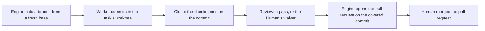
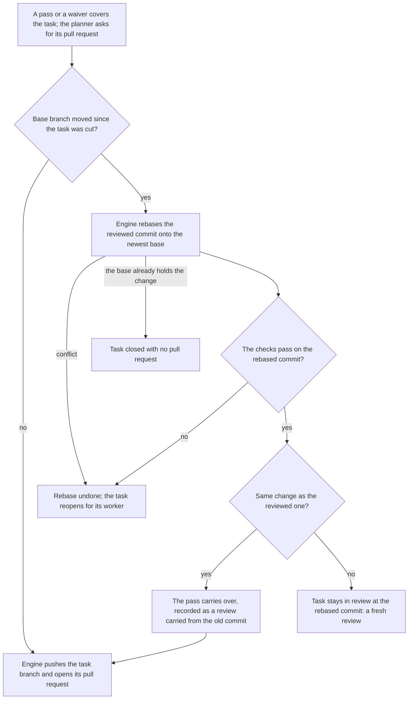
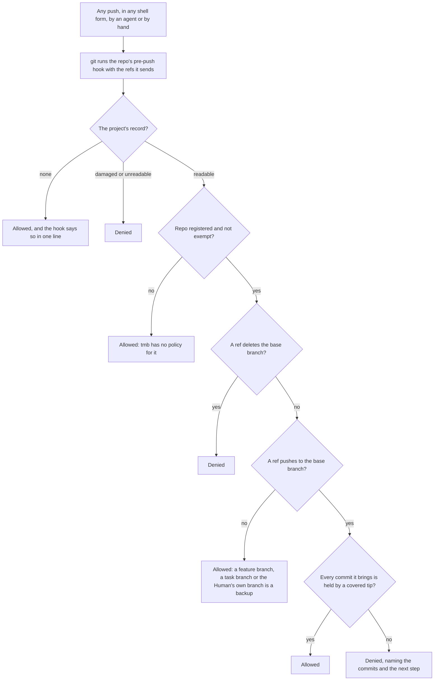
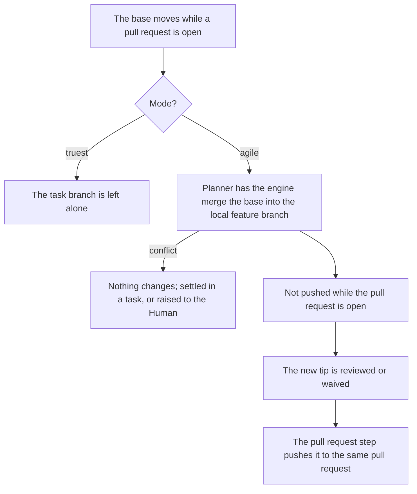

# Git workflow

Where the work sits in git at each step of a task, in time order: what the engine does there, what guards the base branch, and which repo a step belongs to in a multi-repo workspace. [FLOWS.md](FLOWS.md) shows the task chain this serves.

## Local is canonical, origin is downstream

**The local branch is the source of truth at every step. tmb sends work to origin only through a push the engine makes.**

- **Example 1.** A worker commits in its task's worktree. Nothing leaves the machine, so the Human can inspect, rebase or drop anything before it reaches origin.
- **Example 2.** No worker or reviewer pushes. The engine does every git step, so each one is recorded ([ENGINE.md](../architecture/ENGINE.md#containment)).
- **Edge case.** A project has no remote. Nothing is pushed, and the local branch is all there is ([3_WORKFLOW.md](3_WORKFLOW.md#a-project-with-no-remote)).

## tmb has no git guards

**tmb blocks no git command. It guards one thing, the base branch: at [the merge gate](3_WORKFLOW.md#merge-gate) and at [the push gate](#the-push-gate-at-gits-own-hook).**

- **Example 1.** Someone commits directly. tmb does not block the commit.
- **Example 2.** tmb reads no shell command to find a commit, a merge, a checkout or a push. A list of every way to write a git command has no end.
- **Edge case.** A push to the base branch typed in an unusual shell form still meets the gate, because git itself runs the hook.

The other checkpoints are in [ENGINE.md](../architecture/ENGINE.md#containment).

## Where the work sits at each stage

**Each actor has one place, and the main folder never changes branch.**

| Actor | Place |
|---|---|
| The Human and the planner | The project's main folder, which stays on its branch for the whole task |
| A worker | Only the task's worktree, on the task's branch |
| Origin | The remote. The base branch is the branch pull requests merge into |

Agile mode, the recommended one:

| Where | Idle | Task started | Worker committed | Task closed | Milestone | After the merge |
|---|---|---|---|---|---|---|
| **Main folder** | its branch | unchanged | unchanged | unchanged | unchanged | unchanged |
| **Task worktree** | none | on the task branch, cut from the feature branch's tip | commits advance the task branch | removed with the task branch | none | none |
| **Feature branch** | cut from the base branch | unchanged | unchanged | moved to the task's commit | base branch merged in, then reviewed | kept; recorded as merged |
| **Origin** | base branch | same | same | feature branch pushed as a backup | reviewed tip pushed; one pull request | base branch advanced |

- **Example 1.** An agile task closes. The feature branch moves to the task's commit, the engine pushes the feature branch as a backup, and the main folder has not moved.
- **Example 2.** Truest mode has no feature branch. The task branch is cut from the base branch and waits in review at its commit, with its worktree kept. The engine pushes it only for its own pull request, after a pass or a waiver.
- **Edge case.** git lets a branch be checked out in only one worktree at a time. The task's worktree owns the task branch and the main folder stays where it is, so there is never a second checkout to reconcile.

Every case of both modes is in [3_WORKFLOW.md](3_WORKFLOW.md).

## Keeping the base fresh

**The engine fetches the base branch from origin before it cuts a branch from it, so new work starts from the newest base.**

| What is cut | Cut from |
|---|---|
| A feature branch | Origin's base branch, fetched first |
| A feature branch, when the local base branch holds a commit origin lacks, or there is no origin | The local base branch |
| A feature branch, when the fetch fails | What git already holds of origin's |
| A truest task | Fetched the same way; origin's base branch, the local one only with no origin |
| An agile task | The feature branch's tip |

- **Edge case.** A new branch never reuses a name. The engine refuses a feature branch whose name already exists.

**When the base branch moves later, an agile feature branch merges it in and a truest task is rebased onto it.**

- **Example 1.** Agile: on the planner's request the engine merges the base branch into the feature branch before the review. It is a merge commit and never a rebase, since the branch is already pushed.
- **Example 2.** Truest: the engine rebases the reviewed task before its first push ([below](#rebasing-a-reviewed-task)).
- **Edge case.** The merge conflicts. Nothing changes and the engine names the files. The planner settles it in a task on the branch, or raises it to the Human.

The code graph follows the branches ([2_CODE_GRAPH.md](2_CODE_GRAPH.md)).

## Starting a task

**Starting a task cuts its branch and adds its worktree in one step.**

- **Example 1.** The planner starts an agile task. The engine cuts the task branch from the feature branch's tip and adds the task's worktree on it.
- **Example 2.** Claude Code may start a worker in a worktree of its own making. When the worker first reads its brief there, the engine makes that folder the task's worktree, if it is clean and belongs to no other task. Otherwise the task keeps the worktree the engine cut ([ADAPTERS.md](../architecture/ADAPTERS.md)).
- **Edge case.** git cannot add the worktree. Nothing is recorded, and the engine removes what was made.

## Closing a task

**There is no planner-side merge. A fold moves the feature branch to the task's commit, and the close then removes the task's worktree and branch.**

- **Example 1.** Another task folded first. The engine rebases the later task onto the new tip and runs every check again ([3_WORKFLOW.md](3_WORKFLOW.md#safe-close)).
- **Example 2.** The worktree holds uncommitted changes. The close keeps the worktree and its branch and names what holds them. The engine tries again at the planner's session start, when no task is open or in review.
- **Edge case.** The worktree holds only files git ignores. They go with the worktree.

What stays after a close or a drop:

| Thing | Stays when |
|---|---|
| A task's worktree and its branch | The worktree holds uncommitted changes, untracked files git does not ignore, or a lock Claude Code set |
| A truest task's branch | Always, for its pull request |
| A dropped task's worktree | It holds uncommitted work |
| A dropped task's branch | It holds commits |
| A feature branch | Always: tmb deletes no feature branch |

## Rebasing a reviewed task

**Truest mode only. The engine rebases a reviewed task onto the newest base before the first push, in the task's own worktree.**

- **Example 1.** The base moved, and the rebased commit is the same change. It keeps its pass, the way Gerrit carries a vote across a trivial rebase.
- **Example 2.** The rebased commit is a different change. Like any other new commit, it needs a fresh review.
- **Example 3.** The rebase fails. The engine leaves the worktree as it was.
- **Edge case.** The project has no remote. The engine rebases the task onto the local base branch the same way, then records it ready: its worktree goes, its branch stays, and the Human merges it locally ([3_WORKFLOW.md](3_WORKFLOW.md#a-project-with-no-remote)).

## The push gate at git's own hook

**The push gate guards the base branch only. It refuses a push to the base branch that brings a commit no pass or Human waiver covers. Every other push is a backup and goes freely, in both modes.** Review gates the merge, at [the pull request step](3_WORKFLOW.md#merge-gate).

git runs the repo's pre-push hook on every push and hands it the exact refs and commits. The gate reads no command text, so no shell form can hide a push from it. The hook runs inside the repo being pushed, so the policy is that repo's.

- **Example 1.** The engine pushes a feature branch as a backup. No ref goes to the base branch, so the gate allows it.
- **Example 2.** The Human types a push to the base branch that brings a commit no covered tip holds. The gate denies it and names the commits and the next step.
- **Example 3.** Planned (trustmybot/tmb#456): the rule is the same in truest mode, so a task branch pushed before its review goes freely.
- **Edge case.** The record file is there but empty. That counts as damaged, so the gate denies the push ([ENGINE.md](../architecture/ENGINE.md#gates-fail-closed)).

### What the gate counts

**A commit is covered when a pass or a Human waiver sits on that exact commit.** That commit is a feature branch's tip in agile mode, a task's commit in truest mode, or a commit a pass was carried to by a rebase.

- **Example 1.** A pushed range holds a merge commit. The gate leaves it out: a merge commit brings no change of its own.
- **Example 2.** A local ref holds commits that never reached the remote. The gate counts as already there only what the remote says it holds.
- **Edge case.** No base branch is set. The gate judges no push.

### Whom the gate judges

**The gate judges every push to the base branch, the Human's too, and records each decision with who pushed.**

- **Example 1.** The engine pushes for an agent. The record names that agent. A push with no name is the Human's.
- **Example 2.** The Human pushes a branch other than the base. It goes freely, so the Human's own branches need no waiver.
- **Edge case.** A push comes from a task's worktree. Linked worktrees share the hook, so the gate judges it as a push from the repo the worktree was cut from.

### The hook file

**Setup writes the hook, and it never replaces a hook that is another tool's.**

| Case | What tmb does |
|---|---|
| Setup writes its own hook | The hook names its project: setup writes the project's folder into it, relative to the repo's top, so the gate never searches for it |
| The hook is another tool's, as husky and lefthook write | tmb leaves it alone. The gate is off there, and setup, every session start and the health check say so until the gate is on or the repo is exempt |
| The Human says yes to adding the gate | tmb adds one line first in that hook, so the gate sees every pushed ref before the rest runs. The line is safe to commit: it calls the program by name, does nothing where the program is not installed, and hands the same refs on |
| That hook is not written for a shell | tmb does not change it, and says how to call the gate by hand |
| The repo already holds a tmb project | Setup refuses a second one and says why: one repo holds one tmb project |
| tmb is removed | tmb deletes the hook it wrote, or takes out its one line. A hook that is not tmb's stays |

- **Example.** A project is one package of a monorepo, below the top where git runs the hook. The hook names the package's folder, relative to the repo's top.
- **Edge case.** A tool rewrites its hook on every install and drops tmb's line. The next session start says the gate is off again.

### Beyond the local hook

**A local hook can be skipped, so the gate also has a place on the server. It holds there only when the Human requires it.**

- **Example 1.** Each verdict or waiver sets a commit status named tmb/review on that exact commit: success for a pass or a waiver, failure for a fail. The repo's branch protection can require it before a merge.
- **Example 2.** The protection settings are the Human's. tmb says whether the base branch requires the mark and how to turn that on, and never changes the settings. The remote host is the last line of defence: tmb's hook does not replace the branch rules the Human sets there.
- **Example 3.** tmb does not control what the Human does by hand. A pull request the Human opens, and the merge button, are the Human's own. The mark stops such a merge only when it is a required check.
- **Example 4.** tmb sends the mark with the Human's own GitHub command line, and only when origin is a GitHub repo. The mark is a convention among people who can write to the repo, not proof.
- **Edge case.** A mark could not be sent. tmb records that and sends it at the next review, waiver or pull request. It never fails the review.

The health check counts the commits on each base branch that went around tmb. Planned: a gate that was skipped is found by the sync with the remote and recorded as a finding (trustmybot/tmb#70).

## When the base moves after the pull request is open

**An open pull request is never rebased, because that would rewrite what was pushed. Nothing is force-pushed.**

- **Example 1.** Truest: the task branch is left alone.
- **Example 2.** Agile: the engine merges the base into the local feature branch and does not push it while the pull request is open. Once the new tip is reviewed or waived, the pull request step pushes it to the same pull request.
- **Edge case.** tmb opens no second pull request, so the review thread and the history stay in one place.

## Multi-repo workspaces

**A project is a set of repos sharing one record.** Its workspace is the folder where the Human ran `tmb init`, and the record is kept there.

### Setup decides the workspace's shape

**The folder setup runs in decides the shape: one repo, or several repos that share one record.**

- **Example 1.** Setup runs in a folder that holds no repo. Setup makes the folder a git repo and says so: a workspace of one repo.
- **Example 2.** Setup runs in a plain folder that holds git repos. They become a multi-repo workspace and share one record in that folder.
- **Edge case.** A workspace inside a git work tree is a project of one repo, even when it holds nested repos.

**A repo is a folder whose git folder is a real folder.**

- **Example.** A linked worktree or a submodule is never a repo, so setup does not take a task's worktree for one.
- **Edge case.** Setup does not look inside a repo it found, a dot-folder or a dependency folder.

**The record keeps the set of repos, so no later step scans or guesses.**

- **Example.** The Human runs setup again. It adds what appeared and drops what is gone, with a line for each.

### The work names its repo

**tmb finds the repo a step belongs to from the work, never from the folder a session runs in.** A feature branch or a task records its repo.

- **Example 1.** The workspace has one managed repo. A start may leave the repo out.
- **Example 2.** The workspace has several managed repos. The engine refuses a start that names none, and lists them.
- **Example 3.** An agile task works in its feature branch's repo. Every later step runs there: the cut, the worktree, the checks, the fold, the backup push and the pull request.
- **Edge case.** There is no default repo. A default would force one repo to be "the" repo, and it breaks as soon as a second joins. Recording the repo on the work lets sibling repos sit side by side.

### What is per repo, and what is shared

**Each repo has its own policy, origin, hook, code graph and mode. The record is one.**

| Thing | Rule |
|---|---|
| Policy | Each repo has its own base branch and checks, taken from its own git at setup: origin's default branch, else the current branch. A policy set before is kept. The project-wide base branch and checks are not read in a multi-repo workspace ([CONFIG.md](../architecture/CONFIG.md)) |
| Origin | Each repo pushes to its own origin and opens pull requests on its own remote repo |
| The record | One. Task worktrees stay under the workspace, so a worker finds the shared record. Feature names are unique in the record. Issues live in the record and name no repo |
| The gate | Setup writes the pre-push hook into every managed repo. The hook names the workspace's folder: the gate reads the record there and judges the push against that repo's base branch |
| The code graph | One per repo, built from its own base branch, with paths relative to that repo |
| Mode | One per repo, [below](#each-repo-has-a-mode) |

- **Example 1.** A push comes from a repo the record does not register, or registers as exempt. The gate allows it, and the recorded reason says why.
- **Edge case.** A repo cannot be indexed yet. It says why, and the other repos go on.

### Each repo has a mode

**A repo is agile, truest or exempt.** Agile and truest are the review modes ([3_WORKFLOW.md](3_WORKFLOW.md#where-the-review-mode-is-set)).

- **Example 1.** A repo names no mode. It follows the workspace's.
- **Example 2.** A repo holds fixtures that never ship, and tmb does no work in it. The Human marks it exempt: it is listed in the record and left untouched, with no task, no hook, no code graph and no push gate.
- **Example 3.** Everything that reads the mode reads the repo's: starting work, the session start and the health check. The settings and the planner's session start list each repo with its base branch and its mode.
- **Edge case.** Only the Human chooses a repo's mode, as for the workspace's. In unattended mode a repo's mode is not changed.
