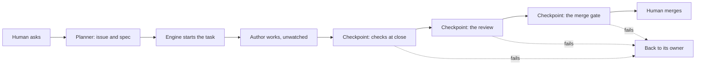
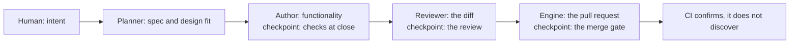
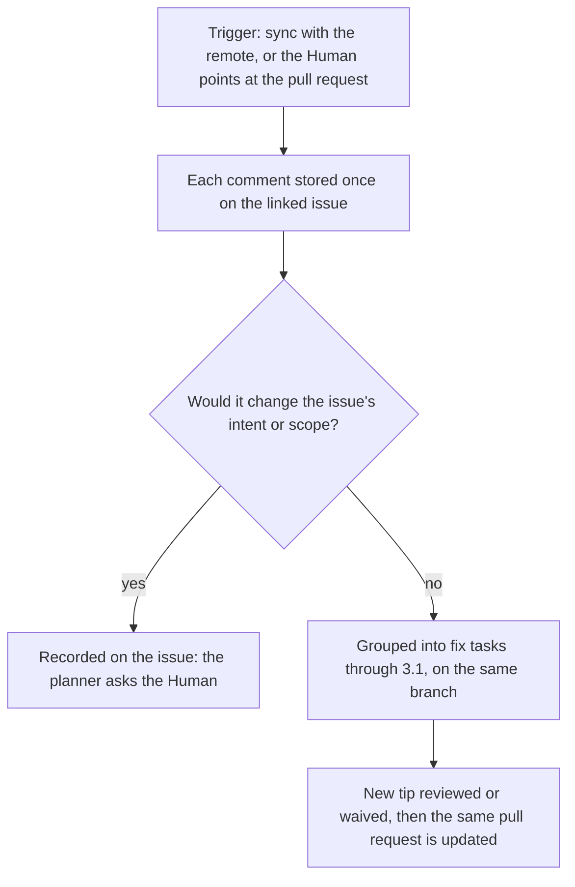
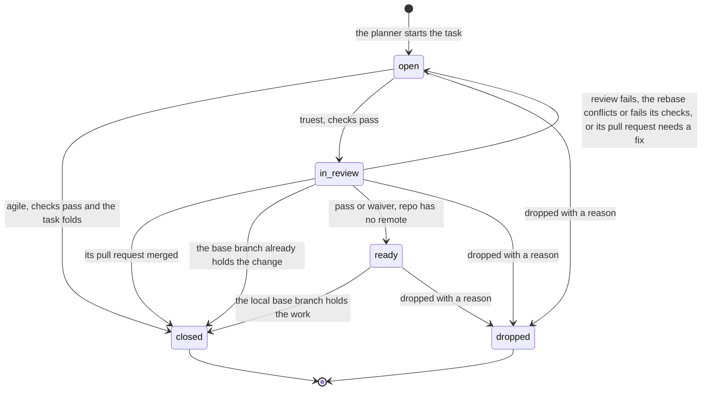

# Agent task handling

Flows 3.1 and 3.5 of [FLOWS.md](FLOWS.md): a task from the Human's ask to the merge, how it fails, its states and how to debug a stuck one. The review and the pull request are in [3_WORKFLOW.md](3_WORKFLOW.md). Branches, worktrees and the push gate are in [3_GIT.md](3_GIT.md).

tmb checks the outcome at these three checkpoints and watches no step in between ([PRINCIPLES.md](../architecture/PRINCIPLES.md), [ENGINE.md](../architecture/ENGINE.md#containment)). What each step leaves in the record is in [TRAJECTORY.md](../architecture/TRAJECTORY.md).

## Units of work

**A task is one change that one agent can finish in one run.** Tasks belong to an issue, and issues can be grouped into a milestone.

| Unit | What it is |
|---|---|
| **Issue** | One goal of the Human's, with the notes and decisions that shaped it |
| **Task** | One change, with a spec: the intent, the files it may touch, the checks that must pass and the success criteria |
| **Milestone** | A group of issues the Human wants to judge as a whole, such as a first usable build |

- **Example 1.** The Human asks for a light and a dark theme. That goal is one issue. The planner splits it into three tasks: the colour tokens, the toggle, and saving the choice.
- **Example 2.** A task is one of two kinds. A worker implements a **code task** ([3.1](#31-task)). The planner writes a **docs task**, a docs or prompts change, itself ([Docs task](#docs-task)). Both end in the same review, merge gate and retry paths.
- **Edge case.** The review mode decides where a task's review happens, and a task keeps the mode it was started in ([3_WORKFLOW.md](3_WORKFLOW.md)).

## Quality layers

**Each step owns one level of quality and hands the next a ready state. No step redoes another step's check** ([PRINCIPLES.md](../architecture/PRINCIPLES.md), [ROLES.md](../architecture/ROLES.md)). A step's method is deterministic, done by the engine, or judgment, made by a role.

- **Example 1.** A check fails at close. It goes back to the author.
- **Example 2.** The reviewer records a finding. It goes back to the author. A design misfit goes back to the planner's spec.
- **Edge case.** A later step or CI catches a cheap check. That is a leak, and it points upstream: the fix is to move the check into the step that owns it. A leak rate per step as the health metric is Planned (trustmybot/tmb#439).

## 3.1 Task

**Any change that touches code is a code task. The planner plans and judges, a worker implements, the reviewer reviews and the Human merges.** The engine does every git step ([ENGINE.md](../architecture/ENGINE.md#containment)).

| Step | Owner | Method | What it guarantees and hands over |
|---|---|---|---|
| Ask | Human | judgment | Intent. When it is vague, the Human and the planner pin it down |
| Record the goal | planner | judgment | An issue titled in the Human's words, saved before any planning, with open questions as a note |
| Spec | planner | judgment | Scoped from the code graph, not by reading files: what to change and why, the files, the checks, and success criteria a check can prove. The planner names the task's kind. Planned (trustmybot/tmb#301): the spec names the flow or design page it implements, and design fit is judged against that page |
| Start the task | engine | deterministic | The task's branch and worktree ([3_GIT.md](3_GIT.md#starting-a-task)) and its brief. Refused until the review mode is set. The engine names the open tasks that share a file, as information |
| Start the worker | host, checked by the gate | deterministic | A worker starts only on an open task whose worktree is ready. The start is recorded as a run |
| Implement | worker | judgment | The spec exactly, in the task's worktree. No edit or command is checked on the way |
| Close | engine | deterministic | The task's and the repo's checks pass on the committed work, or the close is refused and names what failed |
| Fold, review, design fit, pull request, merge | by review mode | | [3_WORKFLOW.md](3_WORKFLOW.md) |

**A close refuses only on its checks, its commit and a clash.**

- **Example 1.** A check fails. The close is refused and names the check.
- **Example 2.** The worktree holds uncommitted work, or the task has no commit past where it was cut. The close is refused.
- **Example 3.** The fold conflicts ([3_WORKFLOW.md](3_WORKFLOW.md#safe-close)), or a docs task's commit holds a file that is not a docs type ([Docs task](#docs-task)). The close is refused.
- **Edge case.** A refused close changes nothing. The task stays open, and the feature branch and the worktree stay as they were.

**Checks never fail open.**

- **Example 1.** A check could not run. It is recorded as not run, with the reason, and the task stays open.
- **Edge case.** A task with no checks never closes.

**A close reports two things without refusing.**

- **Example 1.** The commit changes a file the spec does not list. The close names the file and the spec stays as written. The planner or the reviewer checks those names with git.
- **Example 2.** A file in the main folder changed since the task started. The close lists each one with the command that puts it back, and the planner raises the list to the Human.
- **Edge case.** tmb puts nothing back in the main folder, because the change may be the Human's own.

**Two tasks may change the same file. There is no lock.**

- **Example 1.** A task starts while another open task lists the same file. The engine names that task, as information, and starts the new one.
- **Edge case.** Both tasks change the file. git settles it at the fold, and a clash holds back the later task's close.

**The planner closes the issue.** Planned (trustmybot/tmb#438): it closes itself once all its tasks' commits reach the base branch.

**Planned (trustmybot/tmb#439) at close:** a changelog check, a stale-doc check and a leak check, a probe for each open finding, and a code graph check that no downstream caller breaks.

## Docs task

**A docs task changes docs or prompts and changes no behaviour. The planner writes it, in the worker's place, through 3.1's steps.** These steps differ:

| Step | Owner | What differs |
|---|---|---|
| Name the kind | planner | The planner judges whether a change is docs. A project declares no list of docs paths: such a list is wrong for the next project and the next file |
| Author | planner | The planner writes in the task's worktree. No edit is refused on the way |
| Close | engine | 3.1's checks, plus a check by file type: only prose, data and image types on a fixed list, and files with no extension such as a licence, may change. A type the list does not name counts as code. tmb does not read the file to guess. The list is in the [reference](../reference/README.md#what-a-docs-task-may-change) |
| Review | reviewer | Seen in the same review as the code tasks. The engine cannot tell whether a config or data change alters behaviour; a docs task that did is a blocking finding |

- **Example 1.** A check fails at close. The task stays open: the planner fixes and closes again.
- **Example 2.** The commit touches a file that is not a docs type. The close is refused and names the file. The code part becomes a code task for a worker.
- **Example 3.** The reviewer finds the docs task changed behaviour. That is a blocking finding: that part is redone as a code task.
- **Edge case.** A fold conflict, a rebase conflict, or a failing check after a rebase goes as for a code task ([Retry and escalation](#retry-and-escalation)).

**Planned (trustmybot/tmb#436): the doc-review skill.** The author's self-check and the reviewer's matching checklist.

## Review and the gates

**After the close, a task of either kind passes two more checkpoints: the review and the merge gate. A commit reaches the base branch only when a pass or a Human waiver covers it.** Each has its own page.

| Checkpoint | Rule | Every case |
|---|---|---|
| The review | The reviewer records a verdict on one exact commit: the feature branch's tip in agile mode, the task's commit in truest | [3_WORKFLOW.md](3_WORKFLOW.md) |
| The merge gate | The engine opens the pull request only when a pass or a Human waiver covers that commit | [3_WORKFLOW.md](3_WORKFLOW.md#merge-gate) |
| The push gate | git's pre-push hook refuses a push to the base branch that brings a commit no pass or waiver covers. Every other push is a backup | [3_GIT.md](3_GIT.md#the-push-gate-at-gits-own-hook) |

- **Example 1.** In agile mode the reviewer passes the feature branch's tip. The engine opens the pull request for that commit.
- **Example 2.** In truest mode the reviewer's verdict is on the task's own commit.
- **Example 3.** The engine pushes a feature branch after a fold. That is a backup, and no gate judges it.
- **Edge case.** Someone pushes a commit that no pass or waiver covers straight to the base branch. git's pre-push hook refuses the push.

## Retry and escalation

**A failure goes back to its owner. Nothing waits for a timer: tmb runs only when something calls it.**

- **Example 1.** A check fails at close. The close is refused and names the check. The worker fixes and closes again.
- **Example 2.** A feature branch fails its review. The planner starts a fix task per blocking finding, and the new tip is reviewed again.
- **Example 3.** The approach is wrong. The planner or the Human drops the task with a reason, and a new task names the one it replaces.
- **Edge case.** A run started and never ended. No timer ends it. It is named at the next session start and by the health check, and the planner decides.

**Nothing waits on the Human** except what only the Human may do: a waiver, the review mode, the merge.

**Rework is bounded** (Planned, trustmybot/tmb#400). The number of runs alone never blocks a run; two fails since the last pass do, until the cause is recorded.

Every failure and its path, in the order a task meets them:

| Cause | Path |
|---|---|
| A worker start names no open task | The start is denied, with what would be allowed; the guard decision is recorded |
| The host fails to make the worker | The run ends as stopped, in the record |
| Worker runs out of turns | **Planned (trustmybot/tmb#438):** it commits a checkpoint and hands back; the next run resumes |
| Broken environment or contradictory spec | The worker stops and reports. **Planned (trustmybot/tmb#438):** the task is marked failed and the planner reopens it |
| A check fails at close | The close is refused and names the check, and the failing check run is recorded. The task stays open; the worker fixes and closes again |
| Uncommitted work at close | The close is refused and names the files; then as for a failed check |
| Fold or rebase conflict | The step is undone and names the files; the task stays open until settled |
| Review fail, truest | The review is recorded with its blocking findings and the task reopens in the same worktree. A worker reworks it and closes again for a new review |
| Review fail, feature branch | The planner starts a fix task per blocking finding on the branch; the new tip is reviewed again |
| Two review fails in a row | **Planned** (trustmybot/tmb#400): no worker starts on the task until the planner records the root cause |
| Base branch moved under a feature branch | The engine merges it in before the review; a conflict changes nothing and is settled in a task |
| Checks fail after a truest rebase | The rebase is undone and the task is open again; the worker fixes and closes again |
| Rebased truest commit whose change differs | The task stays in review: one new review of the rebased commit |
| A push to the base branch carries a commit no pass or waiver covers | git refuses the push; the guard decision is recorded |
| A check or a comment fails an open pull request | Agile: the planner starts fix tasks on the branch. Truest, **Planned (trustmybot/tmb#458):** the same task reopens on its branch. The engine updates the pull request once the new commit is reviewed or waived. **Planned (trustmybot/tmb#70):** bringing the comments in ([3.5](#35-pull-request-comment-triage)) |
| Pull request closed without a merge | The branch is recorded as closed and named at session start; a new pull request or a rework task reopens it |
| Work merged outside the flow | The push gate refuses an uncovered push to the base branch. A merge the Human makes by hand on GitHub is the Human's own. **Planned (trustmybot/tmb#438):** its open tasks close, each recorded as a bypass when no review passed |
| Design drift | The planner drops the task and replaces it. **Planned (trustmybot/tmb#438):** the planner amends the spec and reopens |
| Wrong approach, or nobody will finish | The planner or the Human drops the task with a reason; a new task names the one it replaces |
| Nobody will merge the feature branch | The branch is dropped with a reason and kept in git |
| A run started and never ended | Named at the next session start and by the health check; the planner decides |

## 3.5 Pull request comment triage

Planned (trustmybot/tmb#70).

**Each comment on a pull request is stored once on the linked issue. The planner turns it into a fix task, unless it would change the issue's intent or scope: then the planner asks the Human.**

- **Example 1.** A comment changes neither intent nor scope. It is grouped with others into fix tasks on the same branch. The new tip is reviewed or waived, and then the same pull request is updated.
- **Example 2.** A comment would change the issue's scope. It is recorded on the issue and the planner asks the Human. Intent stays the Human's.
- **Example 3.** The comments are fetched a second time. A per-pull-request cursor means the re-fetch returns only newer comments, so each is stored once.
- **Edge case.** A pull request cannot be resolved. It is skipped, and the gap is recorded.

## Task lifecycle

**Every task of both kinds moves through one state machine. Each move is added to the record as an event, the current state is derived from the events, and the engine is the only writer.**

| State | Means |
|---|---|
| open | Work may be done on it. The task's runs say whether an agent is on it. A stuck task stays open until the planner resumes or drops it |
| in_review | A truest task whose checks passed: waiting at its commit for the review, then with its pull request open. The newest review of the commit says where it stands |
| ready | Covered by a pass or a waiver in a repo with no remote, waiting for the Human's local merge |
| closed | Final. An agile task is folded, with its mode recorded; the review or waiver is on the feature branch. A truest task's pull request merged |
| dropped | Final, with a reason. The task that replaces it names it |
| failed | **Planned (trustmybot/tmb#438).** A task whose worker stopped on a broken environment or a contradictory spec ([Retry and escalation](#retry-and-escalation)) |

**Planned (trustmybot/tmb#458).** A truest task stays in review while its pull request is open, and a fix reopens the same task on the same branch.

**Closed and dropped are final.**

- **Example 1.** Closed agile work needs rework. The rework is a new fix task on the feature branch.
- **Example 2.** A task is dropped. Its work reaches no branch. A new task can name the dropped task it replaces, so a chain of retries reads as one line.
- **Edge case.** Dropping keeps what holds work ([3_GIT.md](3_GIT.md#closing-a-task)).

**Review is the default, and only the Human waives it.**

- **Example 1.** A truest task is in review. It keeps its worktree. Only a reviewer run records the verdict, and only on the task's current commit.
- **Example 2.** An agile task closes unreviewed. Its review state is on the feature branch, not the task ([3_WORKFLOW.md](3_WORKFLOW.md#review-state)).
- **Example 3.** The Human waives a review. A waiver is given per truest task or per feature branch, with a reason, on a terminal with a typed yes. It counts as a pass on the current commit and is kept in the record as a waiver. The planner never waives.
- **Edge case.** The repo has no remote, so the reviewed task is ready. The Human merges locally with the command tmb gives, and tmb then counts the work as merged ([3_WORKFLOW.md](3_WORKFLOW.md#a-project-with-no-remote)). A ready task the Human will not merge is dropped.
- **Open, for the Human:** waivers wider than one task or one branch (a listed set, an issue, a session's docs tasks).

**Auditing is a join.** A task's story is its events in order, joined with its runs, check runs and reviews.

- **Example.** A task went from in_review back to open. Its events give the move, and the review joined to it gives the blocking findings.

**Planned moves and stops:**

- **Planned (trustmybot/tmb#438):** each move names a cause from a fixed list and the record it rests on, and the record refuses a move without it.
- **Planned (trustmybot/tmb#438):** a move the planner takes by hand carries a note saying why, so no bypass is silent.
- **Planned (trustmybot/tmb#438):** closing an issue ends its open tasks.
- **Planned: freeze** (trustmybot/tmb#64). The Human stops all work in a project with one request: task and agent starts, closes and pull requests are denied until it is lifted. Reads stay allowed.

## Debugging a stuck task

**tmb has no watcher, so a stuck task is found at the next session start or by `tmb doctor`** ([TRAJECTORY.md](../architecture/TRAJECTORY.md)).

- **Example 1.** A task is open and nothing works on it. `tmb doctor` lists runs with no end and open code tasks with no run. The planner resumes the task or drops it.
- **Example 2.** The task will not close. The refusal names the cause: a failing check, uncommitted work, a conflict with the feature branch, no checks set, or, for a docs task, a file that is not a docs type.
- **Edge case.** Every command stops. The record is unreadable or from a newer tmb. `tmb doctor` still runs and names the cause.

The other symptoms:

| Symptom | Where to look |
|---|---|
| No task will start | The review mode is not set: the Human runs `tmb onboard`. Or the issue is closed |
| The worker will not start | Its start prompt must carry the task's id line from the brief, and the task must be open with its worktree present. In a multi-repo workspace the start must come from inside the task's repo, and the deny names the folder. Reading the repo from the task is Planned (trustmybot/tmb#463) |
| The reviewer's verdict is refused | No reviewer run is open, the commit is not the branch's current tip, or the task is not in review at that commit |
| The pull request will not open | No pass or waiver covers the tip or the commit. The Human waives with `tmb feature waive` or `tmb task waive` |
| The push is denied | It goes to the base branch and carries a commit no pass or waiver covers, or the record cannot be read. The hook's message names the cause |
| The push gate is off | Another tool owns the pre-push hook: `tmb doctor --fix` or `tmb onboard --add-push-gate` |
| A branch stays ready after a local merge | The base branch changed the same lines again; drop it with a reason that says where the work went |
