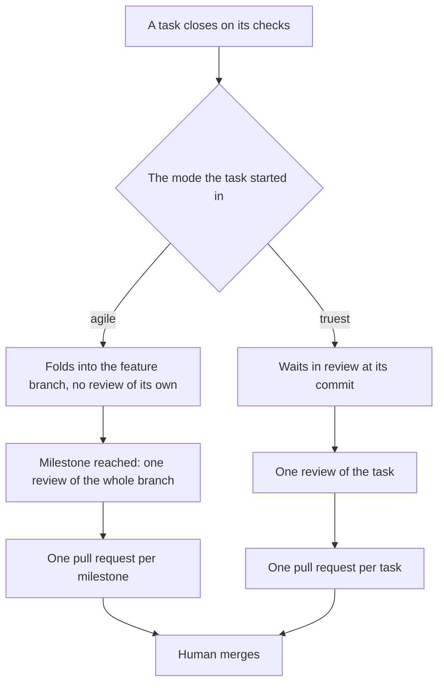
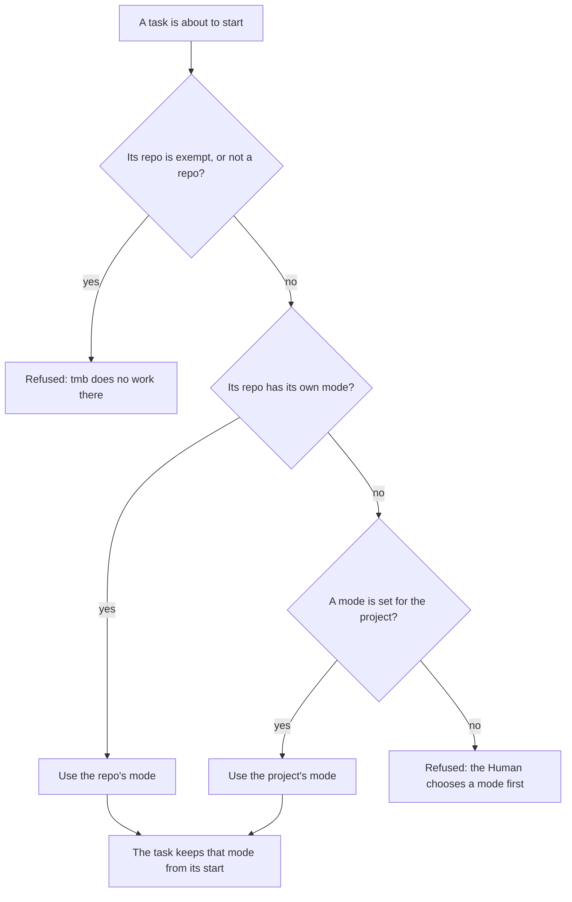
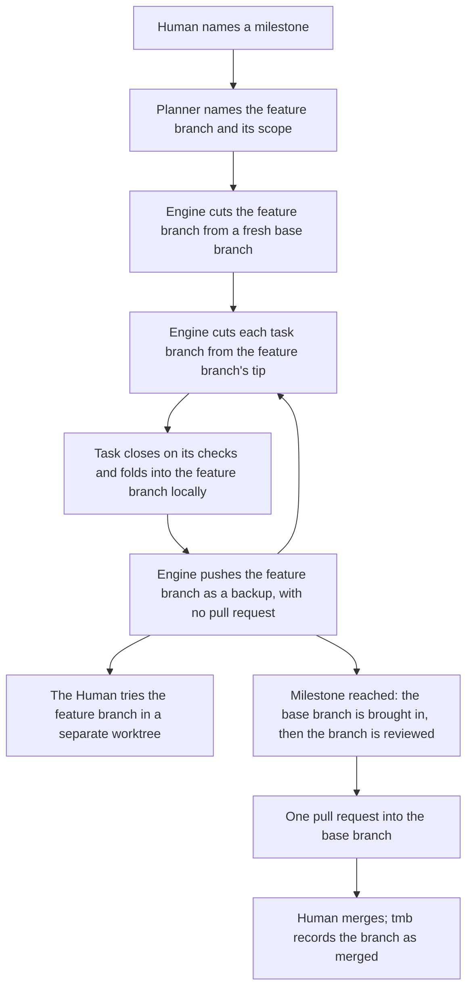
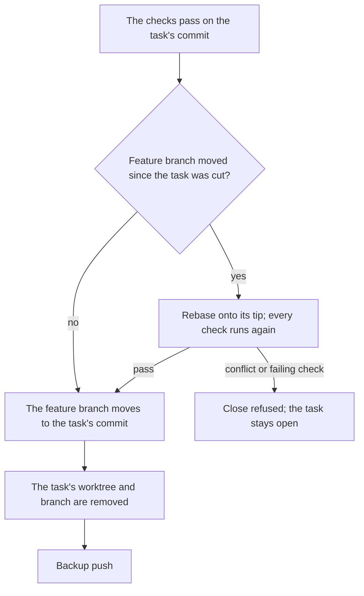
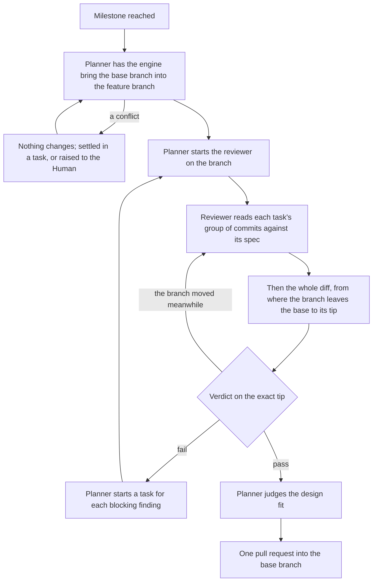
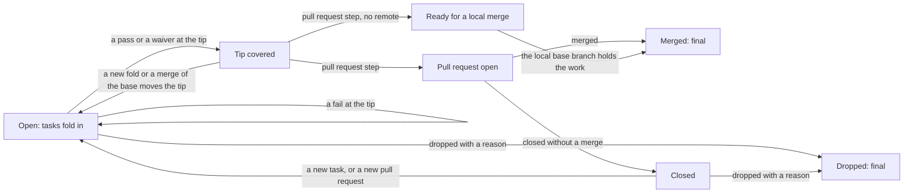
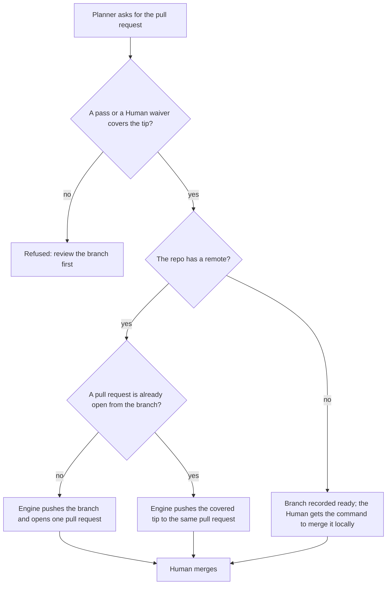
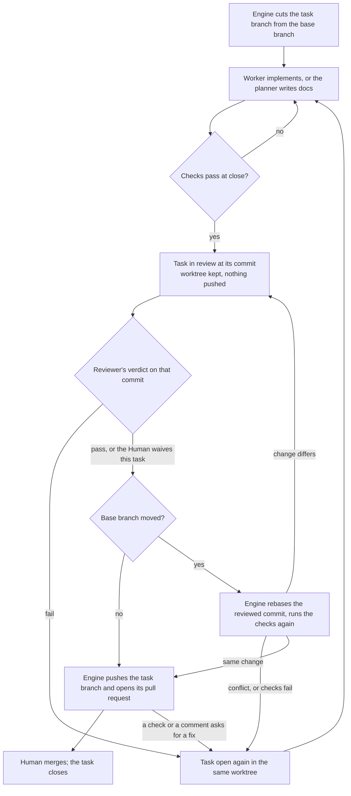

# Workflow modes

The two review modes, agile and truest: how the mode is set and changed, and how each mode takes a closed task through the review and the pull request to the base branch. These are flows 3.9 and 3.10 in [FLOWS.md](FLOWS.md). A task's steps up to its close are in [3_TASKS.md](3_TASKS.md), and branches, worktrees and the push gate are in [3_GIT.md](3_GIT.md).

## The two modes

**The two modes differ in one thing: the unit of review.** Who merges is a separate question: the Human does, in both modes.

| | **Agile** (recommended; the Human chooses) | **Truest** |
|---|---|---|
| Reviewed | The whole feature branch, once | Each task |
| A task branch is cut from | The feature branch | The base branch |
| Reaches the base branch as | One pull request per milestone | One pull request per task |
| A failed review | Fix tasks on the feature branch | The same task reopens |
| For | A feature built in many small tasks and judged as a whole | A change that stands alone, such as a bug fix |

**The gates are the same in both.** The engine opens a pull request only on a covered commit, and git refuses an uncovered push to the base branch ([Merge gate](#merge-gate)).

**The review itself is the same in both.** The planner starts the reviewer on a feature branch or on a task. The verdict is a pass or a fail on one exact commit, and the newest verdict on a commit decides. What the reviewer reads and judges is in [ROLES.md](../architecture/ROLES.md).

- **Example 1.** Agile: a milestone's tasks each close on their checks and fold into the feature branch. The reviewer judges the branch once, and it reaches the base branch as one pull request.
- **Example 2.** Truest: a task's checks pass and it waits in review at its commit. Once it passes, it gets its own pull request.
- **Example 3.** The verdict is a pass. The planner reads it from the record, judges the design fit and asks for the pull request without being told.
- **Example 4.** A repo is truest. The planner cannot widen the unit: it reviews every task and batches none. Only the Human waives.
- **Edge case.** The verdict is a fail. The planner sends the work back to its author without asking the Human.

## Where the review mode is set

**A task takes its repo's mode, else the project's, and keeps it from its start.** Every flow in group 3 runs under the mode its task started in.

- **Only the Human chooses the mode,** because it decides how many tokens the project uses. tmb marks agile as recommended and shows what each mode costs. It never picks. A fence keeps the choice the Human's ([ENGINE.md](../architecture/ENGINE.md#ways-into-the-engine)).
- **The Human is asked at onboarding** ([2_ONBOARD.md](2_ONBOARD.md)).
- **A repo that names no mode follows the workspace's,** and follows it when it changes ([3_GIT.md](3_GIT.md#multi-repo-workspaces)).
- **The mode lives in the record,** and every change is kept as a setting change ([CONFIG.md](../architecture/CONFIG.md)).

- **Example 1.** The project's mode is agile and the repo names none. The task starts agile.
- **Example 2.** The workspace is agile and one repo names truest. A task in that repo starts truest.
- **Edge case.** No mode is set anywhere. No task starts until the Human chooses.

## Switching review modes

**Only the Human switches, by the same fence as the first choice. A change applies to tasks started after it.**

- **Example 1.** The Human changes the project's mode. Tasks started later use it, in every repo that names no mode of its own.
- **Example 2.** The Human changes one repo's mode. Tasks started later in that repo use it.
- **Edge case.** A task is open when the mode changes. It keeps the mode it started in and finishes under it.

## Agile mode

**One feature branch per milestone, reviewed once.** Each task closes on its checks alone and folds into the branch locally. The checks replace the per-task review and CI run.

Agility is the one goal: the feature reaches a state the Human can try, change or drop sooner, with fewer reviews and CI runs on the way.

### The feature branch

**One feature branch collects every task of a milestone.**

- **No approval.** The planner names the branch and starts it without asking. The Human can ask for another name.
- **Pushed only as a backup.** No pull request opens before the review, so no CI runs on the branch.
- **The base branch is brought in before the review.** The planner asks the engine for it at the milestone, and earlier whenever the base moved ([3_GIT.md](3_GIT.md#keeping-the-base-fresh)).
- **How it ends.** Merged, closed or dropped ([Merge gate](#merge-gate)). tmb never deletes the branch.

- **Example 1.** A task closes. Its branch was cut from the feature branch's tip and folds back into it, so the next task builds on the last.
- **Example 2.** A request adds to an open branch's work. It becomes the next task on that branch. A new branch is only for separate work.
- **Example 3.** The Human tries the feature in the branch's own worktree. The engine cuts and moves the branch without checking it out, so the main folder never switches under a session.
- **Edge case.** In a multi-repo workspace, a feature branch belongs to one repo, and its tasks work in that repo. Feature names are unique in the record.

### Safe close

**Dropping the per-task review removes one gate and nothing else.** The close still refuses on its checks ([3_TASKS.md](3_TASKS.md#31-task)), and then the task folds.

- **Example 1.** The feature branch has not moved since the task was cut. The branch moves to the task's commit, and the task's worktree and branch are removed. What keeps a worktree is in [3_GIT.md](3_GIT.md#closing-a-task).
- **Example 2.** Another task folded first. The later task is rebased onto the new tip and every check runs again, so a concurrent fold is never lost.
- **Example 3.** The rebase hits a conflict, or a check fails after it. The close is refused, and the task stays open until the clash is settled.
- **Edge case.** The backup push is never forced, and a failed push does not reopen the task. It is skipped when there is no remote, and while the branch's pull request is open.

### Feature branch review

**At the milestone, one reviewer judges the whole branch, and its verdict is on one commit: the tip.**

- **A group per task.** The branch's brief lists each closed task's commits in the order they landed. The reviewer reads each group against its spec before it reads what the tasks break together.
- **Whole diff.** The review reads what the feature branch adds to the base branch.
- **Docs tasks are in the same review** ([3_TASKS.md](3_TASKS.md#docs-task)).
- **The planner judges the design fit once,** on the whole branch after the reviewer, not at each close.

- **Example 1.** A later task undid an earlier task's change. That change is never reviewed.
- **Example 2.** A conflict was settled on the branch. The reviewer reads it in its settled form.
- **Example 3.** The branch does not hold the base. Nothing refuses the review; the brief says whether the branch holds the base, and that is how the planner and the reviewer know.
- **Edge case.** The branch moves while the reviewer reads. tmb takes a verdict only on the branch's current tip, so the reviewer reads again.

### Review state

**tmb keeps no review state per task.** An agile task is open, closed or dropped, and review is a fact about one commit: the feature branch's tip.

- **Example 1.** The newest verdict on the tip is a pass, or the Human waived the review on it. The tip is covered.
- **Example 2.** A new commit lands on the branch. The moved tip is uncovered, and it needs a new pass or waiver before it reaches the pull request.
- **Example 3.** The verdict on the tip is a fail. The planner starts a task for each blocking finding, and the new tip is reviewed again.
- **Edge case.** The Human waives the tip, and a later verdict on it is a fail. The waiver is the Human's call, so the fail does not undo it.

### Merge gate

**The feature branch reaches the base branch only through one gated pull request.** The engine opens it only when a pass or a Human waiver covers the tip. A push straight to the base branch meets the push gate ([3_GIT.md](3_GIT.md#the-push-gate-at-gits-own-hook)).

- **Waivers.** Only the Human waives a review ([3_TASKS.md](3_TASKS.md#task-lifecycle)). A waiver names one feature branch at its tip, so it covers one repo and nothing folded in later. The record keeps it as a waiver, and the commit's mark on GitHub says the review was waived.
- **What tmb does not gate.** A pull request the Human opens by hand, and the merge button. The commit's mark on GitHub stops a merge only when the Human makes it a required check ([3_GIT.md](3_GIT.md#beyond-the-local-hook)).
- **Merged is final.** tmb reads the pull request's state through the Human's own GitHub command line. A read that fails changes nothing. The session start names each pull request that ended since the last session. **Planned (trustmybot/tmb#458):** the sync with the remote (trustmybot/tmb#70) reads the state, and the session start reports it from the record without calling GitHub.
- **Dropped is final.** The planner or the Human drops a branch nobody will merge, with a reason. The branch is kept in git.

- **Example 1.** A pass covers the tip and no pull request is open. The engine pushes the branch and opens one pull request, and the Human merges it.
- **Example 2.** Nothing covers the tip. The engine refuses the pull request: the branch is reviewed first.
- **Edge case.** A drop is refused while a task on the branch is open or in review, and while its pull request is open. The Human closes the pull request first.

### New work on a branch whose pull request is open

**The branch takes more tasks. The engine holds its backup push until the new tip is covered, so it moves the pull request only to a reviewed tip.**

- **Example 1.** A check fails on the pull request, or a review comment asks for a fix. The fix is a task on the same branch.
- **Example 2.** New work builds on what the branch holds. The base branch does not hold that work yet, so a new branch could not build on it. The planner does not stop to ask. It says in its reply that the pull request grows.
- **Example 3.** The task folds, or the base is merged in. The new commits are not pushed, and the answer says so. They stay in the local branch until the new tip is passed or waived.
- **Edge case.** The new tip is covered. The pull request step pushes it to the same pull request and opens no second one.

**Planned (trustmybot/tmb#70).** Comments on an open pull request are brought into the record and sorted into tasks.

### A project with no remote

**Nothing is pushed and no pull request opens.** A close skips the backup push and says so. Once the tip is covered, the pull request step records the branch ready and gives the Human the command to merge it locally.

- **Example 1.** The Human merges with that command. Once the local base branch holds the tip, tmb records the branch as merged.
- **Example 2.** The Human squashes or rebases by hand. That also counts, when merging the branch into the base would change nothing. A branch with no commit of its own never counts.
- **Example 3.** A ready branch takes a fix task. The first one opens it again, and its new tip needs a new pass or waiver.
- **Edge case.** The base changed the same lines again after the merge, so tmb cannot tell. The branch stays ready until it is dropped with a reason that says where the work went.

A truest task is recorded ready the same way ([3_GIT.md](3_GIT.md#rebasing-a-reviewed-task)).

### A closed feature branch taken up again

**A branch whose pull request closed without a merge is recorded as closed, and the planner's session start says so.** It can be taken up three ways:

| The Human or the planner | What tmb does |
|---|---|
| Asks for a new pull request | Opens it under the same rule: a pass or a waiver at its tip. A tip the earlier review covers needs no new review |
| Starts a task that names the branch | Opens the branch again for rework |
| Reopens the pull request on GitHub (the Human) | Records it and opens none. The record keeps the earlier pull request's link |

## Truest mode

**Every task is reviewed on its own.** There is no feature branch: every task is cut from the base branch and gets its own review and its own pull request.

- **Example 1.** A task's checks pass at close. Nothing is pushed: the task waits at its commit, in its own worktree, for the reviewer.
- **Example 2.** The reviewer passes the task's commit. The verdict is recorded for that exact commit, and the engine pushes the branch and opens the task's pull request.
- **Example 3.** The Human waives the review of one task. Only the Human can, and a waiver covers one task ([3_TASKS.md](3_TASKS.md#task-lifecycle)).
- **Edge case.** The base branch moved before the first push. The engine rebases the reviewed commit once and runs the checks again ([3_GIT.md](3_GIT.md#rebasing-a-reviewed-task)).

The gates are the same as in agile mode ([Merge gate](#merge-gate)). Every failure path is in [3_TASKS.md](3_TASKS.md#retry-and-escalation).

**Planned (trustmybot/tmb#458).** The task stays in review while its pull request is open and closes when it merges. A fix reopens the same task on the same branch, and its new commit is reviewed before the pull request is updated.

**Planned (trustmybot/tmb#442).** The review queue: the tasks waiting for review, proposed in groups by the files they changed, one reviewer per group in parallel.
