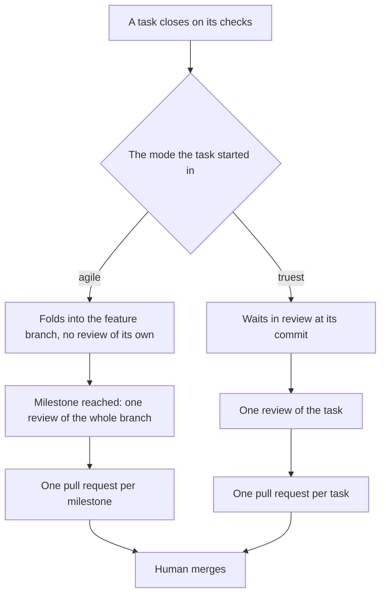
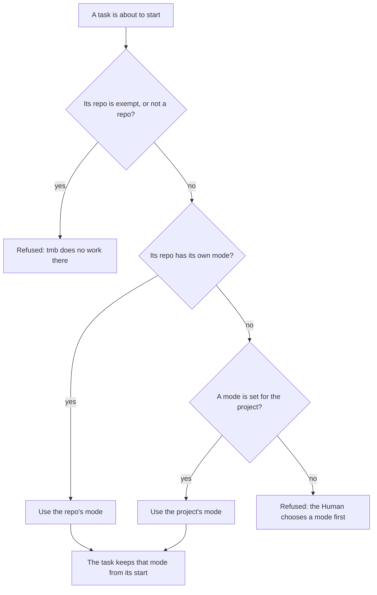
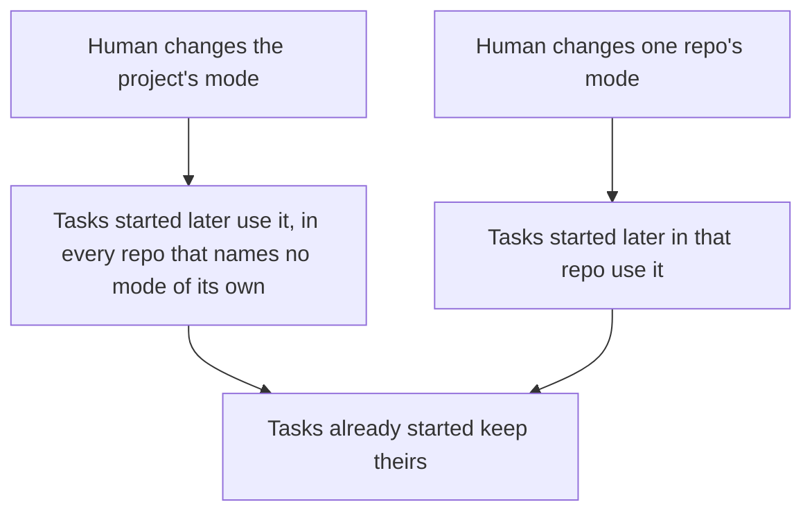
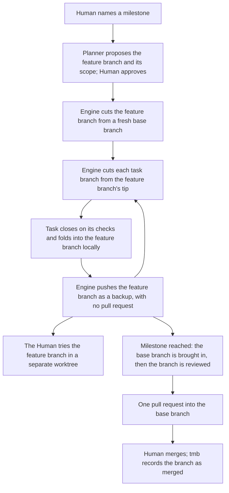
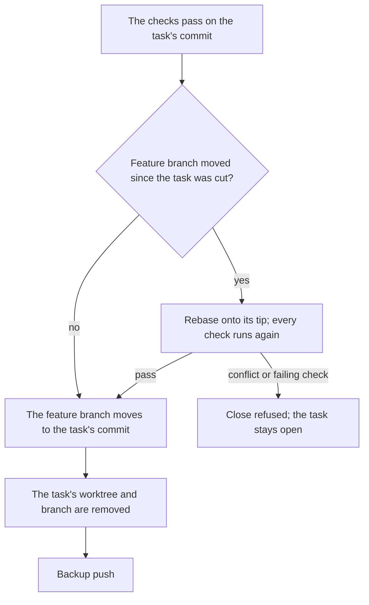
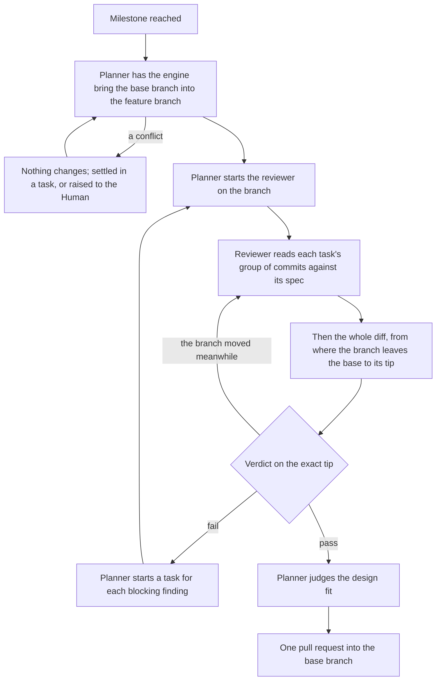
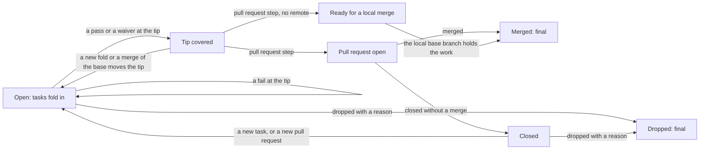
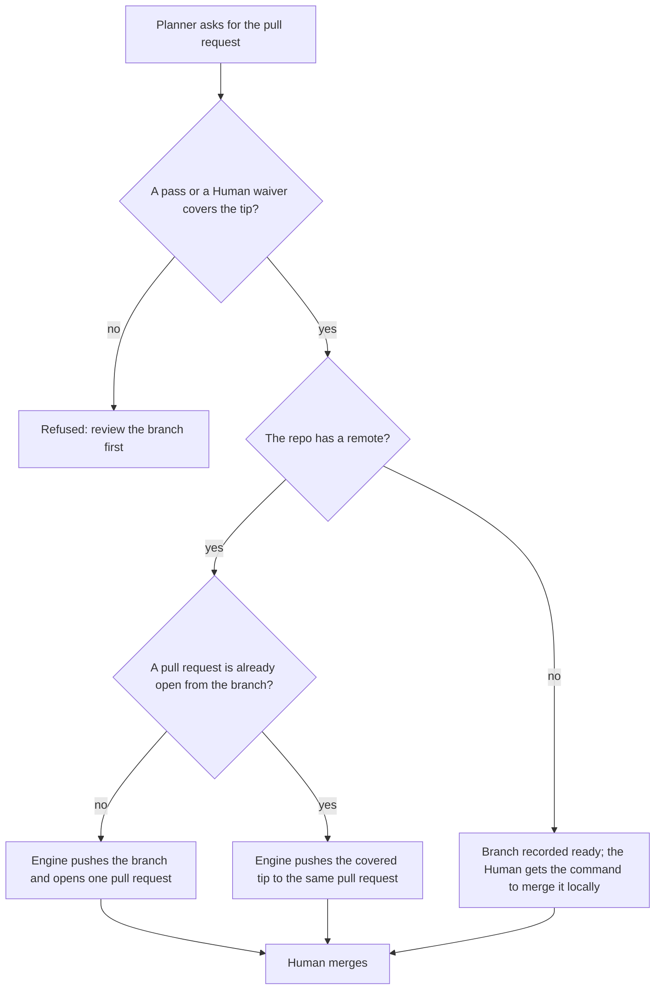
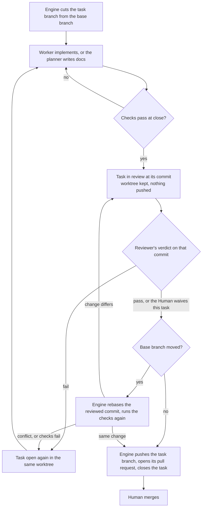

# Workflow modes

Every case of flows 3.9 and 3.10 in [FLOWS.md](FLOWS.md): the two review modes, how the mode is set and changed, and how each mode takes a closed task through the review and the pull request to the base branch. A task's own steps up to its close are in [3_TASKS.md](3_TASKS.md).

The review mode decides who reviews a change and when. Who merges is a separate question: the Human does.

## The two modes

| Mode | Review | Reaches the base branch as | For |
|---|---|---|---|
| **Agile** (recommended; the Human chooses) | Once, on the whole feature branch | One pull request per milestone | A feature built in many small tasks and judged as a whole |
| **Truest** | On every task, before its push | One pull request per task | A repo where nothing may reach the base branch unreviewed |

- **Only the Human chooses the mode,** because it decides how many tokens the project uses. tmb marks agile as recommended and shows what each mode costs. It never picks: until a mode is chosen, no task starts.
- **A mode per repo.** Every flow in group 3 runs under the mode its task started in.
- **The review itself is the same in both.** The planner starts the reviewer on a feature branch or on a task. The verdict is a pass or a fail on one exact commit, and the newest verdict on a commit decides. What the reviewer reads and judges is in [ROLES.md](../architecture/ROLES.md).
- **After a pass,** the planner reads the verdict from the record, judges the design fit and asks for the pull request without being told.
- **After a fail,** the planner sends the work back to its author without asking the Human.

## Where the review mode is set

A task takes its repo's mode, else the project's, and keeps it from its start.

- **Example 1.** The project's mode is agile and the repo names none. The task starts agile.
- **Example 2.** The workspace is agile and one repo names truest. A task in that repo starts truest.
- **Edge case.** No mode is set anywhere. The start is refused until the Human chooses.
- **The Human is asked at onboarding** ([2_ONBOARD.md](2_ONBOARD.md)).
- **A repo that names no mode follows the workspace's,** and follows it when it changes ([3_GIT.md](3_GIT.md#multi-repo-workspaces)).
- **A fence keeps the choice the Human's** ([ENGINE.md](../architecture/ENGINE.md#ways-into-the-engine)).
- **The mode lives in the record,** and every change is kept as a setting change ([CONFIG.md](../architecture/CONFIG.md)).

## Switching review modes

Only the Human switches, by the same fence as the first choice. A later change applies to tasks started after it.

- **Example 1.** The Human changes the project's mode. Tasks started later use it, in every repo that names no mode of its own.
- **Example 2.** The Human changes one repo's mode. Tasks started later in that repo use it.
- **Edge case.** A task opened under one mode finishes under it.

## Agile mode

Agility is the one goal: the feature reaches a state the Human can try, change or drop sooner, with fewer reviews and CI runs on the way.

**One feature branch per milestone.** Each task closes on its checks alone and folds into the branch locally. The checks replace the per-task review and CI run.

### The feature branch

One feature branch collects every task of a milestone.

- **A request that adds to an open branch's work is its next task there.** A new branch is only for separate work.
- **One repo.** In a multi-repo workspace, a feature branch belongs to one repo, and its tasks work in that repo. Feature names are unique in the record.
- **Tasks fold into it.** Each task branch is cut from the feature branch's tip and folds back into it once the task closes, so the next task builds on the last.
- **Pushed only as a backup.** No pull request opens before the review, so no CI runs on the branch.
- **Tried in its own worktree.** The engine cuts and moves the branch without checking it out, so the main folder never switches under a session.
- **The base branch is brought in before the review.** The planner asks the engine for it at the milestone, and earlier whenever the base moved ([3_GIT.md](3_GIT.md#keeping-the-base-fresh)).
- **How it ends.** Merged, closed or dropped ([Merge gate](#merge-gate)). tmb never deletes the branch.

### Safe close

Dropping the per-task review removes one gate and nothing else. The close still refuses on its checks ([3_TASKS.md](3_TASKS.md#31-code-task)), and then the task folds.

- **A concurrent fold is never lost.** The later task is rebased, and a clash holds back its close until it is settled.
- **The backup push is never forced,** and a failed push does not reopen the task. It is skipped when there is no remote, and while the branch's pull request is open.
- **What keeps a worktree** is in [3_GIT.md](3_GIT.md#closing-a-task).

### Feature branch review

At the milestone, one reviewer judges the whole branch, and its verdict is on one commit: the tip.

- **A group per task.** The branch's brief lists each closed task's commits in the order they landed, so the reviewer reads each against its spec before it reads what the tasks break together.
- **Whole diff.** The review reads what the feature branch adds to the base branch. A change a later task undid is never reviewed, and a conflict settled on the branch is reviewed in its settled form.
- **Docs tasks are in the same review** ([3_TASKS.md](3_TASKS.md#32-non-code-task)).
- **The brief says whether the branch holds the base.** Nothing refuses a review of a branch that does not; the brief is how the planner and the reviewer know.
- **The verdict is on one commit.** tmb takes it only on the branch's current tip.
- **The planner judges the design fit once,** on the whole branch after the reviewer, not at each close.
- **A second host can be the reviewer.** It is told at session start which branches wait for a review ([ADAPTERS.md](../architecture/ADAPTERS.md)).

### Review state

tmb keeps no review state per task. An agile task is open, closed or dropped, and review is a fact about one commit: the feature branch's tip.

- **Covered** means the newest verdict on that exact commit is a pass, or the Human waived the review on it.
- **A moved tip is uncovered.** Any new commit on the branch needs a new pass or waiver before it reaches the pull request.
- **A fail sends the work back.** The planner starts a task for each blocking finding, and the new tip is reviewed again.
- **Edge case.** The Human waives the tip, and a later verdict on it is a fail. The waiver is the Human's call, so the fail does not undo it.

### Merge gate

The feature branch reaches the base branch only through one gated pull request.

- **The push gate backs it** ([3_GIT.md](3_GIT.md#the-push-gate-at-gits-own-hook)).
- **Waivers.** Only the Human waives a review ([3_TASKS.md](3_TASKS.md#task-lifecycle)). A waiver names one feature branch at its tip, so it covers one repo and nothing folded in later. The record keeps it as a waiver, and the commit's mark on GitHub says the review was waived.
- **Merged is final.** tmb reads the pull request's state through the Human's own GitHub command line: at the planner's session start, when the branches are listed, and for the dashboard. A read that fails changes nothing. The session start names each pull request that ended since the last session.
- **Dropped work.** The planner or the Human drops a branch nobody will merge, with a reason. Dropped is final, and the branch is kept in git.
- **A drop is refused** while a task on the branch is open or in review, and while its pull request is open: the Human closes the pull request first.

#### New work on a branch whose pull request is open

The branch takes more tasks, and no unreviewed commit reaches the open pull request.

- **What it takes.** Fixes for a failing check or a review comment, and new work that builds on what the branch holds. The base branch does not hold that work yet, so a new branch could not build on it.
- **The planner does not stop to ask.** It says in its reply that the pull request grows.
- **New commits wait locally.** A fold or a merge of the base is not pushed, and the answer says so. The commits stay in the local branch until the new tip is passed or waived.
- **Same pull request.** The pull request step then pushes the tip to it and opens no second one.

#### A project with no remote

Nothing is pushed and no pull request opens. A close skips the backup push and says so. Once the tip is covered, the pull request step records the branch ready and gives the Human the command to merge it locally.

- **tmb sees the local merge.** Once the local base branch holds the tip, the branch is merged.
- **A squash or a rebase by hand also counts,** when merging the branch into the base would change nothing. A branch with no commit of its own never counts.
- **One limit.** When the base changed the same lines again after the merge, tmb cannot tell. The branch stays ready until it is dropped with a reason that says where the work went.
- **A ready branch takes fix tasks.** The first one opens it again, and its new tip needs a new pass or waiver.
- **A truest task is recorded ready the same way** ([3_GIT.md](3_GIT.md#rebasing-a-reviewed-task)).

#### A closed feature branch taken up again

A branch whose pull request closed without a merge is recorded as closed, and the planner's session start says so. It can be taken up three ways:

| The Human or the planner | What tmb does |
|---|---|
| Asks for a new pull request | Opens it under the same rule: a pass or a waiver at its tip. A tip the earlier review covers needs no new review |
| Starts a task that names the branch | Opens the branch again for rework |
| Reopens the pull request on GitHub (the Human) | Records it and opens none. The record keeps the earlier pull request's link |

## Truest mode

Nothing reaches the base branch unreviewed. There is no feature branch: every task is cut from the base branch and gets its own review and its own pull request.

- **A review per task.** The reviewer judges the task's commit, and the verdict is recorded for that exact commit.
- **A waiver per task,** by the Human alone ([3_TASKS.md](3_TASKS.md#task-lifecycle)).
- **Nothing is pushed before the review.** The task waits at its commit, in its own worktree.
- **The rebase runs once, before the first push** ([3_GIT.md](3_GIT.md#rebasing-a-reviewed-task)).
- **The push gate holds here too** ([3_GIT.md](3_GIT.md#the-push-gate-at-gits-own-hook)).
- **Every failure path** is in [3_TASKS.md](3_TASKS.md#34-retry-and-escalation).

## Planned

- **The review queue** (trustmybot/tmb#442). The tasks waiting for review, proposed in groups by the files they changed, one reviewer per group in parallel.
- **Comments on an open pull request** brought into the record and sorted into tasks (trustmybot/tmb#70).
