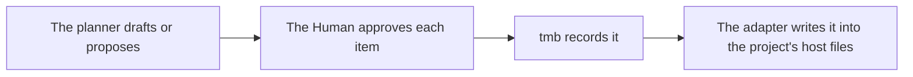
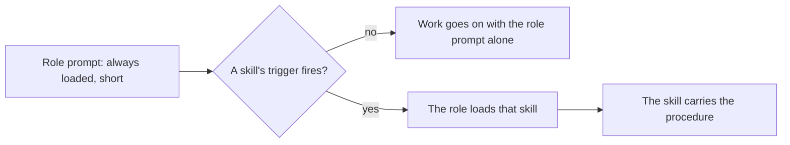
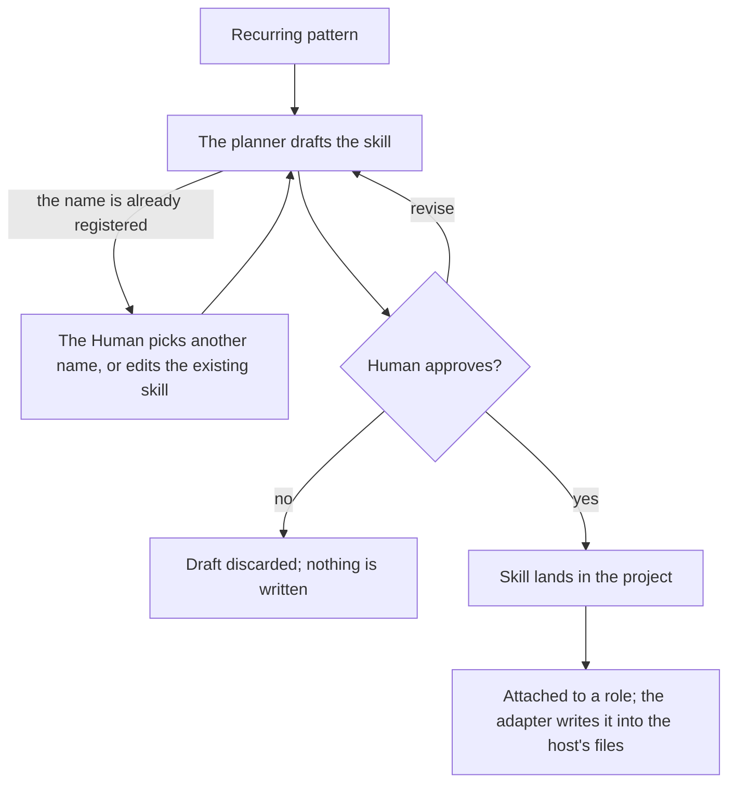
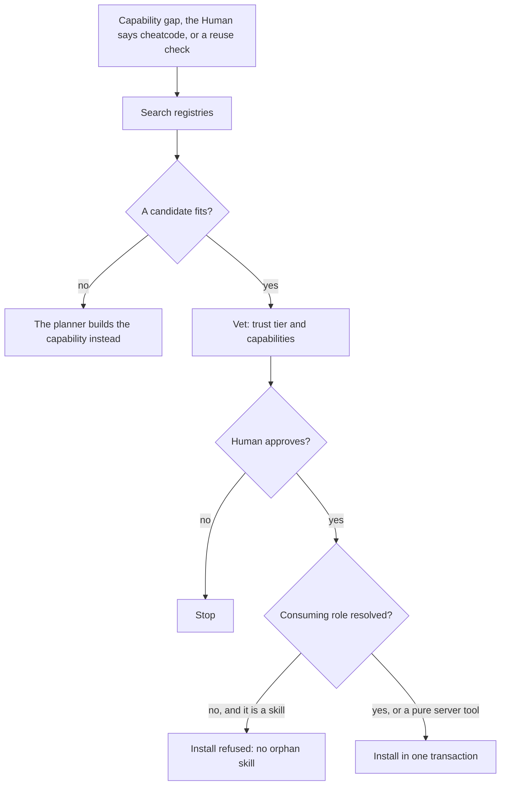
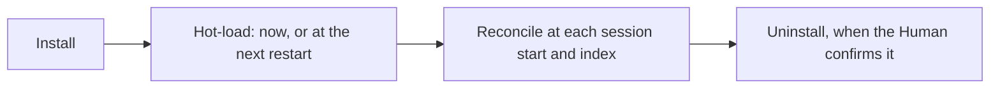
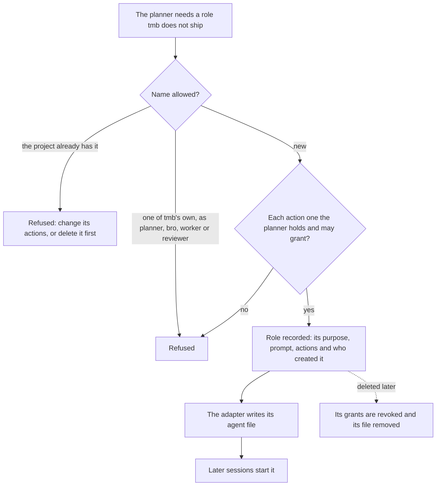
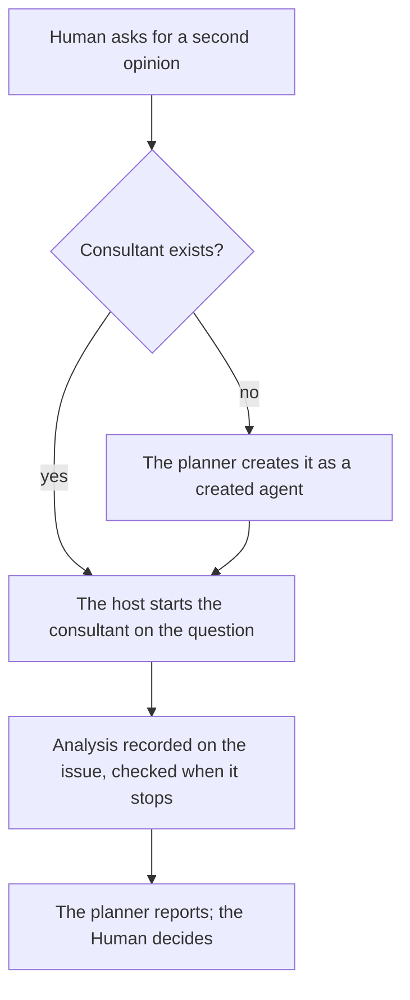

# Extending the team

What a project adds to its team: skills, cheatcodes (published capabilities), created agents and consultants. This page holds every case of flows 4.1 and 4.2 in [FLOWS.md](FLOWS.md). What each agent may do once it exists is in [ROLES.md](../architecture/ROLES.md).

tmb ships three roles, planner, worker and reviewer, and six skills of its own. The rest of this page is **Planned**: the tmb skills not shipped yet (trustmybot/tmb#495), cheatcodes (trustmybot/tmb#112), and project skills, consultants and the recording of a created agent's runs (trustmybot/tmb#437).

| Section | Flow | Adds |
|---|---|---|
| [tmb's own skills](#tmbs-own-skills) | | A procedure a shipped role loads when needed |
| [Skills](#skills) | 4.2 Creating an agent or a skill | A project skill |
| [Cheatcodes](#cheatcodes) | 4.1 Cheatcode lifecycle | A published skill, tool server or host plugin |
| [Created agents](#created-agents) | 4.2 Creating an agent or a skill | A project agent |
| [Consultants](#consultants) | 4.2 Creating an agent or a skill | A second opinion |

## Nothing is written without the Human's approval

This rule holds for skills and cheatcodes. A created agent is the planner's own call, signed in the record ([Created agents](#created-agents)). The planner drafts or proposes, the Human approves each item, and only then does tmb record it and write it. The approval is the Human's: a yes typed on a terminal, like a waiver ([ENGINE.md](../architecture/ENGINE.md#ways-into-the-engine)).

- **Example 1.** The planner drafts a skill and the Human says yes. The skill lands in the project.
- **Example 2.** The planner drafts a skill and the Human says no. The draft is discarded and nothing is written.
- **Edge case.** The Human asks for a change to the draft. The planner revises it and asks again.
- **Where.** Each recorded item is one `extensions` row ([TRAJECTORY.md](../architecture/TRAJECTORY.md#extensions)).
- **Edge case.** An agent writes the file itself, around the approval. tmb watches no file write, but the file is not in the record, so tmb never routes work to it.

## tmb's own skills

**A tmb skill holds one situational procedure of tmb's own harness.** A role loads it when its trigger fires, so the role's always-loaded prompt stays short.

- **Example 1.** A session starts in a project whose settings are empty. The planner loads the onboarding skill.
- **Example 2.** A check fails at a task's close. The planner loads the recovery skill.
- **Edge case.** No trigger fires. The role works from its prompt alone.

Skills are written once, like the roles, and the adapter writes them in the host's format. The placement test in [JUDGMENT_LAYER.md](../prompt-engineering/JUDGMENT_LAYER.md) decides what goes in a role's prompt, a skill or code.

The procedures tmb's skills hold:

| Procedure | Loaded by | When |
|---|---|---|
| Onboarding: the base branch, the checks, the review mode question, the project's areas | Planner | A session starts in a project whose settings are empty (flow 2.1) |
| Writing a spec and scoping it from the code graph | Planner | Before each code task (flow 3.1) |
| The code graph's areas and concepts | Planner | It adds, changes or removes an area or a concept (flow 2.2) |
| Retry and escalation | Planner | A check fails at close, a review fails, a fold or rebase conflicts, or a run never ended ([3_TASKS.md](3_TASKS.md#retry-and-escalation)) |
| Truest mode: a review and a pull request per task | Planner | A task is in a repo set to truest (flow 3.10) |
| Reporting a tmb bug | Planner | tmb itself breaks and the feedback program is on (flow 5.1) |

**Planned (trustmybot/tmb#495, or the issue a row names), and the names are not fixed:**

| Procedure | Loaded by | When |
|---|---|---|
| Agent search: several word queries, then follow the code graph | Planner | It must find where a thing lives or what depends on it (flow 2.2) |
| Doc review | Planner, reviewer | Grading a docs or prompts change ([3_TASKS.md](3_TASKS.md#docs-task)) |
| Pull request comment triage | Planner | Review comments reach a pull request tmb opened (flow 3.5; depends on trustmybot/tmb#70) |
| Running parallel sessions | Planner | The Human asks for several independent streams of work ([ROLES.md](../architecture/ROLES.md#parallel-lanes)) |
| Installing a cheatcode | Planner | A task needs a capability the project lacks (flow 4.1; depends on trustmybot/tmb#112) |
| Creating an agent or a skill | Planner | Routing hits a role with no agent, or a recurring pattern needs encoding (flow 4.2) |
| The review procedure: what to read, what to probe, findings and the verdict | Reviewer | It is started on a feature branch or on a task's commit (flows 3.9 and 3.10) |

## Skills

**Planned (trustmybot/tmb#437).** Flow 4.2. A recurring pattern becomes a project skill: the planner drafts it, the Human approves it, and it is attached to a role.

- **Example 1.** The Human approves the draft. The skill lands in the project and is attached to a role ([Attachment](#attachment)).
- **Example 2.** The Human downloaded a skill. The attach step takes it too.
- **Edge case.** The draft's name is already registered. The Human picks another name, or edits the existing skill.

**The planner never edits a role's prompt.** Attaching a skill only extends the role's skill list.

## Cheatcodes

**Planned (trustmybot/tmb#112).** Flow 4.1. A cheatcode is a published skill, tool server or host plugin. The planner acquires one instead of building the capability by hand.

Up to the install:

After the install:

### Code runs the pipeline, the planner makes three calls

The pipeline (search, record, vet, install, activate) is deterministic: tools and checkpoints, not a checklist in a prompt ([DETERMINISTIC_LAYER.md](../prompt-engineering/DETERMINISTIC_LAYER.md)). Three decisions stay with the planner's judgment.

| The planner's call | How it is made |
|---|---|
| Do I lack a capability this task needs? | A classification |
| Is this candidate trustworthy enough to install? | The planner weighs the signals and asks the Human |
| Which role consumes it? | The one the Human named, or one inferred from the domain |

- **Example 1.** The Human names the role. That role consumes the cheatcode.
- **Example 2.** The Human names none and two roles could fit. The Human answers.
- **Edge case.** The cheatcode is a pure server tool. It needs no consuming role.

### Search asks real registries

Discovery queries real, reputable registries, never a self-built index. Each source has a tier, which also shows how far to trust it. Official sources always rank above curated ones.

| Tier | Sources |
|---|---|
| 1, official | The MCP registry and the host's own plugin marketplace |
| 2, curated | PulseMCP |

- **Example 1.** A registry fails. It adds no candidates and the search goes on.
- **Example 2.** A rule denies web access. Discovery obeys it.
- **Edge case.** An environment without web access gets an empty result, never a crash.

### Vetting reports, the Human approves

The vet reports a candidate's trust tier and capabilities. It never decides. The Human sees the sources and approves each candidate, and the install fails closed without that approval.

- **Example 1.** The Human approves a candidate. The approval is for one source at one version and is used up by one install.
- **Example 2.** The Human approved a cheatcode and it was installed. A reinstall asks again, and so does a new version.
- **Edge case.** The Human declines. The decline is recorded with the candidate.

### An install is one transaction

The external install runs first. Then one transaction writes the `extensions` row with its attachments to the consuming role. The install is idempotent on name and source.

| What happens | Result |
|---|---|
| The install succeeds | The adapter writes it into the host's files for the role |
| The external install fails | Nothing is recorded; the planner reports the error |
| The artifact landed but its attachment or record failed | The entry is recorded as broken; the next reconcile reports it |

- **Example.** A host plugin installs through the host's own marketplace, never by copying files or loading a plugin directory.
- **Edge case.** The candidate is a skill and no consuming role is resolved. The install is refused: no orphan skill.

### Attachment

Installing loads a cheatcode; attachment decides which role can use it. A skill, published or written in the project, is attached to a role once, and the adapter writes it into that role's host files. The cheatcode's kind decides whether it works in the current session; nothing is guessed.

| Kind | Attachment | Works |
|---|---|---|
| Standalone skill | Attached to the consuming role. The skill's file is fetched from its source as part of the install, and an install that cannot fetch it is refused | At once |
| Host plugin contributing skills | The install loads its skills; a role with a restricted skill list gets the name added | At the next restart; the install reports that a restart is needed |
| Host plugin contributing a tool | The tool is added to what the consuming role may use | At the next restart; the install reports that a restart is needed |
| Tool server | Registering the server is the attachment: any role can call it | At the next restart; the install reports that a restart is needed |

- **Every attachment is recorded,** so an uninstall reverses exactly what was wired.
- **The user project only.** Materialization writes the project's host files, through the adapter. It never changes tmb's shipped roles.

### The record is checked against the disk

At each session start and each index, the reconcile checks the `extensions` rows against what is on disk and records drift.

- **Example 1.** An install left an entry recorded as broken. The next reconcile reports it.
- **Example 2.** The project already has a capability tmb does not track yet: a local skill, an enabled host plugin or a configured tool server. Each index records it.

### Teardown

Acquisition must be reversible. In one transaction, an uninstall reverses each recorded attachment, removes the artifact through the host's own uninstall path, and records the removal. It is idempotent.

- **The Human confirms; no gate holds it.** Removing is safer than adding, so the planner proposes an uninstall and the Human confirms it.
- **Example 1.** Uninstalling a standalone skill removes its file and its name from every role it was attached to.
- **Example 2.** An open task depends on the cheatcode. The planner says so before removing it.
- **Edge case.** Teardown fails. The entry stays, marked broken, and the result says so instead of claiming a clean removal.

## Created agents

**The planner creates a role, and the role becomes a real agent of the host.** A role is data in the record: a name, a purpose, a prompt and its actions, with who created it ([PERMISSIONS.md](../architecture/PERMISSIONS.md#4-roles-are-data)). The adapter writes the agent's file, and later sessions start it like a worker. Its tool calls are checked against its actions, and its work passes the same checkpoints ([ROLES.md](../architecture/ROLES.md#agents-a-project-creates)).

- **Example 1.** The planner creates `designer` with a prompt and the action `task.close`. tmb records it, the adapter writes `designer`'s agent file, and the planner starts it on a task.
- **Example 2.** The name is planner, bro, worker or reviewer. The create is refused: a project agent with that name would shadow the workflow backbone.
- **Example 3.** The planner gives `designer` an action the planner does not hold, such as `review.record`. The create is refused; the Human grants such an action with `tmb role grant`.
- **Edge case.** The project already has an agent file of that name that tmb did not write. Setup leaves it alone and says so ([ENGINE.md](../architecture/ENGINE.md#a-file-tmb-wrote-at-an-update)).

| Rule | What it means |
|---|---|
| **The prompt is the planner's draft** | There is no per-role template; the planner writes who the agent is, what it does, its boundaries and how it reports |
| **A backbone role is never copied** | Attaching a skill or a cheatcode to the worker or the reviewer extends that role's lists; the adapter writes the result |
| **The agent's files stay local** | They stay in this checkout, and the record writes them again at every setup |
| **tmb never touches an agent file it did not write** | Setup leaves such a file alone and says so, and replaces only its own while nobody edited it |

## Consultants

**Planned (trustmybot/tmb#437).** Flow 4.2. A consultant is one kind of created agent: it advises, and never decides or writes workflow state ([ROLES.md](../architecture/ROLES.md)).

- **Example 1.** A consultant exists. The host starts it on the question, its analysis is recorded on the issue, the planner reports and the Human decides.
- **Example 2.** No consultant exists. The planner creates one as a created agent, then starts it on the question.
- **Edge case.** The create is refused, as for a name tmb keeps. The planner answers the question itself and says so.

**A consultant holds no workflow state.** Its run and its analysis are recorded; it starts no task, closes none and records no verdict.

**The planner judges when a question fits a consultant.** tmb's hooks are checkpoints, so nothing injects a routing hint on each prompt.
