# The list of tmb's flows

Every flow of tmb, in the order it runs. A flow is a sequence with its own start, its own actors and its own end. Each flow has one line in the table, a state, a link to the page that holds its steps, and one chart of its ideal case.

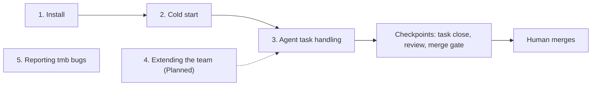

The three checkpoints are in [ENGINE.md](../architecture/ENGINE.md), and who owns each check is in [3_TASKS.md](3_TASKS.md).

## 1. A flow exists when it has a line here

**This page decides which flows tmb has. A pull request that changes a flow also changes that flow's line here and its steps page.**

- **Example 1.** A pull request changes what a task close requires. It also edits the line of flow 3.1 in the table below, and the steps in [3_TASKS.md](3_TASKS.md).
- **Example 2.** A pull request adds a flow. It adds the flow's line and its chart here, and its steps to a steps page.
- **Example 3.** A checkpoint, a mode, a command or a workspace shape is not a flow, so it has no line here. The push gate and multi-repo workspaces are sections of [3_GIT.md](3_GIT.md), a task's failures of [3_TASKS.md](3_TASKS.md#retry-and-escalation), a project with no remote of [3_WORKFLOW.md](3_WORKFLOW.md#a-project-with-no-remote), cleanup of [1_INSTALL.md](1_INSTALL.md#debugging), parallel lanes of [ROLES.md](../architecture/ROLES.md#parallel-lanes) and the unattended run of [ENGINE.md](../architecture/ENGINE.md#unattended-mode).
- **Edge case.** A flow's line here and its steps page disagree. The question goes to the Human, and both are changed to agree ([docs/README.md](../README.md#when-two-things-disagree)).

## 2. The ideal case is here, every other case is in the steps page

**This page shows each flow once, as a chart of the case where nothing goes wrong. The failures, the other cases and how to debug them are in the page the flow's line links.**

- **Example 1.** The chart of flow 1.2 shows an update that is found, verified and installed. What happens otherwise is in [1_INSTALL.md](1_INSTALL.md#upgrade).
- **Example 2.** No other page repeats a chart from this page. A steps page starts where the ideal case ends.
- **Edge case.** Group 5 has no page of its own. The steps of flow 5.1 are in [1_INSTALL.md](1_INSTALL.md#bug-reports), and its line links there.

## 3. A flow keeps its number

**Flows are grouped by when they run and numbered inside their group. Other pages cite a flow by its number, so the number does not change.**

- **Example 1.** "Flow 1.1" is Install and session start: group 1, first flow.
- **Example 2.** [3_WORKFLOW.md](3_WORKFLOW.md) writes "flows 3.9 and 3.10" to point at the two review modes.
- **Edge case.** A flow is removed. The flows after it keep their numbers, so every citation still points at the same flow. Its number stays unused: there is no flow 3.2.

## 4. An unbuilt flow is marked Planned

**A flow that is designed but not built has "Planned" and its GitHub issue in the State column. A built flow says "Built" and names no issue.**

- **Example 1.** Flow 3.1, the task, is Built.
- **Example 2.** Flow 3.5, Pull request comment triage, is Planned (trustmybot/tmb#70).
- **Edge case.** A whole group can be Planned: every flow of group 4 is.

## 5. One test per flow

**Planned (trustmybot/tmb#300). Every flow has one scenario test of its ideal case, so the flow and the code cannot drift apart unseen.**

- **Example.** A change breaks the ideal case of a flow. That flow's test fails.

## Every flow

The complete list. "Steps" links the page that holds every case of the flow.

| # | Flow | What happens | State | Steps |
|---|---|---|---|---|
| 1.1 | [Install and session start](#11-install-and-session-start) | The Human installs tmb in one step and runs `tmb init` once per project. Every session start then briefs the planner from the record. | Built | [1_INSTALL.md](1_INSTALL.md) |
| 1.2 | [Updates and channels](#12-updates-and-channels) | An install follows one channel and updates itself. A running session keeps its build while a task is open. | Built | [1_INSTALL.md](1_INSTALL.md#upgrade) |
| 2.1 | [First contact](#21-first-contact) | At the first session with empty settings, the planner applies the base branch and the checks tmb suggests from the repo's files, and asks the Human for the review mode. No task starts before the answer. | Built | [2_ONBOARD.md](2_ONBOARD.md) |
| 2.2 | [Index and code-graph refresh](#22-index-and-code-graph-refresh) | `tmb init` or `tmb index` builds a code graph per repo from its base branch. A lookup that finds the graph behind brings it forward first. | Built | [2_CODE_GRAPH.md](2_CODE_GRAPH.md) |
| 3.1 | [Task](#31-task) | The planner writes the spec, a worker implements, the engine runs the checks at close, the reviewer reviews, and the Human merges. A docs task is the same, written by the planner. | Built | [3_TASKS.md](3_TASKS.md) |
| 3.5 | [Pull request comment triage](#35-pull-request-comment-triage) | A sync with the remote brings review comments into the record, and the planner sorts them into tasks on the pull request's branch. | Planned (trustmybot/tmb#70) | [3_TASKS.md](3_TASKS.md) |
| 3.9 | [Agile mode](#39-agile-mode) | Tasks close on their checks and fold into one feature branch per milestone. The branch is reviewed once and merges as one pull request. | Built | [3_WORKFLOW.md](3_WORKFLOW.md) |
| 3.10 | [Truest mode](#310-truest-mode) | Each task is cut from the base branch, is reviewed after its checks pass, and gets its own pull request. | Built | [3_WORKFLOW.md](3_WORKFLOW.md) |
| 4.1 | [Cheatcode lifecycle](#41-cheatcode-lifecycle) | The planner finds and vets a published skill, tool server or host plugin for a capability gap, and the Human approves each install. | Planned (trustmybot/tmb#112) | [4_EXTENDING.md](4_EXTENDING.md) |
| 4.2 | [Creating an agent or a skill](#42-creating-an-agent-or-a-skill) | The planner drafts an agent or a project skill, and the Human approves it. A consultant is such an agent: it advises, and the Human decides. | Planned (trustmybot/tmb#437) | [4_EXTENDING.md](4_EXTENDING.md) |
| 5.1 | [Bug report](#51-bug-report) | When tmb itself breaks, or on `tmb feedback`, the Human reads a cleaned draft. Nothing is sent without the Human's yes. | Built | [1_INSTALL.md](1_INSTALL.md#bug-reports) |

## Ideal cases

One chart per flow, under the flow's number and name.

### 1.1 Install and session start

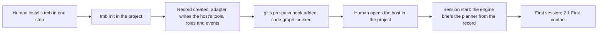

### 1.2 Updates and channels

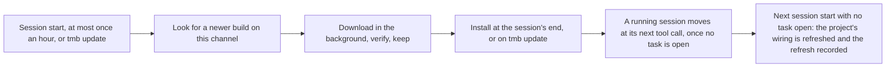

### 2.1 First contact

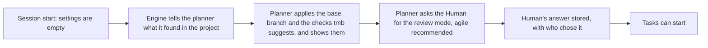

### 2.2 Index and code-graph refresh

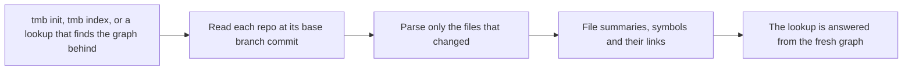

### 3.1 Task

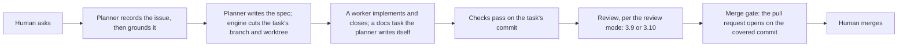

### 3.5 Pull request comment triage

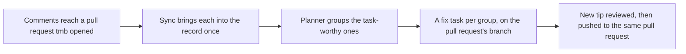

### 3.9 Agile mode

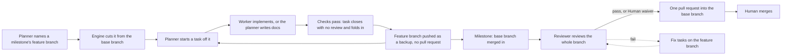

### 3.10 Truest mode

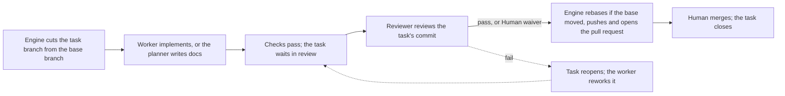

### 4.1 Cheatcode lifecycle

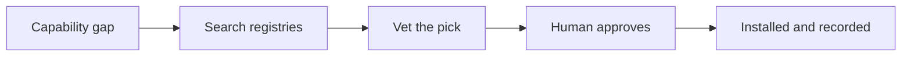

### 4.2 Creating an agent or a skill

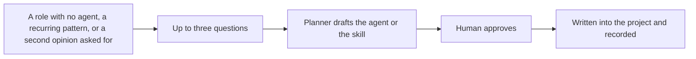

### 5.1 Bug report

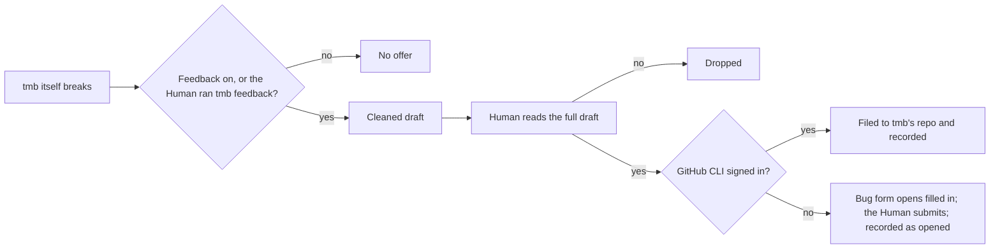
