# The list of tmb's flows

Every flow of tmb, in the order it runs. Each flow has one line in the table, a state, a link to the page that holds its steps, and one chart of its ideal case.

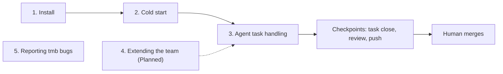

The three checkpoints are in [ENGINE.md](../architecture/ENGINE.md), and who owns each check is in [3_TASKS.md](3_TASKS.md).

## 1. A flow exists when it has a line here

**This page decides which flows tmb has. A pull request that changes a flow also changes that flow's line here and its steps page.**

- **Example 1.** A pull request changes what the push gate requires. It also edits the line of flow 3.3 in the table below, and the steps in [3_TASKS.md](3_TASKS.md).
- **Example 2.** A pull request adds a flow. It adds the flow's line and its chart here, and its steps to a steps page.
- **Edge case.** A flow's line here and its steps page disagree. The question goes to the Human, and both are changed to agree ([docs/README.md](../README.md#when-two-things-disagree)).

## 2. The ideal case is here, every other case is in the steps page

**This page shows each flow once, as a chart of the case where nothing goes wrong. The failures, the other cases and how to debug them are in the page the flow's line links.**

- **Example 1.** The chart of flow 1.2 shows an update that is found, verified and installed. What happens otherwise is in [1_INSTALL.md](1_INSTALL.md#upgrade).
- **Example 2.** No other page repeats a chart from this page. A steps page starts where the ideal case ends.
- **Edge case.** The steps of flows 3.8 and 3.12 are in an architecture page, because a part owns them more than a sequence does. Their lines link there.

## 3. A flow keeps its number

**Flows are grouped by when they run and numbered inside their group. Other pages cite a flow by its number, so the number does not change.**

- **Example 1.** "Flow 1.1" is Install and session start: group 1, first flow.
- **Example 2.** [ROLES.md](../architecture/ROLES.md#parallel-lanes) writes "flow 3.8" to point at parallel lanes.
- **Edge case.** A flow is removed. The flows after it keep their numbers, so every citation still points at the same flow.

## 4. An unbuilt flow is marked Planned

**A flow that is designed but not built has "Planned" and its GitHub issue in the State column. A built flow says "Built" and names no issue.**

- **Example 1.** Flow 3.1, the code task, is Built.
- **Example 2.** Flow 3.5, Pull request comment triage, is Planned (trustmybot/tmb#70).
- **Edge case.** A whole group can be Planned: every flow of group 4 is.

## 5. One test per flow

**Planned (trustmybot/tmb#300). Every flow has one scenario test of its ideal case, so the flow and the code cannot drift apart unseen.**

- **Example.** A change breaks the ideal case of a flow. That flow's test fails.

## Every flow

The complete list. "Steps" links the page that holds every case of the flow.

| # | Flow | What happens | State | Steps |
|---|---|---|---|---|
| 1.1 | [Install and session start](#11-install-and-session-start) | The Human installs tmb in one step and runs `tmb init` once per project. Every session start then briefs the planner from the record. | Built | [1_INSTALL.md](1_INSTALL.md) |
| 1.2 | [Updates and channels](#12-updates-and-channels) | An install follows one channel and updates itself. A running session keeps its build while a task is open. | Built | [1_INSTALL.md](1_INSTALL.md#upgrade) |
| 1.3 | [Move a plugin project](#13-move-a-plugin-project) | `tmb migrate` copies a plugin project's records into tmb's record, one way, and leaves the plugin's database unchanged. | Built | [1_INSTALL.md](1_INSTALL.md#move-a-plugin-project) |
| 2.1 | [First contact](#21-first-contact) | At the first session with empty settings, the planner applies the base branch and the checks it recommends, and asks the Human for the review mode. No task starts before the answer. | Built | [2_ONBOARD.md](2_ONBOARD.md) |
| 2.2 | [Index and code-graph refresh](#22-index-and-code-graph-refresh) | `tmb init` or `tmb index` builds a code graph per repo from its base branch. A lookup that finds the graph behind brings it forward first. | Built | [2_CODE_GRAPH.md](2_CODE_GRAPH.md) |
| 2.3 | [Environment profile](#23-environment-profile) | tmb suggests a repo's checks from the files its stack leaves behind. The planner applies them, or the Human replaces them. | Built | [2_ONBOARD.md](2_ONBOARD.md#the-repos-checks) |
| 3.1 | [Code task](#31-code-task) | The planner writes the spec, a worker implements, the engine runs the checks at close, the reviewer reviews, and the Human merges. | Built | [3_TASKS.md](3_TASKS.md) |
| 3.2 | [Docs task](#32-docs-task) | The planner writes a docs or prompts change itself, in a task marked docs. It passes the same checks and the same review. | Built | [3_TASKS.md](3_TASKS.md) |
| 3.3 | [Push gate](#33-push-gate) | A push is refused unless the record holds what the repo's review mode requires for its commits: a reviewer's pass or the Human's waiver. | Built | [3_TASKS.md](3_TASKS.md) |
| 3.4 | [Retry and escalation](#34-retry-and-escalation) | A failed check, a review fail or a conflict sends the work back to its author without waiting on the Human. | Built | [3_TASKS.md](3_TASKS.md) |
| 3.5 | [Pull request comment triage](#35-pull-request-comment-triage) | A sync with the remote brings review comments into the record, and the planner sorts them into tasks on the pull request's branch. | Planned (trustmybot/tmb#70) | [3_TASKS.md](3_TASKS.md) |
| 3.6 | [Multi-repo workspaces](#36-multi-repo-workspaces) | `tmb init` in a folder that holds several repos gives them one record. A feature or a task names its repo, and every later step runs there. | Built | [3_GIT.md](3_GIT.md) |
| 3.7 | [Bulk cleanup](#37-bulk-cleanup) | `tmb doctor` lists what tmb left on disk, and `tmb doctor --fix` removes each item on the Human's yes. | Built | [1_INSTALL.md](1_INSTALL.md#debugging) |
| 3.8 | [Parallel lanes](#38-parallel-lanes) | Several sessions work in one project at once, each from the shared record, with a branch and a worktree per task. tmb keeps no lane record. | Built | [ROLES.md](../architecture/ROLES.md#parallel-lanes) |
| 3.9 | [Agile mode](#39-agile-mode) | Tasks close on their checks and fold into one feature branch per milestone. The branch is reviewed once and merges as one pull request. | Built | [3_WORKFLOW.md](3_WORKFLOW.md) |
| 3.10 | [Truest mode](#310-truest-mode) | Each task is cut from the base branch, is reviewed after its checks pass, and gets its own pull request. | Built | [3_WORKFLOW.md](3_WORKFLOW.md) |
| 3.11 | [Project with no remote](#311-project-with-no-remote) | Nothing is pushed and no pull request opens. Reviewed work is recorded as ready, and the Human merges it locally. | Built | [3_WORKFLOW.md](3_WORKFLOW.md), [3_GIT.md](3_GIT.md) |
| 3.12 | [Unattended run](#312-unattended-run) | A run with no one to answer applies the planner's defaults and records each as a decision. The checkpoints allow and refuse as in a normal session. | Built | [ENGINE.md](../architecture/ENGINE.md#unattended-mode) |
| 4.1 | [Cheatcode lifecycle](#41-cheatcode-lifecycle) | The planner finds and vets a published skill for a capability gap, and the Human approves each install. | Planned (trustmybot/tmb#112) | [4_EXTENDING.md](4_EXTENDING.md) |
| 4.2 | [Agent creation](#42-agent-creation) | The planner drafts an agent for a role the project has none for, and the Human approves it. | Planned (trustmybot/tmb#437) | [4_EXTENDING.md](4_EXTENDING.md) |
| 4.3 | [Skill creation](#43-skill-creation) | A recurring pattern becomes a project skill: the planner drafts, the Human approves. | Planned (trustmybot/tmb#437) | [4_EXTENDING.md](4_EXTENDING.md) |
| 4.4 | [Consultant invocation](#44-consultant-invocation) | The Human asks for a second opinion. A consultant advises, the planner reports, and the Human decides. | Planned (trustmybot/tmb#437) | [4_EXTENDING.md](4_EXTENDING.md) |
| 5.1 | [Bug report](#51-bug-report) | When tmb itself breaks, or on `tmb feedback`, the Human reads a cleaned draft. Nothing is sent without the Human's yes. | Built | [1_INSTALL.md](1_INSTALL.md#bug-reports) |

## Ideal cases

One chart per flow, under the flow's number and name.

### 1.1 Install and session start

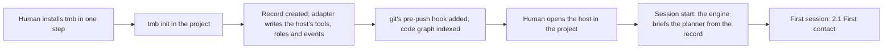

### 1.2 Updates and channels

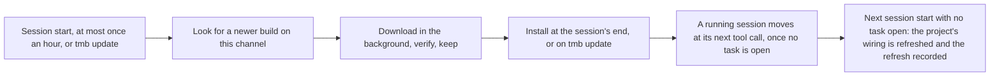

### 1.3 Move a plugin project

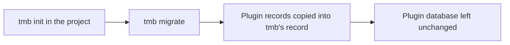

### 2.1 First contact

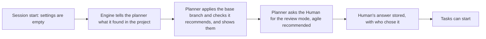

### 2.2 Index and code-graph refresh

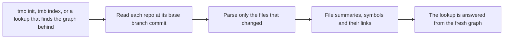

### 2.3 Environment profile

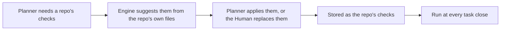

### 3.1 Code task

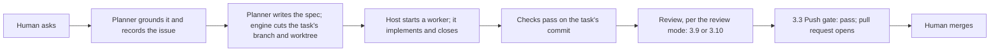

### 3.2 Docs task

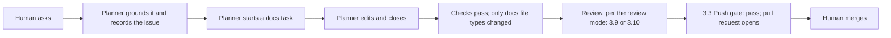

### 3.3 Push gate

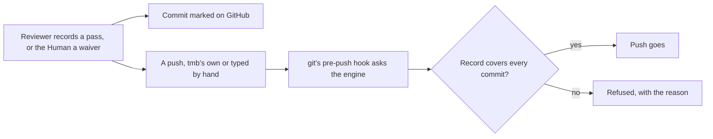

### 3.4 Retry and escalation

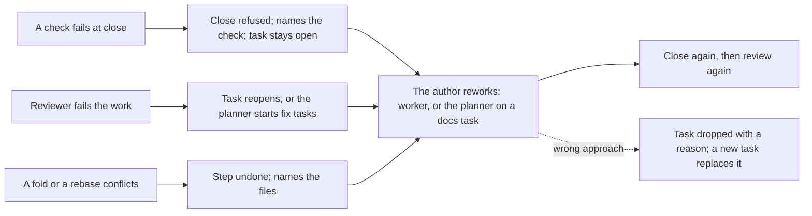

### 3.5 Pull request comment triage


### 3.6 Multi-repo workspaces

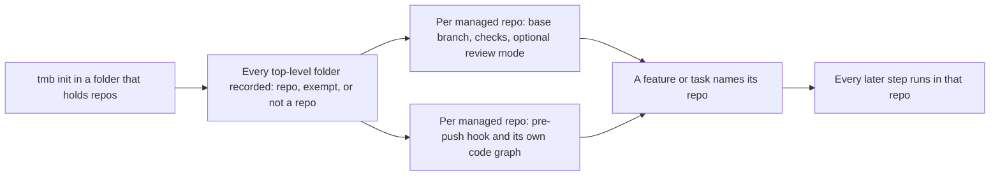

### 3.7 Bulk cleanup

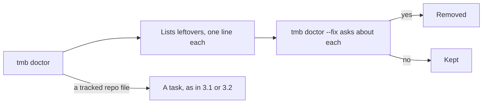

### 3.8 Parallel lanes

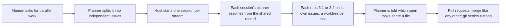

### 3.9 Agile mode


### 3.10 Truest mode

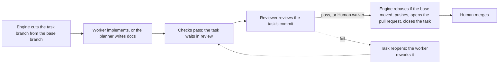

### 3.11 Project with no remote

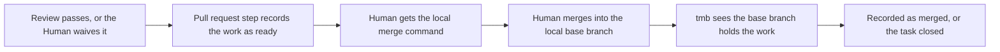

### 3.12 Unattended run

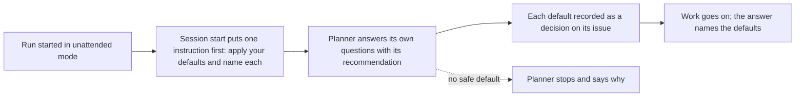

### 4.1 Cheatcode lifecycle

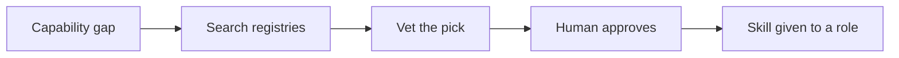

### 4.2 Agent creation

```mermaid
flowchart LR
    A["Role with no agent"] --> B["Up to three questions"]
    B --> C["Tailored draft"]
    C --> D["Human approves"]
    D --> E["Agent written for the host and registered"]
```

### 4.3 Skill creation

```mermaid
flowchart LR
    A["Recurring pattern"] --> B["Planner drafts the skill"]
    B --> C["Human approves"]
    C --> D["Skill lands in the project"]
```

### 4.4 Consultant invocation

```mermaid
flowchart LR
    A["Human asks for a second opinion"] --> B["Consultant started on the question"]
    B --> C["Analysis recorded on the issue"]
    C --> D["Planner reports, Human decides"]
```

### 5.1 Bug report

```mermaid
flowchart LR
    A["tmb itself breaks"] --> O{"Feedback on, or the Human ran tmb feedback?"}
    O -- no --> N["No offer"]
    O -- yes --> B["Cleaned draft"]
    B --> C["Human reads the full draft"]
    C -- no --> R["Dropped"]
    C -- yes --> D{"GitHub CLI signed in?"}
    D -- yes --> E["Filed to tmb's repo and recorded"]
    D -- no --> S["Bug form opens filled in; the Human submits; recorded as opened"]
```
