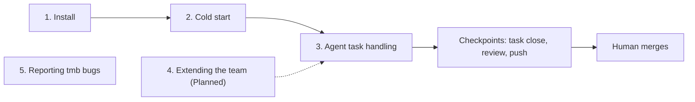

# tmb Workflows

The list of every flow of tmb, in the order it runs: one line per flow, its state, and the page that holds its steps.

## How this page works

| Rule | What it means |
|---|---|
| **Ground truth** | This page is the ground truth for which flows exist. A PR that changes a flow updates its line here, and its steps page, in the same PR. |
| **One line here, the steps in the page** | Every case of a flow, failures included, and how to debug it are in the page its line links. |
| **Numbers stay** | Flows are grouped by when they run and numbered within their group. Other pages cite a flow by its number, such as flow 1.1. |
| **Planned is marked** | Behaviour that is decided but not built is marked Planned, with its GitHub issue. |
| **One test per flow** | Planned (trustmybot/tmb#300): every flow has one scenario test of its ideal case. A change that breaks the flow fails that test, so the flow and the code cannot drift apart unseen. |

The three checkpoints are in [ENGINE.md](../architecture/ENGINE.md), and who owns each check is in [3_TASKS.md](3_TASKS.md).

## Every flow

| # | Flow | What happens | State | Steps |
|---|---|---|---|---|
| 1.1 | Install and session start | The Human installs tmb in one step and runs `tmb init` once per project. Every session start then briefs the planner from the record. | Built | [1_INSTALL.md](1_INSTALL.md) |
| 1.2 | Updates and channels | An install follows one channel and updates itself. A running session keeps its build while a task is open. | Built | [1_INSTALL.md](1_INSTALL.md#upgrade) |
| 1.3 | Move a plugin project | `tmb migrate` copies a plugin project's records into tmb's record, one way, and leaves the plugin's database unchanged. | Built | [1_INSTALL.md](1_INSTALL.md#move-a-plugin-project) |
| 2.1 | First contact | At the first session with empty settings, the planner applies the base branch and the checks it recommends, and asks the Human for the review mode. No task starts before the answer. | Built | [2_ONBOARD.md](2_ONBOARD.md) |
| 2.2 | Index and code-graph refresh | `tmb init` or `tmb index` builds a code graph per repo from its base branch. A lookup that finds the graph behind brings it forward first. | Built | [2_CODE_GRAPH.md](2_CODE_GRAPH.md) |
| 2.3 | Environment profile | tmb suggests a repo's checks from the files its stack leaves behind. The planner applies them, or the Human replaces them. | Built | [2_ONBOARD.md](2_ONBOARD.md#the-repos-checks) |
| 3.1 | Code task | The planner writes the spec, a worker implements, the engine runs the checks at close, the reviewer reviews, and the Human merges. | Built | [3_TASKS.md](3_TASKS.md) |
| 3.2 | Docs task | The planner writes a docs or prompts change itself, in a task marked docs. It passes the same checks and the same review. | Built | [3_TASKS.md](3_TASKS.md) |
| 3.3 | Push gate | A push is refused unless the record holds what the repo's review mode requires for its commits: a reviewer's pass or the Human's waiver. | Built | [3_TASKS.md](3_TASKS.md) |
| 3.4 | Retry and escalation | A failed check, a review fail or a conflict sends the work back to its author without waiting on the Human. | Built | [3_TASKS.md](3_TASKS.md) |
| 3.5 | PR comment triage | A sync with the remote brings review comments into the record, and the planner sorts them into tasks on the pull request's branch. | Planned (trustmybot/tmb#70) | [3_TASKS.md](3_TASKS.md) |
| 3.6 | Multi-repo workspaces | `tmb init` in a folder that holds several repos gives them one record. A feature or a task names its repo, and every later step runs there. | Built | [3_GIT.md](3_GIT.md) |
| 3.7 | Bulk cleanup | `tmb doctor` lists what tmb left on disk, and `tmb doctor --fix` removes each item on the Human's yes. | Built | [1_INSTALL.md](1_INSTALL.md#debugging) |
| 3.8 | Parallel lanes | Several sessions work in one project at once, each from the shared record, with a branch and a worktree per task. tmb keeps no lane record. | Built | [ROLES.md](../architecture/ROLES.md#parallel-lanes) |
| 3.9 | Agile mode | Tasks close on their checks and fold into one feature branch per milestone. The branch is reviewed once and merges as one pull request. | Built | [3_WORKFLOW.md](3_WORKFLOW.md) |
| 3.10 | Truest mode | Each task is cut from the base branch, is reviewed after its checks pass, and gets its own pull request. | Built | [3_WORKFLOW.md](3_WORKFLOW.md) |
| 3.11 | Project with no remote | Nothing is pushed and no pull request opens. Reviewed work is recorded as ready, and the Human merges it locally. | Built | [3_WORKFLOW.md](3_WORKFLOW.md), [3_GIT.md](3_GIT.md) |
| 3.12 | Unattended run | A run with no one to answer applies the planner's defaults and records each as a decision. The checkpoints allow and refuse as in a normal session. | Built | [ENGINE.md](../architecture/ENGINE.md#unattended-mode) |
| 3.13 | Several hosts on one record | Each host connects to the same record and takes a role, such as a planner on one host and a reviewer on another. The record is the handoff. | Built | [ADAPTERS.md](../architecture/ADAPTERS.md#different-models-on-one-task) |
| 4.1 | Cheatcode lifecycle | The planner finds and vets a published skill for a capability gap, and the Human approves each install. | Planned (trustmybot/tmb#112) | [4_EXTENDING.md](4_EXTENDING.md) |
| 4.2 | Agent creation | The planner drafts an agent for a role the project has none for, and the Human approves it. | Planned | [4_EXTENDING.md](4_EXTENDING.md) |
| 4.3 | Skill creation | A recurring pattern becomes a project skill: the planner drafts, the Human approves. | Planned | [4_EXTENDING.md](4_EXTENDING.md) |
| 4.4 | Consultant invocation | The Human asks for a second opinion. A consultant advises, the planner reports, and the Human decides. | Planned | [4_EXTENDING.md](4_EXTENDING.md) |
| 5.1 | Bug report | When tmb itself breaks, or on `tmb feedback`, the Human reads a cleaned draft. Nothing is sent without the Human's yes. | Built | [1_INSTALL.md](1_INSTALL.md#bug-reports) |
