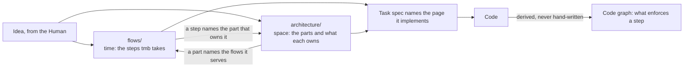

# tmb flows

tmb's design in time: what happens, step by step, from an install to a merged change. [The architecture folder](../architecture/README.md) is the design in space: the parts, what each owns and how they connect.

## Pages

**Start at [FLOWS.md](FLOWS.md): it lists every flow in one line, with its state and a link.** Each other page holds the steps of one flow group, and its name starts with the group's number.

| Group | Page | Details |
|---|---|---|
| 1. Install | [1_INSTALL.md](1_INSTALL.md) | Install, channels, updates, session start, removal, the health check, bug reports |
| 2. Cold start | [2_ONBOARD.md](2_ONBOARD.md) | First contact: what it asks, what it records, and a repo's checks |
| 2. Cold start | [2_CODE_GRAPH.md](2_CODE_GRAPH.md) | Building and refreshing the code graph |
| 3. Agent task handling | [3_TASKS.md](3_TASKS.md) | A task from ask to merge, who owns each check, the gates, retries, a stuck task |
| 3. Agent task handling | [3_WORKFLOW.md](3_WORKFLOW.md) | The workflow modes: agile and truest |
| 3. Agent task handling | [3_GIT.md](3_GIT.md) | Where the work sits in git at each step, and in which repo |
| 4. Extending the team | [4_EXTENDING.md](4_EXTENDING.md) | Agents, skills and cheatcodes a project adds |

- **Edge case.** A page with no number is not a flow page. Two flows have their steps in an architecture page, because a part owns them more than a sequence does: parallel lanes in [ROLES.md](../architecture/ROLES.md#parallel-lanes) and the unattended run in [ENGINE.md](../architecture/ENGINE.md#unattended-mode).

## How the two folders cite each other

**A fact lives in one folder, and the other folder links to it. A flow page says when; an architecture page says who and what.**

- **Example 1.** A gate's rules are in its architecture page. The flow page shows where the gate sits in the sequence, and links to those rules.
- **Example 2.** An architecture page links to the flows a part serves, by flow number.
- **Example 3.** A flow page names no function, file or table of the code: the code graph says what enforces a step. A flow page may name what the Human types, a `tmb ...` terminal command.
- **Edge case.** Two pages disagree. The question goes to the Human, and both pages are changed to agree ([docs/README.md](../README.md#when-two-things-disagree)).

## Decisions

The decisions about the steps. The first column names the page that holds the detail. Decisions about tmb's parts are in [the architecture folder](../architecture/README.md#decisions).

| From | Topic | Decision |
|---|---|---|
| [1_INSTALL](1_INSTALL.md) | Platforms | macOS, Windows and Linux. |
| [1_INSTALL](1_INSTALL.md) | Install and updates | One-step install. Three channels: dev, rc and stable. Updates are pushed to each channel. |
| [3_WORKFLOW](3_WORKFLOW.md) | Review modes | Agile and truest, a mode per repo. Agile is recommended; the Human chooses. |
| [3_TASKS](3_TASKS.md) | Sync with the remote | The remote's issues, comments, milestones and pull requests are read into the record. Planned (trustmybot/tmb#70): the record's changes sent back, and pull request comments sorted into tasks. |
| [4_EXTENDING](4_EXTENDING.md) | Created agents | Planned (trustmybot/tmb#437). An agent a project creates is recorded and harnessed like the worker and the reviewer. |

## Glossary

The words for the steps. The first column names the page a word comes from. The words for tmb's parts are in [the architecture glossary](../architecture/README.md#glossary).

| From | Word | Meaning |
|---|---|---|
| [2_ONBOARD](2_ONBOARD.md) | Init (`tmb init`) | Preparing a project folder for tmb. It asks nothing. |
| [2_ONBOARD](2_ONBOARD.md) | Onboard (`tmb onboard`) | Setting tmb's settings for a project. The planner also onboards a project by itself at the first session with empty settings. |
| [2_CODE_GRAPH](2_CODE_GRAPH.md) | Index (`tmb index`) | Building the code graph. |
| [3_TASKS](3_TASKS.md) | Task | One change that one agent can finish in one run, with its spec. |
| [3_TASKS](3_TASKS.md) | Docs task | A task that changes only docs or prompts. The planner writes it. |
| [3_TASKS](3_TASKS.md) | Start a task | The engine cuts the task's branch and worktree, so a worker can be started on it. |
| [3_WORKFLOW](3_WORKFLOW.md) | Agile mode | One review per feature branch. |
| [3_WORKFLOW](3_WORKFLOW.md) | Truest mode | A review of every task before its pull request. |
| [3_WORKFLOW](3_WORKFLOW.md) | In review | A truest task whose checks passed and whose review has not passed yet. |
| [3_GIT](3_GIT.md) | Workspace | The folder where the Human ran `tmb init`: the root of a project, holding its record. It may be a git repo itself, or hold several repos that share the record (a multi-repo workspace). |
| [3_GIT](3_GIT.md) | Base branch | The branch a pull request merges into. |
| [3_GIT](3_GIT.md) | Feature branch | A long-lived branch that collects a milestone's tasks. |
| [4_EXTENDING](4_EXTENDING.md) | Skill | Guidance tmb ships for a role, loaded on demand. |
| [4_EXTENDING](4_EXTENDING.md) | Cheatcode | Planned (trustmybot/tmb#112). A published skill, tool server or host plugin that the planner finds, vets and installs after the Human's yes. |
