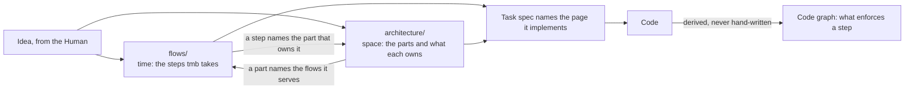

# tmb flows

tmb's design in time: what happens, step by step, from an install to a merged change. [The architecture folder](../architecture/README.md) is the design in space: the parts, what each owns and how they connect.

## Pages

[FLOWS.md](FLOWS.md) is the high-level page the Human reviews: every flow, with one chart of its ideal case. Each other page is the detail under one flow group, and its name starts with the group's number.

| Group | Page | Details |
|---|---|---|
| 1. Install | [1_INSTALL.md](1_INSTALL.md) | Install, channels, updates, session start |
| 2. Cold start | [2_ONBOARD.md](2_ONBOARD.md) | First contact and a repo's checks |
| 2. Cold start | [2_CODE_GRAPH.md](2_CODE_GRAPH.md) | Building and refreshing the code graph |
| 3. Agent task handling | [3_TASKS.md](3_TASKS.md) | A task from ask to merge, the push gate, retries |
| 3. Agent task handling | [3_WORKFLOW.md](3_WORKFLOW.md) | The workflow modes: agile and truest |
| 3. Agent task handling | [3_GIT.md](3_GIT.md) | Where the work sits in git at each step |
| 4. Extending the team | [4_EXTENDING.md](4_EXTENDING.md) | Agents, skills and cheatcodes a project adds |

A page with no number is not a flow page. Three flows are detailed in architecture pages, because a part owns them more than a sequence does: parallel lanes in [ROLES.md](../architecture/ROLES.md#parallel-lanes), the unattended run in [ENGINE.md](../architecture/ENGINE.md#unattended-mode), and several hosts in [ADAPTERS.md](../architecture/ADAPTERS.md#different-models-on-one-task).

## Reading guide

Start with [FLOWS.md](FLOWS.md), then open the detail page of the flow you need.

| Question | Read |
|---|---|
| What happens when the Human asks for Y? | [FLOWS.md](FLOWS.md) |
| How is tmb installed and updated, and what do I check when it is missing or degraded? | [1_INSTALL.md](1_INSTALL.md) |
| What does first contact ask, and what does it record? | [2_ONBOARD.md](2_ONBOARD.md) |
| How does the planner learn a repo's checks? | [2_ONBOARD.md](2_ONBOARD.md#the-repos-checks) |
| How is the code graph built and kept fresh? | [2_CODE_GRAPH.md](2_CODE_GRAPH.md) |
| Who owns which quality check? | [3_TASKS.md](3_TASKS.md#quality-layers) |
| Why is my task stuck? | [3_TASKS.md](3_TASKS.md) |
| What does agile review mode skip, and when is the skipped review done? | [3_WORKFLOW.md](3_WORKFLOW.md) |
| Which branch is the work on, and which repo? | [3_GIT.md](3_GIT.md) |
| How does a project gain an agent, a skill or a second opinion? | [4_EXTENDING.md](4_EXTENDING.md) |
| How will the planner add a published skill? | [4_EXTENDING.md](4_EXTENDING.md#cheatcodes) |

## How the two folders cite each other

A fact lives in one folder, and the other links to it.

- **A flow page says when; an architecture page says who and what.**
- **A flow step links to the part that owns it.** Example: a gate's rules are in the architecture page; the flow shows where the gate sits in the sequence.
- **An architecture page links to the flows a part serves,** by flow number.
- **A flow page names no function, file or table of the code.** The code graph answers what enforces a step.
- **Where two pages disagree, the question goes to the Human,** and both are changed to agree ([docs/README.md](../README.md#when-two-things-disagree)).

## Decisions

The decisions about the steps. The first column names the page that holds the detail. Decisions about tmb's parts are in [the architecture folder](../architecture/README.md#decisions).

| From | Topic | Decision |
|---|---|---|
| [1_INSTALL](1_INSTALL.md) | Platforms | macOS, Windows and Linux. |
| [1_INSTALL](1_INSTALL.md) | Install and updates | One-step install. Three channels: dev, rc and stable. Updates are pushed to each channel. |
| [1_INSTALL](1_INSTALL.md) | Plugin projects | A fresh start. A one-way migration tool carries a plugin project's records over. |
| [3_WORKFLOW](3_WORKFLOW.md) | Review modes | Agile and truest, a mode per repo. Agile is recommended; the Human chooses. |
| [3_TASKS](3_TASKS.md) | Sync with the remote | Planned (trustmybot/tmb#70). It brings pull request comments into the record and syncs issues both ways; issues that exist only on GitHub are not all copied in. |
| [4_EXTENDING](4_EXTENDING.md) | Created agents | Planned. An agent a project creates is recorded and harnessed like the worker and the reviewer. |

## Glossary

The words for the steps. The first column names the page a word comes from. The words for tmb's parts are in [the architecture glossary](../architecture/README.md#glossary).

| From | Word | Meaning |
|---|---|---|
| [2_ONBOARD](2_ONBOARD.md) | Init (`tmb init`) | Preparing a project folder for tmb. It asks nothing. |
| [2_ONBOARD](2_ONBOARD.md) | Onboard (`tmb onboard`) | Setting tmb's settings for a project. The planner also onboards a project by itself at the first session with empty settings. |
| [2_CODE_GRAPH](2_CODE_GRAPH.md) | Index (`tmb index`) | Building the code graph. |
| [3_TASKS](3_TASKS.md) | Task | One change that one agent can finish in one run, with its spec. |
| [3_TASKS](3_TASKS.md) | Docs task | A task that changes only docs or prompts. The planner writes it. |
| [3_TASKS](3_TASKS.md) | Start a task | The engine cuts the task's branch and worktree, so a worker can be started on it. |
| [3_WORKFLOW](3_WORKFLOW.md) | Agile mode | One review per feature branch. |
| [3_WORKFLOW](3_WORKFLOW.md) | Truest mode | A review of every task before its push. |
| [3_WORKFLOW](3_WORKFLOW.md) | In review | A truest task whose checks passed and whose review has not passed yet. |
| [3_GIT](3_GIT.md) | Workspace | The folder where the Human ran `tmb init`: the root of a project, holding its record. It may be a git repo itself, or hold several repos that share the record (a multi-repo workspace). |
| [3_GIT](3_GIT.md) | Base branch | The branch a pull request merges into. |
| [3_GIT](3_GIT.md) | Feature branch | A long-lived branch that collects a milestone's tasks. |
| [4_EXTENDING](4_EXTENDING.md) | Skill | Planned. Guidance tmb ships for a role, loaded on demand. |
| [4_EXTENDING](4_EXTENDING.md) | Cheatcode | Planned (trustmybot/tmb#112). A published skill, tool server or host plugin that the planner finds, vets and installs after the Human's yes. A skill is given to a role once, for every host in that role. |
