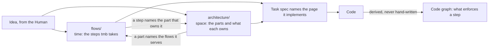

# tmb flows

This folder is tmb's design in time: what happens, step by step, from an install to a merged change. [The architecture folder](../architecture/README.md) is the design in space: the parts, what each owns and how they connect.

## Pages

[FLOWS.md](FLOWS.md) is the high-level page: every flow, one chart of its ideal case each. The Human reviews that page. Each other page is the detail under one flow group, and its name starts with the group's number.

| Group | Page | Details |
|---|---|---|
| 1. Install | [1_INSTALL.md](1_INSTALL.md) | Install, channels, updates, session start |
| 2. Cold start | [2_ONBOARD.md](2_ONBOARD.md) | First contact and a repo's checks |
| 2. Cold start | [2_CODE_GRAPH.md](2_CODE_GRAPH.md) | Building and refreshing the code graph |
| 3. Agent task handling | [3_TASKS.md](3_TASKS.md) | A task from ask to merge, the push gate, retries |
| 3. Agent task handling | [3_WORKFLOW.md](3_WORKFLOW.md) | The workflow modes: agile and truest |
| 3. Agent task handling | [3_GIT.md](3_GIT.md) | Where the work sits in git at each step |
| 4. Extending the team | [4_EXTENDING.md](4_EXTENDING.md) | Agents, skills and cheatcodes a project adds |

A page with no number is not a flow page. Three flows are detailed in architecture pages, because a part owns them more than a sequence does: parallel lanes in [RESPONSIBILITIES.md](../architecture/RESPONSIBILITIES.md#parallel-lanes), and the unattended run and several hosts in [HOSTS.md](../architecture/HOSTS.md).

## How the two folders cite each other

- **A flow page says when; an architecture page says who and what.** A fact lives in one of them, and the other links to it.
- **A flow step links to the part that owns it.** A gate's rules are in the architecture page; the flow shows where the gate sits in the sequence.
- **An architecture page links to the flows a part serves,** by flow number.
- **A flow page names no function, file or table of the code.** The code graph answers what enforces a step.
- **Where they disagree, [FLOWS.md](FLOWS.md) and the high-level architecture pages win,** and the detail page is fixed.
